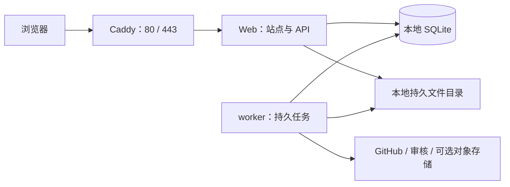

# 第四类收尾：依赖与 Linux 部署

状态：架构第 109 节已确认，用户同意继续最后一类实施顺序与验收。用户已确认先按「单台 Linux 服务器＋Docker Compose＋本地持久存储」设计，具体服务商以后填写。页面分区与入口已确认，UI 后续调整。本文细化部署契约，不代表已创建应用、执行迁移或上线。

核对日期：2026-10-11；版本元数据、包完整性摘要、镜像摘要及实际检查结果见 [依赖版本核对](依赖版本核对.json)。该文件是选型证据，不是完整依赖锁文件。

## 1. 首版运行组合

建议以 Ubuntu 24.04 LTS、Linux x86_64 作为首版主机基线；应用容器采用 Debian bookworm 的 Node 24 LTS。主机安装 Docker Engine 与 Compose 插件，网站、任务和数据库不依赖主机全局 Node。Node 官方当前将 24 列为 LTS，生产环境优先使用受支持的 LTS 分支。[Node 发布状态](https://nodejs.org/en/about/previous-releases)

| 用途 | 核对后的候选版本 | 接入方式 |
|---|---|---|
| Node / 包管理 | Node 24.21.0；pnpm 12.11.2 | 容器构建与运行使用同一 Node 补丁版本。 |
| Web | Next.js 16.4.0；React / React DOM 19.3.0 | App Router；访问 SQLite 的路由明确使用 Node runtime。 |
| TypeScript | 7.0.2 | Web 与 worker 共享契约和业务模块；完整构建兼容性实施时验证。 |
| SQLite 访问 / 迁移 | better-sqlite3 13.0.3；Drizzle ORM 0.45.4 / Kit 0.31.11 | 统一 Repository 与事务接口；迁移由维护进程执行。 |
| 输入契约 | Zod 4.6.5 | 同一注册 schema 支持请求、配置和业务 payload 校验。 |
| GitHub OAuth | oauth4webapi 3.8.8 | OAuth 协议工具；用户、会话及权限由本站模块管理。 |
| 图片 | sharp 0.35.5 | 独立线程或子进程处理，保留已有处理期限。 |
| Markdown | unified 11.0.5；remark-parse 11.0.0；remark-gfm 4.0.1；remark-rehype 11.1.2；rehype-sanitize 6.0.0；rehype-stringify 10.0.1 | 统一安全渲染管线，附件引用经本站解析，不执行 MDX。 |
| S3 兼容存储 | AWS SDK client-s3 / s3-request-presigner 3.1149.0 | 通过存储适配器接入；服务商和凭据以后配置。 |
| 界面样式 | Tailwind CSS / @tailwindcss/postcss 4.3.3；PostCSS 8.5.29 | 公共组件与主题 token；视觉细节可后续调整。 |
| 验证工具 | Vitest 5.0.3；Playwright Test 1.64.0；tsx 4.23.15 | 测试、浏览器验收和开发运行，不用 tsx 启动生产 worker。 |
| 代理 / 编排 | Caddy 2.11.7；Compose 5.6.0 | 自动 HTTPS、入口代理及单机服务编排。 |

上述 Node 范围符合已核对包的声明要求，不等于完整组合已通过生产验证。实施时补齐类型包和测试工具的 peer 依赖，固定直接依赖并提交 pnpm 完整锁文件；使用冻结锁文件安装。安全升级通过变更、复验和新镜像发布，不永久停留在本次候选版本。

应用镜像候选为 `node:24.21.0-bookworm-slim`，代理为 `caddy:2.11.7-alpine`；已查询其多平台与 amd64 摘要，最终发布按验证后的 digest 固定。应用选择 glibc 环境以统一原生驱动和图片库的运行条件，Windows 的 node_modules 不复制到 Linux。[sharp 安装要求](https://sharp.pixelplumbing.com/install/)

## 2. 进程与构建边界

常驻服务只有 Caddy、web、worker；SQLite 不单独运行数据库容器。web 与 worker 使用同一应用镜像、同一发布版本，共用业务模块、数据库目录和媒体目录。worker 是独立 Node 进程，不靠页面请求或 Web 内定时器维持任务。

构建采用多阶段 Dockerfile，在目标 Linux 平台安装原生依赖。Web 产物采用 Next standalone，并显式打包 public、.next/static、原生模块和共享模块所需文件；worker 用 TypeScript NodeNext 配置编译为可直接运行的 ESM，保留生产依赖、迁移与注册资源。所有路径从部署配置或包内明确位置解析，不依赖启动目录。[Next standalone 说明](https://nextjs.org/docs/app/api-reference/config/next-config-js/output)

部署维护入口与应用同镜像，提供 migrate、bootstrap-admin、backup、verify、restore 的受控命令。具体脚本和 Compose 文件在实施阶段创建；管理员日常操作仍通过既定管理界面。Web 和 worker 启动只检查 schema 版本，不竞争执行迁移。Compose 依赖关系须检查迁移成功与服务就绪，容器启动本身不能作为就绪证明。[Compose 启动顺序](https://docs.docker.com/compose/how-tos/startup-order/)

## 3. 持久目录与配置

| 主机位置示例 | 内容与访问 |
|---|---|
| `/srv/dsh-plugin-review/data/db` | app.sqlite 及 WAL / SHM；两个进程挂载整个目录。 |
| `/srv/dsh-plugin-review/data/media` | 原图、展示文件及本地保底副本，按稳定 ID 与摘要定位。 |
| `/srv/dsh-plugin-review/data/incoming` | 接收中的文件；重启按接收记录和截止时间恢复。 |
| `/srv/dsh-plugin-review/data/backups` | 完整恢复点、不可变清单、核验结果及所需文件副本。 |
| `/srv/dsh-plugin-review/secrets` | 受限凭据文件；不包含在公开媒体、镜像或普通数据库备份中。 |
| Caddy 持久卷 | 证书与代理运行资料，随容器重建保留。 |

应用进程建议统一 UID/GID 10001，部署入口负责创建目录并核对权限。SQLite 位于本机持久磁盘，不使用 NFS/CIFS，不让不同主机共享一个数据库文件；Web 端口只开放给代理。数据不放进镜像或容器临时层。

部署配置包括站点正式 origin、域名、GitHub OAuth client ID 与 secret、初始管理员 GitHub 稳定 ID、OAuth 挑战加密密钥、目录同步凭据及可选审核／存储 secret 引用。站点后台管理既定业务配置与已注册提供商参数；密钥使用受控秘密引用，界面不回显原值，普通审计不保存原值。

域名到位后才配置正式 HTTPS 与 GitHub 回调地址。生产 origin 必须明确，不能默认 localhost；证书自动申请还需要 DNS 与端口符合要求。[Caddy 自动 HTTPS](https://caddyserver.com/docs/automatic-https)

上传采用逐文件流式 API，选择一批文件不等于发送一个巨大请求。服务器核对真实接收字节、单文件及格式限制；代理上传路由的体积与超时上限必须覆盖注册配置的合法请求，不能截断允许的上传，也不能以代理放行代替业务限制。继续采用已有接收执行权、续期和绝对截止；普通 API 不沿用上传的长等待时间。

## 4. SQLite 驱动与事务契约

所有连接通过统一工厂创建，启用 foreign_keys，数据库采用 WAL；建议 synchronous=FULL、busy_timeout 初值 5000ms。锁等待作为部署参数有界配置，实施时用真实短事务并发测定；better-sqlite3 是同步驱动，等待会阻塞所属线程，不能据此保证吞吐或响应延迟。

启动检查 SQLite 版本、FTS5 trigram、JSON 函数、延迟外键、schema 版本及目录写权限，不支持必需能力时明确失败。三字及以上检索与双字补充沿用已确认规则；条件写入、联合外键及搜索投影必须用真实迁移验证。业务事务保持短小，内部不等待网络或执行图片处理。[Drizzle SQLite 接入](https://orm.drizzle.team/docs/sqlite/get-started-sqlite)

备份使用驱动 backup API 取得一致数据库快照。只根据已完成快照查询所需文件 ID，复制并核对不可变文件，生成准确清单，再登记恢复点完成；不能用稍后的在线数据库查询拼成不匹配的清单。备份在独立连接执行，继续遵守长任务进展和执行权规则。[better-sqlite3 backup API](https://github.com/WiseLibs/better-sqlite3/blob/master/docs/api.md)

每天北京时间 03:00 调度，P0 保留全部完整恢复点；同机备份只能恢复部分误操作和损坏，不抵抗整机丢失。独立副本位置以后配置，未配置时后台如实显示，不标称已具备异地备份。

## 5. 认证选型落地

oauth4webapi 提供 OAuth 协议工具，不引入另一套用户／会话表。GitHub 登录采用 state 与 S256 PKCE，回调核对浏览器绑定、有效期和一次性使用；获取稳定 GitHub ID 后调用本站身份与 SessionService。[oauth4webapi](https://github.com/panva/oauth4webapi)、[GitHub OAuth 流程](https://docs.github.com/en/apps/oauth-apps/building-oauth-apps/authorizing-oauth-apps)

为避免 Web 重启丢失登录上下文，新增本站 `oauth_login_challenges` 表，具体字段见模型第 3 节补充。短期挑战默认 600 秒；code_verifier 使用共享部署密钥的 AES-256-GCM 信封保存，状态和浏览器绑定只存摘要。验证完整上下文后条件消费挑战，再进行令牌交换；交换失败需要重新发起登录，不复用已消费挑战。成功建立会话的事务以挑战 ID 唯一关联，避免重复回调建立多个会话。

正式会话继续保存随机凭据摘要，Cookie 使用 `__Host-dsh_session`、Secure、HttpOnly、SameSite=Lax、Path=/；写请求核验 origin 与既定请求保护。用户角色、禁用状态和有效期读取本站当前状态；GitHub token 不进入 Cookie，不作为长期站点会话。挑战 cookie 只用于临时浏览器绑定，不代表已登录。加密密钥通过秘密渠道单独保管，密钥调整对未完成挑战的影响需显示为重新登录，不改写已有会话规则。

初始管理员只能由部署入口绑定明确稳定 GitHub ID，记录审计；后续管理遵守至少一个正常管理员规则。游客登录 token 与站点目录同步凭据分开，目录请求统一经过已有额度与冷却接口。

## 6. 服务商以后配置的接入边界

默认本地存储适配器可工作；S3 兼容适配器作为同一文件接口的另一个实现。启用前验证 endpoint、鉴权、桶、读写及摘要一致性，切源先复制核验，稳定媒体 URL 不变。私有文件读取继续核对权限；对象存储存在不能绕过本站访问规则。

审核通过已注册适配器接入，配置认证引用、模型、文本／图片能力、响应解析版本和已有请求期限。仅填写一个 URL 不能视作已兼容。未配置、超时或能力不足是检查不可用，维持待处理／人工复核流程，不能自动认定通过或违规；首次真实接入必须验证正确结果、故障与图片能力。

GitHub 目录读取通过独立服务凭据接入，凭据身份与额度归属统一登记。服务商、收费计划、域名、凭据和独立备份位置当前不代填，也不影响本轮确定本地部署结构。

## 7. 首次启动、升级与恢复

首次启动依次完成：配置域名和 secrets；创建持久目录；拉取经验证的固定应用镜像；独占执行迁移和初始管理员绑定；检查外键、搜索、目录与 schema；启动同版本 web / worker；验证正式登录和一条投稿流程，再开放入口。未配置的外部能力在后台明确显示。

升级先确认完整可恢复点，然后入口进入维护状态，停止接收新写入及领取任务，取消或收束在途工作并停止两个写入进程；按停机后最终数据制作升级前恢复点，再由唯一维护进程迁移。迁移失败保持维护状态。验证成功后启动同版本 web / worker，检查核心读写，再开放入口；P0 不承诺无停机迁移。

回退先判断旧程序是否兼容新 schema。不能兼容时停止进程，恢复匹配的数据库、文件及配置恢复点，核验完成后运行对应镜像；不直接把旧镜像接到新数据库，不以自动向下迁移代替恢复。恢复后的会话与任务按现有失效和执行权规则重新核对。

SIGTERM 时停止新请求／任务领取并取消可取消工作，预留有界退出时间；未完成任务通过持久执行权到期恢复。旧进程迟到写入仍需令牌和版本校验；外部请求可能已经执行，不能用正常退出声称外部调用恰好一次。

## 8. 运行观察与验收边界

存活检查确认进程可响应；就绪检查确认 schema、数据库和关键持久目录可用。worker 通过心跳与真实任务进展观察，不把仍在发心跳视作全部任务正常；外部提供商故障按能力降级显示，公共本地读取仍可服务。

日志使用结构化 stdout，包含 request/task ID 和受限错误码，不记录凭据或私有正文；建议每容器日志轮转 10MiB × 3，部署配置可调整。后台显示空间、任务、存储、备份和依赖状态，沿用既定动作；磁盘不足明确阻止无法完成的写入，不切到内存库、不自动删除历史。

本轮已实际验证 8 项：连接与约束能力、Drizzle 查询与回滚、中文 FTS 与双字补充、快照备份完整性、图片转换、OAuth state / PKCE 基础验证、Zod 输入检查、安全 Markdown 渲染。运行环境为 Windows x64、Node 24.12.0，驱动内 SQLite 3.53.4，sharp 0.35.5 / libvips 8.18.7；全部位于隔离临时目录，不涉及网站业务数据。

尚待实施验收：目标 Node 24.21.0 的 Linux 镜像完整构建、Web 与 worker 并发真实迁移、正式 GitHub OAuth、浏览器与代理上传、真实审核／S3 适配、停止重启和升级回退、完整恢复演练。当前环境没有 Docker，以上项目不记作已通过；性能容量也须实测。

本类已确认，最后一类见 [实施顺序与验收](实施顺序与验收.md) 及架构第 110 节，仍待确认；将既定流程分阶段安排，不新增 P0 功能。
