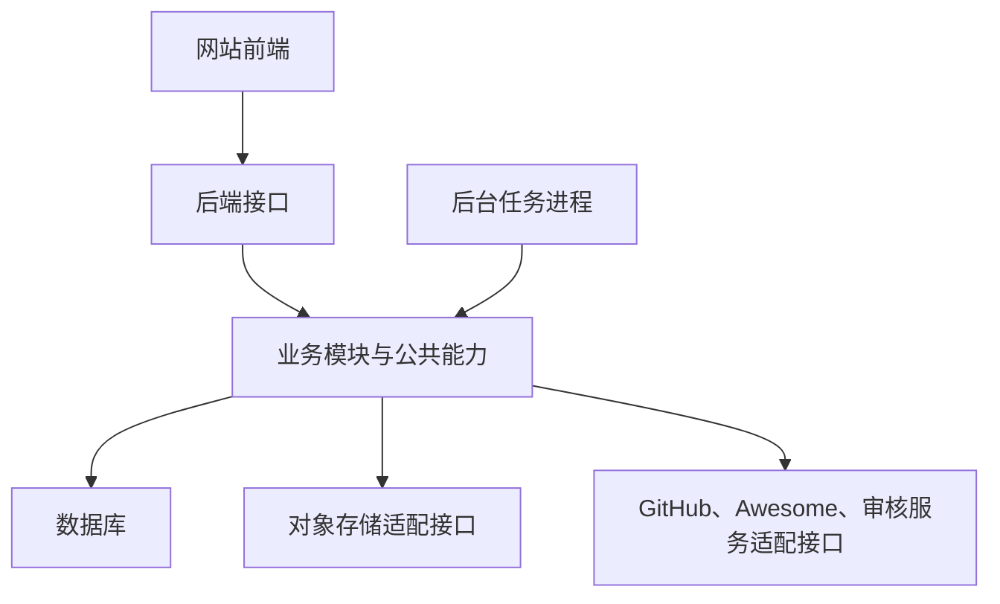

# DSH Plugin Review · 架构与数据设计

更新日期：2026-10-10  
需求依据：[P0 需求说明](idea.md)  
讨论方式：逐点设计、逐点确认。标为提案的内容尚未确认。

## 1. 已确认的设计约束

- 按业务职责划分模块，明确接口与依赖，重视抽象、封装、扩展和维护。
- 评论、审核、通知、配置等公共能力集中封装。
- 评测文章与整合包发布版本共享可评论对象抽象，整合包评论仍绑定具体版本。
- 业务参数尽量可配置，分类、模板等资料由数据驱动。
- 外部目录、GitHub、存储和审核服务通过适配接口接入。
- 表操作按业务封装，日常数据管理通过管理员后台完成；关联更新、状态变化、权限校验和操作记录由服务端处理，表结构升级通过统一部署迁移入口执行。
- 本阶段遵循既定 P0 范围；配套 DSH 导入插件等后续功能不构成首版前提。

## 2. 总体形态：模块化单体

状态：已确认。

这是面向 P0、可以长期维护的正式起步架构。MVP 描述功能范围，模块化单体描述代码组织与运行方式；后续功能增长仍可沿用该架构，是否拆分服务根据实际业务和运行压力判断。

后端采用一套代码库，业务按模块组织。网站请求与后台任务通过各模块明确的接口调用公共业务逻辑，集中维护权限、状态变化和配置读取。

- 网站前端负责展示、编辑、上传交互及任务状态查看。
- 后端接口负责请求校验、身份权限和业务调用。
- 后台任务进程负责目录同步、批量导入、审核及通知等异步工作；与接口进程共用业务模块，可独立运行。



选择依据：根据本项目的首版范围，业务关联较多，统一维护便于处理内容、版本、权限与任务状态；模块接口和后台任务执行边界为后续扩展保留位置。此为本项目的设计判断。参考 [Martin Fowler：Monolith First](https://martinfowler.com/bliki/MonolithFirst.html) 关于早期系统边界与模块化的讨论。

语言与运行环境采用 TypeScript、Node.js，网站框架采用 Next.js，首版主数据库采用 SQLite，后台任务采用 SQLite 持久队列；业务模块边界与具体数据结构在后续逐点设计。

## 3. 开发语言与运行环境：TypeScript、Node.js

状态：已确认。

前端、后端与后台任务统一使用 TypeScript；后端与任务采用 Node.js 运行环境。通过公共包共享接口契约、状态定义和必要的校验结构，浏览器代码只引用适合前端使用的公共定义。

领域对象、可评论对象抽象与外部服务适配接口采用明确的类型定义，具体公共包边界在模块设计阶段细化。

支持在 Linux 部署：构建 TypeScript 为 JavaScript，再由 Node.js 运行网站服务及后台任务进程。部署方式与具体版本后续选定。

本项目大量操作涉及数据库与外部接口，适合采用 Node.js 的异步 I/O 模型。目录同步、批量解析与图片处理等耗时工作由后台任务执行；其中持续占用 CPU 的处理应采用工作线程或独立处理进程，避免阻塞请求进程及任务进程的事件循环。实际容量需结合数据库索引、分页、任务并发及场景压测评估，当前不预设并发承诺。

依据：[TypeScript 官方手册](https://www.typescriptlang.org/docs/handbook/intro.html)、[Node.js 官方介绍](https://nodejs.org/learn/getting-started/introduction-to-nodejs)。具体版本仍待选定。

部署与性能依据：[Node.js 平台支持](https://github.com/nodejs/node/blob/main/BUILDING.md#platform-list)、[避免阻塞事件循环](https://nodejs.org/learn/asynchronous-work/dont-block-the-event-loop)、[工作线程](https://nodejs.org/api/worker_threads.html)。

## 4. 网站框架：Next.js

状态：已确认。

采用 Next.js（React、App Router）组织网站页面与 HTTP 接口。页面负责展示与交互，接口入口负责请求解析与校验，并调用独立业务模块；业务规则、权限检查及状态变化集中在业务模块中维护，供网站与后台任务共用。

目录同步、批量导入与审核等异步工作仍由独立 Node.js 后台任务进程执行。业务模块不依赖 Next.js 的页面或路由对象，以便独立验证、复用以及将来调整接口框架。

部署支持自建 Node.js 服务或 Docker 容器。具体版本与部署方案后续确认。

依据：[Next.js 部署文档](https://nextjs.org/docs/app/getting-started/deploying)、[Next.js HTTP 接口能力与边界](https://nextjs.org/docs/app/guides/backend-for-frontend)。

## 5. 首版主数据库：SQLite

状态：已确认。

采用 SQLite 保存用户、插件、评测及修订、整合包及发布版本、评论、收藏、审核记录与站点配置等业务数据。图片文件使用对象存储，数据库保存文件标识、元数据和业务关联。

核心对象与关联采用关系表、外键及唯一约束，例如评测所属插件、评论对应的可评论对象，以及同一用户对同一对象的收藏去重。一次业务操作涉及多项数据库写入时，通过事务保证整体成功或回滚，例如发布整合包版本时同时保存版本与插件条目。

首版按单机部署设计，网站服务与后台任务进程访问同一主机本地持久磁盘上的数据库，启用 WAL 模式。WAL 支持读写并行，但同一数据库同时只有一个写事务；写事务保持短小，外部接口调用、文件上传和耗时计算放在事务之外，批量任务分批写入并控制并发。连接初始化明确启用并校验外键约束，锁等待、重试和任务并发参数在实现阶段统一配置。

需要灵活扩展的配置值、外部目录元数据等可使用经过应用校验的 JSON 文本；核心关系与需要稳定查询、约束的字段保留明确表结构。数据库访问封装在各模块的数据访问层内。

数据库文件放在部署更新后仍保留的持久目录，备份使用一致性备份方式并验证恢复；WAL 模式下运行期间不能仅复制主数据库文件作为完整备份。具体备份方案在部署设计阶段细化。

具体版本、数据访问工具、表结构及中文关键词搜索实现后续逐点确认。未来若需要多机共同访问数据库或写入压力持续超出单机方案，再评估 PostgreSQL；迁移涉及表结构、数据转换与行为验证，不承诺仅修改配置即可切换。

依据：[SQLite 适用场景](https://www.sqlite.org/whentouse.html)、[WAL 与并发边界](https://www.sqlite.org/wal.html)、[外键启用](https://www.sqlite.org/foreignkeys.html)、[一致性备份 API](https://www.sqlite.org/backup.html)。

## 6. 数据库访问层：Drizzle ORM

状态：已确认。

采用 Drizzle ORM 管理 TypeScript 表结构定义及数据库查询，采用 Drizzle Kit 生成、执行有版本记录的 SQL 迁移文件。SQLite 驱动与依赖版本在实施前确认兼容性，再固定到项目中。

各业务模块封装自己的数据访问接口，例如查询插件、保存评测修订、读取整合包版本；页面和 HTTP 接口通过业务模块操作数据。数据库连接初始化、事务执行及迁移入口集中管理，避免各模块重复实现。涉及多个数据访问操作的一次业务事务由业务服务统一协调，所有参与操作使用同一事务上下文。

抽象按实际业务职责建立；查询可以使用 Drizzle 或必要的参数化 SQL，不要求所有数据操作套用同一个通用增删改查父类。对外业务接口不暴露 Drizzle 查询对象或数据库连接，便于维护与调整存储实现。

表结构变更流程为：修改 TypeScript 定义，生成并检查 SQL 迁移，在测试数据库验证后随代码保存。部署时通过统一入口执行迁移；网站和任务进程不各自并行迁移同一数据库。迁移指本数据库的表结构演进，跨数据库迁移仍需单独设计。

数据库访问采用上述工具，管理操作遵循第 7 节的业务封装要求。

依据：[Drizzle SQLite 支持](https://orm.drizzle.team/docs/sqlite/get-started-sqlite)、[事务接口](https://orm.drizzle.team/docs/transactions)、[表结构迁移](https://orm.drizzle.team/docs/migrations)。

## 7. 管理数据的操作封装

状态：已确认的设计要求。

管理员通过面向业务的后台入口完成已确认范围内的数据管理，包括修正插件资料、恢复使用同步字段、设置评测来源、审核与隐藏内容、维护分类与模板、调整业务配置、管理管理员权限，以及启动同步和批量导入任务。表单使用业务名称、关联对象选择及有效值校验，日常操作无需管理员填写外键 ID 或手动修改数据库表。

管理入口调用业务服务，由业务服务统一执行权限与状态检查、协调数据访问层和事务，并保留必要的处理原因及操作记录。涉及异步工作的操作创建任务并展示进度、结果和失败原因。管理员修正字段后仍遵循同步覆盖规则，内容处理仍遵循已确认的公开状态与历史保留规则。

可复用表单、分页和数据访问公共能力；具体管理动作仍按业务定义，避免任意字段编辑绕过规则。后台操作与其他业务入口共用相应服务，数据库细节封装在数据访问层。

表结构升级通过受版本管理的迁移入口执行。尚未确认的永久删除规则不因提供管理后台而默认开放；具体页面与接口在模块设计阶段细化。

## 8. 后台任务：SQLite 持久任务队列

状态：已确认。

首版将任务记录保存在 SQLite，由独立 Node.js 后台任务进程领取并执行。目录同步、批量导入、内容筛查及通知等按任务类型接入统一任务接口，具体任务处理器调用对应业务模块。

任务保存类型、关联业务对象及内容修订标识、状态、进度、执行次数、可执行时间、失败原因与执行记录。业务提交状态与对应任务在同一短事务中保存，避免内容已提交但任务未入队。批量任务按条目记录结果，重试保留已有成功条目；前端查询任务状态，已上传并入队的工作不依赖网页持续打开。

领取任务通过短事务或原子条件更新完成，执行过程不持有数据库写事务。领取时记录本次执行标识和有期限的执行权，执行中定期续期；进程重启后重新处理到期未完成任务，结果写回须校验本次执行权。任务可能重复执行，各处理器必须按业务对象与操作标识去重；审核结果只作用于提交时的修订，通知等关联写入使用唯一约束，不能把自动重试理解为天然只执行一次。

可恢复故障按配置延迟重试；需要作者修改或管理员判断的事项按业务流程处理，避免无限重试。每日目录同步仍遵循下一轮重试的既定规则。人工审核事项由管理员后台处理，后台任务只负责自动处理及转交，不代替人工决定。

审核调度沿用不同作者之间轮流安排的要求，同时控制不同任务类型的处理资源，避免批量任务持续挤占其他工作。轮询间隔、处理并发、重试与执行权期限等参数集中配置，具体默认值和调度算法在任务模块设计阶段细化。

用户在个人中心查看自己的导入和投稿任务；管理员在网站管理后台查看同步及处理任务、逐项结果与失败原因，并按业务权限重试。任务队列能力独立封装，以便未来调整实现。

技术依据：[SQLite 事务隔离与写入并发](https://www.sqlite.org/isolation.html)。任务记录、执行权、调度与恢复机制需由任务模块实现，并在实施阶段验证重启、重复执行及并发领取场景。

## 9. 关键词搜索：SQLite FTS5 与短关键词补充查询

状态：已确认。

首版采用 SQLite FTS5 的 trigram 索引实现连续字符匹配，用于中文与英文关键词搜索；它按连续三个 Unicode 字符建立索引，不等同于中文词语分词或语义理解。实施前验证所选 SQLite 驱动实际支持 FTS5 与 trigram。

少于三个字符的查询词不能直接依赖 trigram 全文匹配，例如“模型”“搜索”。搜索模块为这些查询词提供参数化子串查询；混合长短词采用一致的匹配规则并合并条件，避免短词被忽略。所有关键词按普通文本处理，查询语法及通配符由服务端转义，具体多关键词规则在搜索接口设计时确认。

搜索范围沿用需求：插件匹配名称、仓库、作者及简介；评测匹配标题、公开正文的纯文本及对应插件名称；整合包匹配名称与用途说明。Markdown 提取适合搜索的纯文本，保留原正文用于展示。搜索入口仍位于各自列表页。

有关键词时按匹配程度排序，名称或标题命中优先于正文命中；权重、分页参数集中配置。插件与评测沿用既定分类和来源等筛选，整合包不增加尚未纳入 P0 的用途标签筛选。

只索引当前公开内容。待审修改继续检索原公开正文，通过后更新索引；撤回或隐藏时移除对应公开索引。结果查询再次校验业务对象的公开状态，列表数量与摘要同样受该条件约束，避免索引更新或重建期间暴露非公开内容。索引可从业务数据重建，发布、修订及状态变化与索引更新的事务边界在数据设计阶段明确。

搜索接口独立封装；实施阶段验证中文两字词、较长词、英文包名、符号及隐藏内容，并测量短词查询与索引存储开销。性能需要结合实际数据验证，后续可据此调整索引或搜索服务实现。

依据：[SQLite FTS5 trigram 及短词限制](https://www.sqlite.org/fts5.html#the_trigram_tokenizer)。上述搜索组织、排序与公开状态校验为本项目设计。

## 10. 图片存储：统一接口、对象存储与本地保底

状态：已确认；具体服务商未选定。

业务代码通过统一存储接口读写图片，提供 S3 兼容对象存储适配器和本地文件存储适配器。本地文件放服务器持久目录，作为可独立使用的保底实现，并为本站托管文件保存实际副本。上传、读取元数据、访问及复制等能力通过统一接口封装，业务模块使用稳定附件 ID，不直接依赖厂商 URL。

对于支持预签名上传的服务，网站校验用户身份、内容编辑权限及图片限额后，签发限定对象和有效期的上传凭证，浏览器直传对象存储。存储密钥由服务端部署配置管理，接入地址与存储桶等也集中配置。

本地适配器通过网站服务端上传入口接收文件，使用同一附件登记、核验和处理流程；编辑器不承担不同存储源的业务差异。对象存储不可用时，可按配置转为本地上传，记录待补齐的远端副本，恢复后复制校验。附件标记就绪前须确认本地文件已持久保存，原图与压缩展示图分别管理副本。

上传完成后服务端核验实际文件类型、大小、归属与上传记录，确认通过后才可用于正文或封面；仅有前端声明或上传成功回调不足以确认可用。图片压缩展示图与内容筛查通过后台任务处理，沿用已确认的 JPG、PNG、WebP 及可配置限额。核验与处理使用确定的文件快照，处理后采用独立对象，避免仍有效的上传凭证改写已确认文件。

数据库记录附件 ID、文件尺寸版本、内容摘要、大小、类型、处理状态及业务关联；每个文件可关联多个存储位置，各位置分别记录复制、验证与可用状态。正文引用固定站内资源地址，例如 `/media/{附件ID}/{尺寸版本}`，不保存厂商链接或会过期的访问签名作为永久图片地址。站内资源入口校验内容权限后选择已验证的可用副本，首选来源失败时回退到其他已验证来源，包括本地副本。草稿与待审文件按内容权限提供预览，撤回或隐藏后的凭证与缓存处理在附件模块设计时细化。

同一附件的同一尺寸版本采用不可变内容标识，各源复制相同字节并校验内容摘要与大小；校验不一致的副本不得用于读取，须修复后重新确认。更换图片或重新生成展示文件时使用新的文件版本，不在多个源各自生成不同内容后沿用同一标识。多源复制通过可重试任务完成，复制中或失败的副本明确标记，不能当作已经同步。

切换存储来源采用先迁移后启用的流程：从已验证来源复制文件，逐项核验，再将新源纳入读取或调整优先级。迁移期间继续使用原可用来源，批次切换只涉及已确认完整的文件。停用旧源前检查每个受影响文件存在其他可用且已验证的副本；存在缺失或不一致时阻止停用并列出原因。固定资源地址与附件关联保持不变，后台提供迁移进度、失败项目及重试入口，操作保留记录。

本地保底依赖真实副本和持久目录，备份恢复须同时覆盖数据库中的附件映射及对应文件；仅保留本地接口或一个空目录不能提供回退。存储一致性验收覆盖新增文件复制、切源后旧链接、缺失副本回退、复制失败重试及摘要不一致拒绝读取，外部图片链接不自动纳入本站多源复制。

用户继续在网站编辑器粘贴、拖拽或选择图片，管理员通过网站内容管理入口查看关联图片及处理状态；日常内容管理无需直接操作存储桶。S3 兼容并不表示支持全部相同功能，选定服务前验证签名上传、所需文件操作及浏览器跨域配置。

依据：[S3 预签名上传](https://docs.aws.amazon.com/AmazonS3/latest/userguide/PresignedUrlUploadObject.html)、[兼容服务的 API 差异示例](https://developers.cloudflare.com/r2/api/s3/api/)。接口封装、固定资源地址与副本一致性机制为本项目设计，引用示例不表示已选择该服务商。

## 11. 登录状态：GitHub OAuth 与数据库会话

状态：已确认；具体认证库仍待选定。

GitHub OAuth 用于确认用户身份，成功后按 GitHub 稳定账户标识关联本站用户 ID，并创建本站会话。GitHub 用户名变化不重新创建本站用户；首次登录资料确认沿用需求中的可跳过流程，公开 GitHub 主页的默认值仍待确认。

会话持久保存在 SQLite，浏览器 Cookie 仅携带不可预测的会话凭证，服务端按会话记录确认用户、有效期和撤销状态。生产环境采用 HTTPS，并设置 HttpOnly、Secure、SameSite 等 Cookie 属性。数据库中的会话凭证使用摘要保存，具体认证库及其适配方式在实施前选定并验证。

退出登录时撤销对应会话并清除 Cookie。后续管理员操作按当前数据库角色校验，管理员权限撤销后新的管理请求立即拒绝，不能只依靠页面是否展示按钮或登录时缓存的角色。会话读取与业务授权通过统一服务提供，网站接口及内容访问使用同一规则。

有效会话不依赖网站进程内存，普通服务重启不要求用户重新登录；过期或被撤销的会话仍须重新登录。有效期及续期策略集中配置，续期写入按间隔控制，避免每次请求都更新 SQLite。后台任务使用明确的任务身份与业务授权规则，不复用浏览器会话作为执行凭证。

OAuth 流程校验 state，并采用 GitHub 支持的 PKCE 方式保护授权回调；请求满足身份获取所需的权限。GitHub 应用凭据由服务端部署配置管理，OAuth 访问令牌不作为本站 Cookie 或本站用户权限的依据。GitHub 目录同步所需凭据在外部服务接入设计时单独确定。

依据：[GitHub OAuth 授权流程](https://docs.github.com/en/apps/oauth-apps/building-oauth-apps/authorizing-oauth-apps)、[Next.js 数据库会话与授权](https://nextjs.org/docs/app/guides/authentication#database-sessions)。会话封装、角色生效及续期策略为本项目设计。

## 12. 配置生效：统一配置服务与版本记录

状态：已确认。

业务参数保存在 SQLite，由统一配置服务提供读取与修改接口。每项参数定义名称、类型、默认值、有效范围、用途说明和生效方式，管理员在网站设置页面修改。插件分类、映射和参考模板作为业务资料，通过相应后台页面管理。GitHub 应用密钥、存储访问密钥等部署凭据继续由服务端部署配置管理。

配置修改经过权限与值校验，在一个事务中保存新值、配置版本和操作记录；多项关联配置同时校验，避免只保存部分。管理员并行编辑时检查所依据的版本，出现冲突时显示最新值并要求重新确认，避免覆盖其他管理员的修改。

页面所需的公开参数由服务端从同一配置服务提供，内部任务参数和部署凭据不返回给浏览器。服务端校验按当前配置执行；用户表单使用旧配置导致提交不符合新规则时，返回明确原因及最新限制，保留用户编辑内容。

网站请求与后台任务在业务操作开始时读取当前配置版本，同一次操作使用一致的配置快照。首版不依赖跨进程的长期内存缓存；后续若引入缓存，须实现版本校验与失效机制。配置更新后，后续操作采用新值；已经执行中的处理保留开始时的快照，不自动改写既有文章、文件或历史版本。任务重试和定时调度的具体配置读取时点在任务设计阶段明确。

后台显示当前值、默认值、修改记录及生效说明，支持恢复默认值并记录该操作。常用业务参数调整无需重启服务；涉及部署配置或存储切换等需要额外步骤的事项明确显示生效流程，存储变更仍遵循迁移完整性检查。

具体配置键、范围及未确认的默认参数在模块设计时逐项确定。

## 13. 插件身份：本站固定 ID 与仓库来源分离

状态：已确认。

每个已收录插件分配固定的本站插件 ID。评测、收藏与整合包条目关联该 ID，插件页面以该 ID 确定身份；展示名称、仓库地址和作者资料变化时保持 ID 与既有页面关联不变。具体 ID 格式与页面路径后续确认。

仓库作为独立来源实体，保存 GitHub 仓库 ID、当前地址及来源状态；一个仓库可关联多个插件。插件保存其所属仓库及插件子路径，以仓库身份与规范化子路径联合去重。根目录采用统一表示，路径保留实际大小写，提交链接中的分支或提交标识作为读取信息，不作为创建另一个插件的身份依据。

GitHub、Awesome 与用户提交链接先解析并核验仓库与插件目录，再关联同一个插件条目。并发提交与同步通过数据库唯一约束及事务避免重复收录；网络故障或来源身份尚未确认时不凭名称创建或合并条目。

仓库更名或转移后，核验仓库身份再更新来源资料，沿用本站插件 ID。插件迁移子目录或迁移到另一个仓库时，不能仅靠名称相同自动认定为同一插件；无法确认的关系由管理员后台处理，保留处理记录及既有内容，具体操作规则后续细化。

整合包历史发布版本继续保存当时的插件版本与安装来源快照；关联的插件当前资料更新不改写历史安装目标。仓库归档、暂不可访问及恢复仍沿用需求中的状态规则。

依据：[GitHub 仓库接口提供的仓库标识及当前资料](https://docs.github.com/en/rest/repos/repos#get-a-repository)。本站身份、来源实体与联合去重为本项目设计。

## 14. 评测数据：文章身份、编辑草稿与提交修订分离

状态：已确认。

评测文章持有固定文章 ID、作者与插件关联、公开状态及当前公开修订引用。页面、评论和“有帮助”记录关联固定文章身份，正文更新不创建另一个公开文章对象，也不重置既有讨论和投票。

编辑草稿保存可修改的标题、Markdown 正文、版本字段、封面与附件关联，自动保存只更新草稿。提交时生成独立修订快照，保存提交时的内容和关联信息；审核任务与人工审核均对应这份快照，提交后的编辑不能修改正在审核的内容，后续编辑继续保存为草稿。

修订通过检查后，业务服务在事务内核验提交是否仍可发布，再更新文章的当前公开修订引用与相关公开数据。有旧公开修订时，修改、待审及退回阶段继续展示旧内容；没有公开修订的新文章在通过前不进入公开列表。审核结果延迟或乱序到达时，不得覆盖更新的公开内容；撤回或隐藏后也不能被旧任务重新公开。具体发布资格及并发校验字段在状态设计阶段明确。

保留各次提交修订及处理记录，作者和管理员按既定权限查看。读者只查看当前公开正文；撤回后正文与评论不再公开，重新提交生成新的修订并重新检查，沿用原文章身份。管理员设置的评测来源标签及其他管理动作保留操作记录，自动保存正文不得覆盖管理字段。

具体逻辑表见第 33—39 节，完整物理字段与枚举见第 107 节第二类提案。

## 15. 整合包数据：固定身份与独立发布版本

状态：已确认。

整合包本身持有固定整合包 ID、作者及版本关联。收藏指向整合包 ID，整合包入口展示最近仍公开的发布版本；每个发布版本具有独立 ID 与固定版本链接，便于准确分享历史组合。

编辑草稿保存名称、用途说明、DSH 版本、按顺序排列的插件清单、各项作用说明、Markdown 使用说明及可选配置模板。提交时生成确定的版本快照，审核绑定该快照，继续编辑不会改变待审内容。通过检查后形成公开发布版本；后续更新由草稿提交为新版本，旧版本内容不被覆盖。草稿保存与提交能力可复用评测中的公共机制，具体发布动作按整合包规则实现。

每个版本保存完整内容及作者实测声明：每个插件条目关联本站插件 ID，同时保留当时的展示资料、被选插件版本或提交、安装来源与安装标识；DSH 版本、插件顺序、作用说明、配置模板、测试任务和结果均随版本保存。不能仅引用插件当前资料来重建旧版组合，也不能在读取时把未知或失效安装目标替换为最新版。

安装资料的后续核验状态及失效提示独立记录，绑定具体版本条目与被核验目标，并保留检查时间及依据。核验结果可以更新，不修改发布内容中的安装目标；作者修正组合仍须发布新版本。

评论关联具体整合包版本，旧版评论继续属于旧版；收藏保持整合包级别。撤回或隐藏仅改变对应版本的公开状态，不删除版本快照；默认入口据此重新选择最近仍公开的版本，全部版本不公开时按需求退出公开列表。旧任务不得把已撤回或隐藏版本重新公开，修改撤回内容后提交为新版本。

整合包版本与评测文章共用可评论对象，关联见第 16、33—36 节；完整字段与枚举见第 107 节第二类提案。

## 16. 评论关联：公共内容实体与具体内容一对一

状态：已确认；公共属性存储结构见第 18 节。

公共内容实体保存固定对象 ID、对象类型及第 18 节的基础信息，并提供评论能力。每篇评测文章对应一个公共实体，每个整合包发布版本分别对应一个公共实体；具体内容记录通过主键及外键关联该实体。评测修订不另建评论对象，整合包的新发布版本则创建新对象。

评论统一保存可评论对象 ID、作者、正文及评论自身的状态；回复引用对应评论 ID，且必须属于同一个可评论对象。公共实体与评论使用真实外键约束，具体内容与公共实体的类型及一对一关系通过数据约束和创建事务保证，防止评论关联不存在的内容或跨版本回复。

评论模块通过按对象类型注册的内容访问接口取得作者、当前公开状态与跳转位置。公开状态按公共可见性控制与具体内容的发布情况统一判断，具体属性存储位置参照第 18 节，不能在公共实体和具体内容中分别维护两套公开状态。评测撤回、整合包版本撤回或管理员隐藏内容后，评论读取与写入均按内容状态校验，既有评论保留但不再公开。

评论列表、回复、编辑、删除占位、发布检查、举报和通知共用既定服务。评论公开后通知对应内容作者，回复公开后通知被回复者；通知通过对象类型解析正确的文章或整合包版本链接，沿用自己回复自己不通知及事件去重规则。

公开查询、分页数量与提交评论均检查目标内容权限，不仅依靠页面是否展示评论区。已有公开评测的新修订待审时，原公开正文及其讨论仍按既定规则可用；整合包不同版本的讨论保持独立。

代码中的公共接口负责共享行为，具体评测与整合包版本保留各自数据和发布规则；具体逻辑表见第 33—39 节，物理约束见第 107 节第二类提案。

## 17. 公共抽象方向：公共属性与可组合能力

状态：方向已确认；具体公共属性、存储结构和能力边界继续逐点确认。

共享范围不局限于评论。设计区分公共属性、能力接口与公共业务服务，围绕实际共同规则复用；具体类型只接入自身适用的能力。代码复用不要求所有内容放入同一张表，也不要求所有实体继承同一个具有全部功能的父类。

| 抽象范围 | 可共享的属性或能力 | 保留的业务边界 |
|---|---|---|
| 内容基础 | 固定身份、对象类型、作者、创建与更新时间，以及权限和公开状态读取接口 | 评测文章与整合包版本的正文结构和发布动作各自定义；共有属性的实际存储位置须保持单一权威来源。 |
| 编辑与附件 | Markdown 编辑、自动保存、草稿恢复、封面和图片关联、上传及处理状态 | 整合包插件清单及配置模板由整合包模块维护；纯文字内容不强制有附件。 |
| 提交与审核 | 提交快照、规则校验、内容筛查、人工处理、处理原因与历史、幂等任务 | 各类型声明必填规则和通过后的动作；评测切换公开修订，整合包公开新版本，评论更新对应正文。 |
| 互动与事件 | 评论回复、举报受理、通知生成与去重、操作记录 | 具体目标类型、权限与跳转位置由业务接口提供，整合包评论仍绑定版本。 |
| 版本信息 | 已知或未知版本表达、发布版本或提交引用、版本选择与外部核验接口 | 被测插件版本、记录的 DSH 版本、整合包发布版本和安装标识语义不同，不合并成一个无法区分用途的字段。 |

收藏可复用添加、取消和去重服务，但其目标仍是插件或整合包本身；“有帮助”服务仅接入评测文章，不能因抽象出互动能力就向整合包默认增加投票。共享能力不扩大既定 P0 功能范围。

第 16 节采用公共内容身份基础，评论作为其一种能力。作者、时间等共同属性集中到公共实体表，关联方式见第 18 节；公开状态与权限不能在父实体、子实体和缓存中各自形成独立规则。

共用服务通过能力接口取得所需信息与执行对应操作，例如取得内容作者、判断是否公开、读取提交快照和执行审核后的发布动作。调用方依赖能力契约，具体类型实现自己的规则；可复用有共同规则的基础组件，避免仅为相似字段重复制造继承层级。

## 18. 公共内容属性：基础信息集中保存

状态：已确认。

将公共可评论实体扩展为公共内容基础实体，首版用于评测文章和整合包发布版本。公共表集中保存以下属性；具体内容表使用公共内容 ID 作为自身主键及关联公共表的外键，保持一对一关系，避免为同一内容维护两份固定身份。

| 公共属性 | 用途与约束 |
|---|---|
| 内容 ID、内容类型 | 确定身份及解析具体内容；评测文章沿用固定身份，整合包每个发布版本独立。 |
| 作者 ID | 关联本站用户，供权限判断、作者展示及评论通知使用。整合包作者从整合包实体取得，创建版本时核验公共作者一致性；P0 不增加内容转让功能。 |
| 创建时间、首次发布时间、公开内容更新时间 | 区分对象创建与实际发布。草稿自动保存只更新草稿时间，不让公开列表或正文显示为已经更新。 |
| 作者撤回与管理员隐藏的控制信息 | 集中记录可见性控制及对应原因、时间；两种控制独立，防止解除隐藏后意外公开作者已撤回的内容。 |

公共内容接口结合这些控制信息与具体类型的发布情况，统一返回当前公开状态：评测须存在有效的公开修订，整合包版本须完成发布，同时不得处于撤回或隐藏状态。具体内容表不重复保存作者撤回或管理员隐藏标记。公共控制与具体发布引用的变更由业务服务在事务中协调。

审核状态属于对应提交快照，与内容是否已有公开版本分开处理。已公开评测的新修订待审时，文章原公开版本继续可见；不能把新修订的待审状态直接覆盖文章公开状态。

标题、Markdown 正文、被测版本、整合包插件清单及配置等继续随具体修订或发布快照保存。封面和附件通过对应内容快照关联，避免把父表上的可变字段作为历史版本正文的来源。评论作为公共内容能力接入，第 16 节中同目标回复及评论共享服务的规则沿用。

第 14、15 节所述内容持有的公共属性通过基础实体取得；业务含义不变，仅统一实际存储位置。字段名、约束与内容状态枚举在具体表结构设计时确定。

## 19. 草稿保存：公共服务与并发版本校验

状态：已确认。

评测与整合包使用公共草稿服务，统一处理作者权限、保存结果、自动保存时机、本地临时内容恢复和提交前确认。具体内容类型提供自己的数据结构及校验接口，整合包插件清单等字段不会因复用保存服务而丢失或被当作 Markdown 正文处理。

每份草稿记录独立的保存版本号，区别于插件版本、文章提交修订与整合包发布版本。保存请求携带读取时的版本号，服务端以原子条件更新确认它仍为当前版本，成功后递增并返回新版本号与保存时间。旧版本请求不能覆盖已经保存的新内容。

同一标签页的自动保存按顺序提交，保存期间继续编辑的内容进入下一次保存。请求带重复识别标识，网络中断后重试同一次请求可以确认已保存结果，不重复改变草稿；重新提交另一份编辑内容则使用新的请求标识。

多个标签页、设备或离线恢复遇到版本冲突时，停止自动覆盖，保留本地编辑内容并显示服务器版本与保存时间。允许查看服务器内容并复制保留本地文本；作者明确选择保留哪份内容或手动合并后，再基于最新版本保存，不自动拼接或丢弃任一份。登录过期时同样保留本地编辑内容，重新登录并核验作者身份后再恢复保存，本地恢复数据按账户和草稿隔离。

正式提交前确认最新编辑已保存，并校验作者所确认的草稿版本；提交事务据此生成确定的快照与任务。存在保存失败、版本冲突或其他标签页更新时，提示作者处理后再提交，避免发布到一份与当前编辑器不同的内容。

保存版本与去重记录的具体字段、恢复交互和保留策略在接口设计阶段细化，不要求每次自动保存都生成完整提交修订历史。

## 20. 审核服务：共享流程与类型规则接口

状态：已确认；各类型的发布条件、自动处理边界和人工复核范围沿用需求。

通过统一审核服务协调确定的提交快照、基础规则校验、内容筛查、人工处理与发布。评测、整合包和评论分别提供校验与发布接口；公共服务处理审核任务、结果解释、状态变化、原因与历史，避免各类型重复实现完整流程。

类型校验接口读取提交快照并返回明确的缺失字段或问题。例如评测检查插件关联及版本填写或未知标记，整合包检查名称、用途、插件清单及版本，评论检查正文。未知版本、作者未实测和负面评价本身不构成拒发原因；整合包安装资料待核实也按既定规则提示，不自动阻止分享。

内容筛查服务通过提供商适配接口接入，统一返回无疑问、明确需修改、有疑问或服务故障等结果及依据。公共审核服务按可配置规则决定自动通过、提示补充或转人工；外部服务故障保持待处理并记录任务失败原因，不能当作内容违规或默认放行。具体提供商、模型、结果结构和规则默认值后续确定。

管理员在统一后台查看提交时的快照、规则问题、筛查依据与处理历史，通过同一审核服务执行决定并记录原因。提交版本、审核配置版本与每次自动或人工处理记录保持关联，普通重复任务不能覆盖已经完成的人工决定。

通过后调用对应类型的发布接口：评测切换当前公开修订，整合包公开对应新版本，评论公开新正文或替换已检查的编辑正文。执行前重新校验目标状态、提交版本与发布资格，防止旧审核结果覆盖新内容或重新公开撤回、隐藏的对象；发布变更与必要的后续事件记录在同一事务中保存，外部调用与耗时处理不在事务中执行。

上述公共审核流程负责判断是否符合发布条件，不保证插件实际可用或评测结论真实。各类型接口保留相应业务差异，举报和复核可复用记录及处理能力，但不把举报数量作为自动隐藏条件。

具体审核状态、接口契约及人工处理与自动任务的并发规则在详细设计阶段确定。

## 21. 通知服务：持久事件与去重生成

状态：已确认；首版仍只提供已确认的站内通知。

评测与整合包评论、回复及需要反馈用户的管理处理结果，通过统一事件接口接入通知服务。事件保存固定事件 ID、业务类型、关联对象、操作者和发生时间；按事件类型确定接收人及跳转目标，不由各业务模块分别实现未读数量、重复判断和通知展示。

业务状态变化与对应待处理事件在同一数据库事务中保存。例如新评论正式公开时，同时保存需要通知的事件，事务失败则两项均不生效。后台任务读取持久事件并生成站内通知，处理失败按既定任务规则重试，服务重启后继续处理；已持久保存的事件不依赖内存回调。

站内通知按事件、接收人及通知用途设置唯一约束，同一任务重复执行不生成重复记录；通知写入与事件处理结果在事务中协调。自己评论或回复自己不发送对应互动通知，同一人同时符合多个接收角色时按既定同事件去重原则处理。

新评论通知对应内容作者，回复通知被回复者，整合包通知定位具体发布版本。生成互动通知时确认关联内容与评论仍允许公开，避免把尚未通过检查或已经隐藏的正文写入通知摘要。举报、隐藏及复核结果通知使用处理结果和可公开原因，按当事人权限展示，不因目标已隐藏就漏掉需要告知作者的处理结果。

通知保存接收人、类型、关联事件及对象、创建时间和已读时间，提供本人列表、未读数量与标记已读接口。跳转时按对象当前权限校验，撤回或隐藏后显示对应状态，不通过通知链接暴露正文。通知的标题和链接通过集中模板及对象解析接口生成。

不增加收藏更新提醒、邮件或浏览器推送。具体事件结构、摘要模板及后台任务接口在详细设计阶段确定。

## 22. 收藏服务：共享操作与明确目标关系

状态：已确认；收藏目标仍为需求中已确认的插件与整合包本身。

提供统一收藏服务，按目标类型接入插件和整合包的数据访问及内容解析接口。身份校验、设置收藏、取消收藏、查询本人收藏状态及个人中心列表等公共操作集中封装；目标存在性、可访问情况与页面展示资料由对应业务模块提供。

数据层采用插件收藏关系与整合包收藏关系分别保存，每项通过真实外键关联本站用户和对应目标，并通过用户与目标的联合唯一约束去重。共享服务不要求所有收藏挤入一张缺少目标外键约束的多态关系表，表结构见第 40 节，查询入口见第 89 节，完整物理约束见第 107 节第二类提案。

收藏操作明确表达希望保存的状态，而非每次请求都反转当前状态。重复提交收藏仍为已收藏，重复取消仍为未收藏，网络重试不会反向改变用户选择。接口返回已确认的服务端状态，前端失败时保留可重试反馈。

整合包收藏关联固定整合包 ID，不关联某次发布版本；进入时展示最近仍公开的版本，并保留可访问的历史版本入口。全部版本撤回时保留收藏关系并显示状态，不返回非公开正文。插件归档或暂不可访问同样保留已有收藏及资料状态，不因同步失败自动清除。

个人中心按插件与整合包分别查看本人收藏，分页及排序由统一查询能力配合目标模块实现。收藏变化不生成尚未纳入 P0 的更新提醒；评测的“有帮助”仍为独立能力，仅作用于评测文章，不能因共享互动代码扩大收藏或投票目标范围。

具体字段、接口与列表组合查询在详细设计阶段细化。

## 23. 权限服务：角色、归属与对象状态统一判断

状态：已确认；首版继续只区分普通用户与管理员。

公共权限服务按操作者、业务动作与目标对象判断是否允许访问。操作者身份及当前角色由服务端解析，内容作者、归属和状态从业务数据取得，不信任浏览器提交的作者 ID、角色或公开标记。各类型提供所需目标信息，具体动作遵循既定业务权限。

匿名用户查看当前公开内容；作者管理自己的草稿、文章、整合包和评论；管理员执行审核、隐藏、资料纠错、分类与配置维护及角色管理。评测作者不因拥有文章而获得删除他人评论的权限。修订历史按作者与管理员的既定范围提供，私有草稿和本人通知、收藏与导入任务仍按各自权限查询，管理角色不自动意味着可以任意修改所有字段。

页面展示按钮前可以查询可执行动作，实际接口及业务服务仍重新检查权限。读取列表、详情、搜索摘要、图片和任务结果也应用相应访问范围，不能仅在修改操作或页面入口检查。权限判断与实际写入在需要时通过事务和条件更新协调，避免检查后目标状态改变导致越权操作。

后台任务按事件来源与处理器范围调用业务服务，执行时重新核验当前对象状态及动作资格；自动审核任务不能绕过撤回、隐藏及版本校验。身份确认、业务授权与任务执行权分别封装，不能把后台进程视为可执行所有用户动作的通行凭证。

管理员权限变更使用当前角色检查，并在事务中保证至少保留一个管理员，记录操作者和变更结果。权限被撤销后后续管理请求按新角色处理，沿用第 11 节的会话方案。权限不足或目标已变为不可访问时返回适当状态，保留编辑内容，不自动修改或丢弃草稿。

具体动作清单与接口错误在详细设计时确定。实施验证覆盖直接调用接口、访问他人草稿、跨对象回复、撤回后图片访问、角色撤销和后台旧任务等场景。

## 24. 插件资料：来源记录与人工修正分层

状态：已确认；人工修改优先及按字段恢复同步的业务规则继续沿用。

GitHub 与 Awesome 等来源分别保存最近成功取得的结构化资料、来源标识和成功同步时间，处理错误单独记录。资料合并服务按字段及已配置映射选择有效值，不把最后一次请求返回的整份资料直接覆盖插件记录。同步失败保留该来源上次成功资料，不用空结果清除既有字段。

管理员修正按插件与字段独立保存覆盖标记、修正值、操作者、时间与原因。覆盖标记与值分别表达，支持管理员明确清空允许为空的字段，避免将空值误认为没有人工修改。同步继续更新来源资料，但不改写人工修正。

展示、搜索索引与后台预览统一使用资料合并服务的有效结果：有人工覆盖的字段采用修正值，其余按对应字段的来源映射规则解析。后台展示当前有效值、人工修正及可用同步值，标明来源与时间；管理员对字段执行“恢复使用同步资料”时解除人工覆盖，重新计算该字段当前有效值并记录操作。

不同来源对同一字段存在差异时保留各来源值，按字段规则选择或标为待确认；优先级与映射集中管理，具体默认来源规则在接入设计阶段确定。需要成组一致的安装字段以结构化资料组校验，不能把不相符的包名、版本和来源随意拼接为安装命令。

合并服务仅管理插件当前资料，不更改本站插件身份、评测正文或整合包历史安装快照。有效资料变化时同步更新相关搜索数据，失效与归档状态仍由既定来源检查规则处理，不能因简介覆盖而绕过仓库身份核验。

字段清单、资料组结构及合并接口在详细设计阶段确定。

## 25. Markdown 处理：统一解析、展示与文本提取

状态：已确认；首版继续使用 Markdown 编辑与导入。

README、评测正文及整合包说明使用共享 Markdown 处理模块。采用 unified 生态的 remark、rehype 处理链，使用 remark-gfm 支持 GitHub 常见 Markdown 语法，并通过 HTML 净化模块处理最终展示树；具体依赖版本在实施前固定并验证。编辑预览与正式展示共用语法、链接解析和净化规则，业务页面只接入输出及对应内容权限。

原始 Markdown 随来源资料或内容快照保存，显示 HTML 与搜索纯文本为可重新生成的派生数据。搜索文本从净化后的可见内容提取，避免直接检索 Markdown 标记、不可展示 HTML 或未通过检查的草稿。处理规则版本与内容版本共同决定派生数据是否需要重建。

处理模块接收内容来源上下文：GitHub README 的相对链接与图片按仓库、读取的提交及 README 所在目录解析；本站上传图片按固定附件地址解析；导入时已处理的本地图片引用沿用附件规则，保留的外部链接继续按原来源访问。地址转换通过语法树处理，不用字符串替换任意改写代码块和正文。

用户上传内容按普通 Markdown 处理，不执行其中的 JavaScript、JSX 或 MDX 表达式。原始 HTML 仅保留规则允许的标签、属性和链接协议，脚本、事件属性和未经支持的嵌入内容不能进入可执行展示输出。视频沿用外部链接方案，是否增加特定平台展示组件需另行确认。

链接与图片组件使用统一地址解析结果，预览继续遵循草稿权限。最终输出净化后不再经过未经审核的 HTML 改写；缓存及摘要同样按内容版本与访问范围使用，不能让共用渲染缓存绕过正文或附件权限。

依据：[remark-gfm 支持的语法与处理边界](https://github.com/remarkjs/remark-gfm)、[rehype-sanitize](https://github.com/rehypejs/rehype-sanitize)。共享解析与内容上下文规则为本项目设计，实施验证覆盖表格、代码块、相对图片、内部附件、HTML 及预览与正式展示一致性。

## 26. 版本与安装信息：共同表达与安装目标分离

状态：已确认；版本填写、未知标记与固定安装目标的需求沿用既定规则。

公共版本结构统一表达填写状态、版本类型、原始值与填写来源。插件版本可以来自同步版本选择、手工版本文本、GitHub 提交或明确未知；DSH 版本沿用实际使用版本或未知的规则。版本服务提供相应校验、显示标签和选择接口，各使用场景声明允许的表达类型，不强制手工文本一定符合语义化版本格式。

版本引用随评测提交修订或整合包发布快照保存，不随插件当前版本变化。插件版本、DSH 版本及整合包自己的发布编号使用不同的业务字段；复用数据表达和操作能力不合并这些语义。

整合包条目的实际安装目标独立保存为有类型的结构：npm 来源保存包名与明确包版本，GitHub 来源保存仓库身份、安装相关子路径与固定提交。通过来源适配接口核验目标并生成相应安装标识，不能仅从展示标签猜包名、版本或安装方式，也不能用 latest、版本范围或可变分支代替已记录的固定安装目标。

展示版本与安装目标建立可核验的对应关系；对应关系未确认、目标缺失或失效时沿用待核实及来源入口，不生成可能安装错版本的命令。条目仍可按既定规则分享，页面明确显示未生成命令的项目。安装命令从校验通过的结构化目标生成，参数检查及命令格式由适配器统一实现。

核验记录关联目标指纹、条目快照与检查时间，区分确认可获取、确认失效和本次核验故障。网络故障不直接证明目标已删除；旧任务核验的另一个目标不能更新当前条目的结果。核验不在网站服务器执行插件代码，资料可获取也不代表已经实测安装或兼容指定 DSH 版本。

具体数据类型、目标对应规则和命令生成接口在详细设计阶段细化。已查证的 DSH 与 pnpm 指定版本能力沿用需求第 26 节，实际安装验证仍待实施阶段安排。

## 27. 操作记录：统一记录与后台查询

状态：已确认；审核、纠错、配置及角色变更的留痕要求继续沿用。

通过公共操作记录服务保存关键业务动作，包括提交与发布、撤回与隐藏、审核及复核决定、插件资料修正与恢复同步、分类与模板维护、配置和管理员权限变化，以及存储切换等已确认管理操作。操作者可为用户、管理员或明确的系统任务，各业务通过统一记录接口接入。

记录保存固定操作 ID、动作类型、目标对象、操作者、时间、处理原因、请求或任务关联标识，以及必要的变更前后值或修订引用。需要关联具体内容的记录使用真实业务标识，由目标解析接口提供后台跳转；数据访问层约束及各类型关联方式在表结构设计时细化。

数据库中的业务修改与成功操作记录在同一事务中保存，避免已修改却没有记录；重复请求或任务通过操作标识去重，不能记录多个独立成功动作。处理失败保留相应请求、任务或待处理事项中的失败信息，与成功变更记录区分，不把失败当作修改已经生效。

管理员在网站后台按对象、动作、操作者及时间查询记录，并能从对象详情查看相关处理历史。记录按既定权限显示内容与处理材料，普通用户只通过自己的创作、审核或举报结果入口查看允许的信息；不增加读者公开修订历史功能。

正文变化引用确定的修订或版本，不为每次五秒自动保存重复写入完整正文日志。记录不保存 OAuth、存储和模型服务的明文凭据，展示所需的敏感配置变化采用适当摘要。操作记录保留已发生事实，后续纠正通过新的业务操作并继续记录，不通过编辑旧记录改写历史。

具体动作清单、字段及保留期限在详细设计时确定。记录查询不等于任意回滚，恢复或纠正须调用对应业务服务并遵循当前权限、版本与状态规则。

## 28. 备份恢复：数据库快照与文件清单配套

状态：已确认；具体周期、保留数量和备份位置仍待确认。

公共备份服务创建包含数据库快照、文件清单及所需文件副本的恢复点。数据库采用 SQLite 在线备份 API 或经验证的等效一致性方案，不在运行期间单独复制主数据库文件；清单从完成的数据库快照读取，记录所需附件及尺寸版本、内容摘要和存储位置，覆盖应保留的公开、私有和历史内容，以及处理中已经持久保存的文件。

快照确定后复制或核验对应不可变文件，在此期间保护所引用文件不被迁移清理或其他物理删除操作移除。数据库与清单完整性、文件存在性及摘要检查通过后，恢复点才能标为完整可用；失败记录具体缺失项目并允许重试，不能把只有数据库的备份显示成完整备份。可复用已验证的备份文件副本，避免每次重复复制全部未变化图片，具体实现与保留策略后续确认。

备份目标支持持久本地目录及对象存储适配器，定时周期、保留数量、目标和处理并发集中配置。正式部署需要配置独立于主服务器的有效备份位置，并在后台区分本地备份完成与独立位置副本完成；本地保底图片与同机备份不作为服务器损坏后的独立恢复来源。具体位置与成本在部署设计时确认。

管理员在网站后台查看恢复点、备份进度、完整性状态和失败原因，可立即创建备份或重试未完成项目。备份内容按管理权限访问，不能作为公开下载资源；网站可运行时通过管理入口发起恢复流程，站点无法启动时保留运维恢复工具，不要求手工修改业务表。

恢复使用独立维护流程：确定恢复点，在维护状态停止业务写入及后台任务，先在独立目录核验数据库、应用迁移版本与所需文件，再切换完整数据集合。恢复前保存当前可恢复状态，校验失败不替换正在使用的数据；恢复后检查固定图片地址、内容关联和至少一个管理员，再恢复服务。不能在进程仍持有连接时直接覆盖活跃数据库文件。

恢复后撤销备份中带回的旧登录会话，重新核验未完成任务及执行权，避免旧任务状态或旧会话直接恢复权限。任务重新处理继续使用原有去重与状态校验机制。部署凭据按独立部署配置恢复，不能指望数据库快照包含对象存储或 GitHub 应用密钥。

依据：[SQLite 在线备份机制](https://www.sqlite.org/backup.html)。文件清单、独立位置副本和维护恢复流程为本项目设计，实施阶段通过实际恢复演练验证；具体周期与保留数量仍待确认。

## 29. 用户表结构：站内资料与外部身份分离

状态：已确认；以下为首组逻辑表结构，暂不生成代码或迁移文件。

### 29.1 站内用户：users

| 字段 | 用途 |
|---|---|
| id | 固定本站用户 ID，作为作者、收藏、通知及会话等数据的关联目标。 |
| nickname、avatar_reference | 用户选择的站内昵称与头像引用；本站上传头像使用附件标识，外部头像按来源记录。 |
| role、account_status、management_version | 本站角色、账户状态与管理并发版本；新用户角色为普通用户，管理版本初始为零，账户行为见已确认第 106 节，物理状态版本见第 107 节第二类提案。 |
| github_profile_visible | 用户是否公开 GitHub 主页的选择；初始默认值提案见第 106 节。 |
| created_at、updated_at、last_login_at | 注册、资料更新和最近登录时间，分别记录，不通过同步身份资料修改注册时间。 |

### 29.2 外部身份：external_identities

| 字段 | 用途 |
|---|---|
| id、user_id | 身份记录 ID 与本站用户外键。 |
| provider、provider_user_id | 登录来源及其稳定账户标识，首版来源仅为 GitHub；外部标识按文本保存，避免依赖用户名或显示昵称。 |
| provider_username、profile_url、avatar_url | 最近取得的 GitHub 用户名、主页和头像等身份资料。 |
| created_at、synced_at | 身份建立及最近成功取得资料的时间。 |

身份表对来源与外部账户标识设置联合唯一约束，同一个 GitHub 身份不能关联两个站内用户；首版对本站用户与来源也设置唯一约束，一名本站用户只关联一个 GitHub 身份。首次登录以事务创建用户与身份关系，重复回调或并发登录复用既有关系，不生成重复用户。

首次登录使用 GitHub 资料预填站内昵称和头像，沿用可跳过的资料确认流程。后续登录更新外部身份资料及登录时间，保留站内昵称、头像和公开主页选择，不自动覆盖用户个人设置。GitHub 更名通过稳定账户标识关联原本站用户，已有内容归属不变。

本站会话另表保存并关联 users，沿用第 11 节方案；GitHub 应用身份或 GitHub 返回的管理标记不授予本站管理员角色。个人设置只修改允许用户编辑的资料，角色变化通过管理员业务接口与操作记录处理。

内部 ID 与时间格式见第 55 节，账户状态及初始参数见第 100—106 节；完整物理模型见第 107 节第二类提案。

## 30. 仓库与插件表结构：一个仓库对应多个插件

状态：已确认；本组定义仓库与插件身份，来源资料及人工覆盖记录在后续表结构中展开。

### 30.1 仓库：repositories

| 字段 | 用途 |
|---|---|
| id | 固定本站仓库 ID，供插件关联。 |
| github_repository_id | GitHub 仓库稳定标识，按文本保存并设置唯一约束。 |
| full_name、html_url | 当前仓库名称及主页地址，确认更名或转移后更新。 |
| is_archived | 是否已归档，与可访问状态分别记录。 |
| availability_state、confirmed_inaccessible_rounds | 仓库可访问状态与连续确认不可访问轮数；超时、限流等请求故障不计入轮数。 |
| last_checked_at、last_successful_check_at | 最近尝试检查及最近成功检查时间，失败检查不更新成功时间。 |
| last_applied_check_sequence | 最近已应用仓库检查结果的同步轮次序号，阻止旧轮次晚到覆盖状态及重复计数，规则见第 94 节。 |
| created_at、updated_at | 本站记录建立及更新的时间。 |

### 30.2 插件：plugins

| 字段 | 用途 |
|---|---|
| id | 固定本站插件 ID，作为评测关联、收藏及整合包条目关联的目标。 |
| repository_id | 仓库外键，同一个仓库可以关联多个插件。 |
| plugin_path | 插件在仓库中的规范化子路径，根目录统一表示为 `.`；保留实际路径大小写。 |
| created_at、updated_at | 本站插件记录建立及更新的时间；插件上游更新时间通过来源资料另行保存。 |

对 `repository_id + plugin_path` 设置联合唯一约束，并由各目录发现、同步和用户提交入口共用同一套路径规范化及查重服务。相同仓库的同一子路径只产生一个插件；同仓库不同子路径、不同仓库同名插件分别保留，分支和提交号不参与插件身份。

仓库更名或转移经稳定标识确认后，只更新仓库当前地址，插件 ID、评测、收藏及整合包关联保持不变。旧地址指向另一个仓库或插件目录疑似迁移时，不凭名称自动合并，交由管理员处理。仓库状态影响关联插件的当前展示，但不删除其资料或关联数据；单个插件目录或配置失效的核验结果在插件来源记录中保存，不把它当成整个仓库不可访问。

插件名称、简介、分类、安装来源和各来源的最近成功同步时间沿用第 24 节的来源资料与人工覆盖方案，后续另表定义，不把有效展示值和原始来源混为一份可反复覆盖的数据。整合包历史条目仍保存发布时快照，不能因当前仓库地址或资料更新而修改历史安装目标。

GitHub 仓库所有者与本站用户分开记录，不因用户提交插件或 GitHub 用户名相同，就自动授予插件资料管理权限；首版资料修正继续使用已确认的反馈及管理员处理流程。

## 31. 插件资料表结构：来源记录与人工覆盖分开

状态：已确认；落实第 24 节资料合并方案，字段优先级见第 92 节，安装资料核验见第 93 节。

### 31.1 来源记录：plugin_source_records

| 字段 | 用途 |
|---|---|
| id、plugin_id | 来源记录 ID 与插件外键。 |
| source_kind、source_key、source_url | 来源类型、该来源条目的稳定定位键及当前资料地址；区分 GitHub 仓库资料、插件配置、Awesome 条目等。 |
| directory_source_scope_key | 目录来源记录所属的稳定来源范围键；Awesome 等清单来源必填，非清单来源为空，用于限定完整清单的缺失项比较范围，见第 97 节。 |
| data、data_schema_version | 最近成功取得并校验的来源资料，以及资料结构版本；按来源定义结构化字段，保留名称、简介、分类或安装线索等原始来源值。 |
| check_status、last_error_code | 最近检查结果及错误摘要，物理枚举见第 107 节第二类提案。 |
| last_checked_at、last_successful_sync_at | 最近尝试时间与最近成功更新资料的时间。 |
| last_applied_sync_sequence | 最近已应用该来源结果的同步轮次序号，防止较旧同步或来源撤回结果覆盖新资料，规则见第 94 节。 |
| created_at、updated_at | 记录建立及更新的时间。 |

对 `plugin_id + source_kind + source_key` 设置联合唯一约束。同一插件可保留多个来源，重复同步更新原记录；来源定位键与可变地址分开，仓库更名后不因地址改变而复制一份来源。

`data` 使用经过类型校验的 JSON 结构，不允许来源适配器随意添加可以生效的业务字段。同步失败保留最近成功资料，仅更新检查结果；来源明确撤回某字段与本次没有取得该字段分别表达，由来源适配器按完整响应或部分响应语义处理，不能把缺失字段统一当成清空。Awesome 移除条目只记录来源状态，不删除本站插件。

### 31.2 人工覆盖：plugin_field_overrides

| 字段 | 用途 |
|---|---|
| id、plugin_id | 覆盖记录 ID 与插件外键。 |
| field_key、value | 被修正的字段或字段组及其结构化值；字段键来自统一注册的可修正规则，值按对应类型校验。 |
| updated_by、reason、updated_at | 最近操作管理员的用户外键、修正原因及时间。 |

对 `plugin_id + field_key` 设置联合唯一约束。一条记录存在即表示该字段启用人工覆盖；允许按字段规则填写空字符串或空列表，不以“值为空”判断是否取消覆盖。“恢复同步值”通过业务接口删除当前覆盖记录，并在操作记录中保留恢复动作及此前值。

安装来源等必须保持一致的关联字段作为一个字段组校验和覆盖，避免把不同来源的包名、版本及仓库地址拼成错误目标；仓库稳定标识、插件 ID 和插件子路径不属于普通资料覆盖字段。

页面、搜索索引及后台通过同一个资料解析服务读取有效值：优先采用人工覆盖，没有覆盖时按该字段配置的来源规则选择。解析结果同时返回值的来源，便于后台展示“当前有效值、人工修正、各来源最近成功值”；衍生索引可重建，不作为独立资料来源。同步更新和人工修正都触发相应展示及搜索更新，保留已发布评测和整合包的历史快照。

## 32. 分类表结构：分类字典、来源映射与插件关联

状态：已确认；本组仅用于已确认的插件用途分类及相应评测筛选，不增加整合包标签功能。

### 32.1 分类字典：plugin_categories

| 字段 | 用途 |
|---|---|
| id、key | 固定分类 ID 与唯一稳定键，筛选链接使用稳定键，不依赖显示名称。 |
| name、description | 分类显示名称及可选说明，可在后台修改。 |
| sort_order、is_enabled | 展示顺序及是否启用。 |
| created_at、updated_at | 分类建立及更新的时间。 |

### 32.2 来源映射：plugin_category_mappings

| 字段 | 用途 |
|---|---|
| id、source_kind、source_value | 映射记录 ID、来源类型及按该来源规则规范化的分类键或标签。 |
| category_id | 本站分类外键。 |
| is_enabled、created_at、updated_at | 映射启用状态及建立、更新时间。 |

对 `source_kind + source_value + category_id` 设置联合唯一约束，允许多个上游标签映射到同一分类，也允许一个来源标签映射到多个本站分类。来源原始分类或 GitHub 标签继续保存在第 31 节来源资料中；无法匹配的值保留供管理员配置映射，不自动生成本站分类。

### 32.3 有效关联：plugin_category_links

| 字段 | 用途 |
|---|---|
| plugin_id、category_id | 插件与分类外键，设置联合唯一约束。 |

此关联表是资料解析结果的可重建投影，用于列表筛选、用途标签及对应插件的评测筛选，不另存一套人工编辑结果。分类人工修正仍使用第 31 节的覆盖记录，值为经过校验的分类 ID 列表，后台通过分类选择器操作；人工覆盖为空列表表示明确不设置分类，不能再被自动映射补上。

没有人工覆盖时，默认优先使用 Awesome 分类映射，缺少可用分类时再使用 GitHub 标签映射，沿用已确认需求；映射及来源选择规则集中维护。一个插件可关联多个启用分类；没有有效分类时显示“未分类”，“未分类”作为计算结果及筛选条件，不生成与普通分类混合的虚假关联。

分类改名保留 ID 与稳定键，已有筛选链接继续有效。停用分类或映射保留原记录及人工覆盖，更新有效关联，使其退出当前标签及分类选项；重新启用时根据现有来源与覆盖重新计算。管理员通过后台维护字典、映射及启用状态，操作留痕，不要求直接操作关联表。

来源同步、分类覆盖和映射变更调用同一个分类解析服务。更新单个插件的有效关联以事务整体替换，避免读取到半套分类；批量受影响插件通过已有任务机制重算，后台显示进度及失败项，期间各插件保留最近完整结果。对应搜索数据随结果更新，列表与评测筛选共用同一有效关联。

## 33. 公共内容表结构：评测与整合包版本共用基础身份

状态：已确认；落实第 16、18 节已经确认的公共内容实体，不扩展可评论对象范围。

### 33.1 公共内容：content_entities

| 字段 | 用途 |
|---|---|
| id | 固定公共内容 ID，也是对应具体内容表的主键。 |
| content_type | 首版仅为评测文章或整合包发布版本，用于选择对应业务处理器。 |
| author_id | 作者用户外键；整合包版本的作者须与所属整合包作者一致。 |
| created_at | 内容对象建立时间。 |
| first_published_at | 首次成功发布时间，未发布为空，再次发布不重置。 |
| public_updated_at | 最近成功发布正文或具体内容更新的时间，草稿保存和审核过程不更新此字段。 |
| withdrawn_at、withdrawal_reason | 作者撤回时间及可选说明；时间为空表示当前未撤回。 |
| hidden_at、hidden_by、hidden_reason | 管理员隐藏时间、操作管理员用户外键及必填原因；时间为空表示当前未隐藏。 |
| hidden_operation_id | 当前生效隐藏动作的全站操作记录外键，供复核核验决定身份；未隐藏时为空。 |
| visibility_control_version | 可见性控制的并发版本，初始为零；撤回、隐藏及解除等有效控制变化时递增。 |

具体评测文章表和整合包版本表使用同一个 `id` 作为主键及指向公共表的外键。公共记录与对应具体记录在同一事务建立，类型必须匹配，不能出现同一个公共 ID 同时对应评测和整合包版本；具体物理约束见第 107 节第二类提案，迁移在实施时落实。

一篇评测无论修改多少次，只有一个公共内容 ID，修订快照另表保存，评论及“有帮助”关联保持稳定。整合包每个发布版本有独立公共内容 ID，评论关联到该版本；整合包整体另有固定 ID，供收藏和版本导航使用，不把整合包整体或评测修订额外注册为可评论对象。

不单独保存一个容易与其他字段冲突的“公开状态”字段。统一访问服务结合撤回、隐藏信息与具体类型的发布记录计算可见性：评测须存在有效公开修订，整合包版本须完成发布，并且当前未撤回、未隐藏。解除管理员隐藏只清除隐藏控制，不能同时清除作者撤回；审核任务也不能凭通过结果绕过当前可见性控制。

标题、正文、封面、版本信息及整合包清单留在对应快照中，公共表不重复保存这些可变资料。管理员标注站点评测属于评测业务属性，不提升为整合包也具有的公共字段。

公共内容的创建、发布、撤回和隐藏均由业务接口封装，事务内协调具体内容及操作记录；后台通过内容详情及管理动作操作，不直接编辑公共表。评论、举报和通知通过公共 ID 解析当前作者、可见性及访问地址，继续应用各自已经确认的规则。

## 34. 评测表结构：固定文章与提交修订分开

状态：已确认；本组定义评测身份及不可变内容快照，草稿和公共审核记录后续单独设计。

### 34.1 评测文章：reviews

| 字段 | 用途 |
|---|---|
| id | 主键及公共内容外键，与对应 `content_entities.id` 一致。 |
| plugin_id | 关联插件外键；尚未绑定的私有草稿阶段允许为空，提交前须确认有效插件，有公开内容时与当前公开修订的插件关联一致。 |
| source_kind | 社区评测或站点评测，默认社区评测，只能通过管理员业务动作调整。 |
| published_revision_id | 当前公开修订引用，首次成功发布前为空。 |
| latest_submitted_revision_id | 最近提交的修订引用，用于处理进度及发布资格校验；草稿自动保存不修改此引用。 |

作者、创建时间、公开更新时间及撤回、隐藏信息统一从公共内容表读取，不在评测表重复保存。两个修订引用必须指向属于同一篇评测的修订，具体外键与一致性约束在完整模型中落实。

### 34.2 提交修订：review_revisions

| 字段 | 用途 |
|---|---|
| id、review_id | 修订 ID 与评测文章外键。 |
| revision_number | 文章内递增的提交序号，与文章 ID 设置联合唯一约束；区别于插件和 DSH 版本。 |
| plugin_id | 提交时对应的插件外键，保留该次提交的关联。 |
| title、body_markdown | 提交时的标题和 Markdown 原文。 |
| plugin_version、dsh_version | 按第 26 节统一版本结构保存的实际填写值、未知标记及必要的来源信息，按各字段允许类型校验。 |
| cover_file_id | 可选封面的不可变文件版本外键，固定所使用的展示图；附件使用资格和快照关联由附件服务校验。 |
| submitted_at | 该次提交时间。 |

修订在提交时从已确认保存的草稿生成，正文、插件关联、版本与封面等快照字段生成后不可修改。正文中的本站图片引用另有附件关联记录，后续附件表结构展开；渲染 HTML 和搜索文本属于可重建结果，不替代 Markdown 原文。

草稿中调整插件选择不改变原公开文章的插件关联；如该次提交包含关联调整，业务服务在成功发布时协调文章关联、公开修订和相关索引，确保公开列表与正文指向同一插件。插件当前资料变化不重写修订中作者填写的被测版本。

审核状态、筛查依据、处理原因及发布资格校验信息放入公共提交与审核记录，通过明确关联指向这份修订，不把审核状态当成文章整体公开状态。成功发布时在事务中核验提交顺序、当前发布资格和可见性控制，再切换 `published_revision_id`；新修订待审或退回时保留旧公开修订。

评测来源标签留在文章上，不能被作者保存或提交正文覆盖。历史修订按作者和管理员权限访问，普通读者只读取当前可公开的修订；评论与“有帮助”始终关联文章 ID，不随修订序号重新创建。

## 35. 整合包表结构：包身份与版本内容分开

状态：已确认；本组定义整合包及其版本，版本内插件条目下一组展开。

### 35.1 整合包：plugin_packs

| 字段 | 用途 |
|---|---|
| id | 固定整合包 ID，供收藏、包入口及版本关联使用。 |
| author_id | 创建者用户外键，首版不提供所有权转让。 |
| last_release_number | 最近分配的发布序号，初始为零，只在首次成功发布新版本的事务中递增。 |
| created_at | 整合包建立时间，不因创建新版而重置。 |

整合包本身不另建公共可评论实体。名称及用途说明随版本保存，公开列表从最近仍公开的版本读取，不能从正在编辑的草稿读取；没有公开版本时保留包身份及作者管理入口，但不进入公开列表。

### 35.2 整合包版本：plugin_pack_releases

| 字段 | 用途 |
|---|---|
| id | 主键及公共内容外键，与对应 `content_entities.id` 一致。 |
| pack_id | 所属整合包外键。 |
| release_number | 首次成功发布时分配的包内固定版本序号，未发布时为空，与整合包 ID 设置联合唯一约束；区别于 DSH 和各插件的版本。 |
| name、purpose、body_markdown | 该版本的名称、用途说明及 Markdown 组合使用说明。 |
| dsh_version | 作者制作或实际使用组合时的 DSH 版本，按统一版本结构保存，允许明确未知。 |
| config_template、config_dsh_version | 可选配置模板及其适用 DSH 版本说明；不要求与实际使用版本含义相同，不明时按规则标明。 |
| test_status、test_task、test_result | 该版本的作者实测声明、测试任务及结果，默认未实测；选择已实测时要求任务与结果。 |
| submitted_at | 确定该版本快照并提交检查的时间。 |

作者、创建及首次发布时间、撤回和隐藏信息通过公共内容表取得。建立版本时校验公共作者与包作者一致；是否完成首次发布通过公共发布时间和成功发布记录判定，不在包表、版本表与公共表重复维护多个发布标记。

提交后名称、说明、版本、配置模板、实测声明及插件条目均为固定快照，后续编辑保存草稿并提交新版本。每次新版本的实测声明需要作者重新确认，不能因为从旧版本复制草稿就自动继承“已实测”。作者修改撤回版本时同样生成新版本，不修改原快照或重新利用原版本作为新组合。

可选配置模板按已确认需求提供查看、复制及配置步骤，秘密信息使用占位符；本组不引入配置文件托管、自动应用或一键安装。图片与测试证据中的本站附件另有快照关联，沿用共同附件服务。

默认包入口由统一访问服务按成功发布后分配的包内序号，从大到小选择最近仍公开的版本，排除未发布、已撤回和已隐藏版本；全部版本不公开时保留收藏关联并显示状态。历史版本使用各自固定链接与评论对象，访问时重新判断当前权限，不能因为是旧链接就绕过撤回或隐藏控制。

版本内插件清单另表关联此版本 ID，后续安装资料核验独立记录；动态核验结果不修改版本快照，也不把清单目标替换成插件最新版。

## 36. 整合包插件条目表结构：固定清单与动态核验分开

状态：已确认；落实第 15、26 节的历史快照及安装目标核验规则。

### 36.1 版本内插件条目：plugin_pack_release_items

| 字段 | 用途 |
|---|---|
| id、release_id | 固定条目 ID 与整合包版本外键。 |
| plugin_id | 本站插件外键，供跳转与后续资料关联使用，不代替历史快照。 |
| position | 清单内顺序，与版本 ID 设置联合唯一约束。 |
| purpose | 作者可选填写的该插件在组合中的作用。 |
| display_snapshot | 提交时的插件名称、仓库及来源展示资料，使用经过类型校验的结构。 |
| plugin_version | 该条目选定或填写的插件版本、提交或未知标记，使用统一版本结构。 |
| install_target | 可选的结构化固定安装目标；资料不足时允许为空，不填入猜测目标。 |
| source_url | 提交时的来源入口，在安装目标待核实或无法生成命令时仍可展示。 |

条目与所属版本快照在同一提交事务中保存，提交后的顺序、作用、版本和安装目标均不可原地修改；调整组合从草稿生成新版本及新条目。展示历史内容使用条目快照，插件当前名称、地址或上游版本变化不覆盖它。

`install_target` 按来源类型校验：npm 目标保存包名及明确版本，GitHub 目标保存仓库稳定身份、当时的仓库定位资料、插件子路径及完整固定提交。展示版本、安装目标与来源线索分别保存；待核实条目可以分享，不把未知版本改成 latest，也不把用户输入的整段命令直接作为可执行安装目标。

### 36.2 安装核验记录：plugin_install_checks

| 字段 | 用途 |
|---|---|
| id、release_item_id | 核验记录 ID 与具体整合包条目外键。 |
| target_fingerprint | 对规范化安装目标及对应展示版本生成的核验指纹，绑定本次实际核验对象。 |
| check_sequence、task_id | 条目内按发起顺序分配的核验序号及关联任务标识；与条目设置序号唯一约束，重复任务结果去重。 |
| result | 结构化核验结果，分别表达目标是否可获取、展示版本与安装目标是否对应，以及本次是否完成有效核验。 |
| reason、evidence | 核验原因与必要依据，不保存部署凭据或执行插件代码的结果。 |
| requested_at、completed_at | 发起与完成时间，未完成时完成时间为空。 |

每次核验保留独立记录，不修改固定条目目标。结果服务只采用属于该条目、匹配目标指纹且次序有效的结果，防止较早发起但较晚完成的任务覆盖较新核验；任务表及结果写入的去重约束在任务模型中落实。

网络超时、限流或服务故障记录为核验故障，不直接判定安装目标已经失效。后台与作者可以看到最近尝试结果和最近有效核验依据；如展示以前的成功依据，明确其检查时间及本次失败提示，不显示为本次核验成功。确认目标失效时显示警告，修正目标需要作者发布新版本。

安装命令由统一适配器从已确认可获取且版本对应的结构化目标生成，不把命令文本作为另一份人工可编辑事实。逐条与批量复制共用同一结果解析，按 `position` 排序；未能生成命令的项目明确列出并在批量复制前提示。此核验仍不代表实际安装成功、组合已实测或 DSH 兼容性保证。

## 37. 草稿表结构：统一保存与重复请求回执

状态：已确认；落实第 19 节的草稿保存、并发校验及断网恢复规则。

### 37.1 编辑草稿：content_drafts

| 字段 | 用途 |
|---|---|
| id、owner_id | 固定草稿 ID 与编辑者用户外键，个人中心及本地恢复按账户和草稿隔离。 |
| draft_type | 评测或整合包，决定内容结构及对应校验器。 |
| review_id、pack_id | 分别指向评测或整合包的真实外键，按类型恰好填写其中一个。 |
| base_review_revision_id、base_pack_release_id | 可选的编辑起点快照外键；按类型至多填写对应项，并核验属于同一文章或包。 |
| payload、payload_schema_version | 当前编辑内容及其结构版本，使用按类型校验的 JSON；保存标题、正文、版本、附件引用，以及整合包特有的有序清单等。 |
| save_version | 每次成功保存递增的草稿版本号，用于原子条件更新，不是发布编号或插件版本。 |
| created_at、saved_at | 草稿建立及最近成功保存时间。 |

评测对 `review_id` 设置唯一约束，复用同一份当前编辑草稿。整合包草稿分别归属固定包身份，是否从某个版本开始编辑由起点引用记录，不把尚未提交的草稿注册为可评论版本。编辑者须与对应文章或包作者一致，服务端根据登录身份取得，不能通过提交表单改为他人。

保存校验允许尚未完成的内容，例如未关联插件的评测和暂未填写的版本字段；结构、引用权限及输入限制仍须校验。正式提交另执行完整条件检查，并在事务中再次校验选中的插件及附件，生成具有真实关联约束的修订或整合包版本快照。草稿中保存不完整资料，不代表可绕过发布条件。

### 37.2 保存回执：draft_save_receipts

| 字段 | 用途 |
|---|---|
| draft_id、request_key | 草稿外键与一次保存操作的请求标识，设置联合唯一约束。 |
| expected_version、payload_digest | 请求携带的原草稿版本及保存内容摘要，用于识别同一次请求，防止重复使用标识保存另一份内容。 |
| result_version、saved_at | 本次成功保存后的版本号及时间，供网络中断后的重试确认。 |

业务接口先校验当前用户的草稿权限，再查同一请求回执。同一请求、相同内容重复到达时返回原成功结果；标识相同而内容或预期版本不同则拒绝混用。没有回执时，以 `save_version` 匹配请求的预期版本执行更新，保存内容、递增版本及写回执在同一事务完成。

成功回执只证明该次内容曾经保存，不保证它仍是最新版本。后续已经保存新内容时，客户端不能用较旧回执覆盖当前编辑器状态；其他窗口基于旧版本保存仍返回冲突，保留本地内容并按第 19 节处理。回执不保存每次完整正文，不等同于历史修订；其首版保留及清理边界见第 106 节，回执缺失也不得绕过版本校验。

提交读取作者确认的草稿版本生成固定快照，继续编辑只更新草稿，不改变已提交内容。恢复旧修订或旧包版本到草稿同样走权限校验和保存接口；整合包新版本的已实测声明按第 35 节要求重新确认。

## 38. 提交与审核表结构：统一流程关联确定快照

状态：已确认；本组定义提交及处理历史，具体状态枚举与转换条件后续展开。

### 38.1 提交记录：content_submissions

| 字段 | 用途 |
|---|---|
| id、submitted_by | 固定提交 ID 与实际提交者用户外键，由服务端核验身份及内容归属。 |
| submission_type | 评测修订、整合包版本或评论修订，选择对应校验及发布处理器。 |
| review_revision_id、pack_release_id、comment_revision_id | 指向确定内容快照的真实外键，按类型恰好填写一个；评论修订表在评论模型中定义。 |
| draft_id、draft_save_version | 评测或整合包提交时的草稿外键及作者确认的保存版本；评论流程不要求具有此类草稿。 |
| request_key、request_digest | 提交请求去重标识与摘要，绑定目标及确认版本，防止同一标识对应不同内容。 |
| processing_state、state_version | 当前处理阶段及并发校验版本；每次有效状态转换递增，不能作为内容公开状态。 |
| current_decision_record_id | 当前生效决定的处理记录引用，必须属于本提交。 |
| publication_context | 服务端生成的类型专属发布校验上下文，记录提交顺序及目标控制版本等必要依据；与发布状态设计共同细化。 |
| submitted_at、updated_at | 提交及最近处理状态更新的时间。 |

对提交者与请求标识设置联合唯一约束，并对各类快照引用设置唯一约束：一份快照只有一条提交，人工复核或故障重试继续关联原提交，作者修改内容后生成新快照与新提交。重复请求经权限及摘要核验后返回既有提交，不重复生成版本或任务。

确认草稿版本、建立快照、写入提交及创建首个处理任务在同一事务完成。审核读取固定快照，不从最新草稿重新取正文；任务只携带必要关联，不复制出另一份可独立变更的审核正文。

### 38.2 处理记录：content_moderation_records

| 字段 | 用途 |
|---|---|
| id、submission_id | 处理记录 ID 与提交外键。 |
| operation_key | 本次处理操作的去重标识，与提交 ID 设置联合唯一约束。 |
| stage、result | 基础校验、内容筛查、人工处理或发布执行等阶段及其结构化结果，按统一定义校验。 |
| actor_kind、actor_user_id、task_id | 用户、管理员或系统任务身份；需要时关联实际用户或任务，不能把系统调用伪装为管理员决定。 |
| config_version、checker_reference | 本次采用的规则配置版本及必要的检查器来源、模型或实现版本信息。 |
| reason、evidence | 可解释的处理原因、缺失项目或必要检查依据，按作者与管理员权限分别展示。 |
| created_at | 本次处理记录建立时间。 |

处理历史追加保存，不因后续决定而覆盖此前记录；当前决定引用只选择有资格生效的记录。配置在每次处理开始时按第 12 节取得并记录版本，任务失败或服务故障与明确需修改的结论分别表达，不把故障记录为违规或默认通过。

状态转换以 `state_version` 及当前执行资格作条件更新，决定和必要处理记录同事务保存。人工已完成的决定不能被普通重复自动任务覆盖；新一次人工复核仍需验证当前版本及权限，并记录其原因。

审核通过与实际发布分别记录。发布处理器仍需核验对应内容的最新提交、当前公开引用及撤回、隐藏等控制条件，再以事务完成发布及后续事件；旧任务不能只凭曾经通过就替换新内容。发布失败可以按既定任务机制处理，不把内容展示为已经成功发布。

后台统一队列与个人处理进度通过提交和处理记录查询，关联快照、原因及允许的下一步操作；全站操作记录引用关键提交或处理记录，避免另存不一致的审核结论。

## 39. 评论表结构：固定评论与待检查正文分开

状态：已确认；落实需求第 11 节及架构第 16 节的评论、回复和修改规则。

### 39.1 评论：comments

| 字段 | 用途 |
|---|---|
| id、content_entity_id | 固定评论 ID 与公共内容外键，目标为评测文章或具体整合包版本。 |
| author_id | 评论作者用户外键，由当前登录身份取得。 |
| reply_to_comment_id | 可选的被回复评论外键，必须属于同一公共内容对象，不能指向自身。 |
| root_comment_id | 可选的顶层评论外键，与被回复评论及本评论属于同一公共内容；顶层两项回复引用均为空，回复两项均有值，由服务端按第 79 节解析固定分组。 |
| published_revision_id、latest_submitted_revision_id | 当前公开正文与最近提交正文的修订引用，必须属于本评论；未公开前公开引用为空。 |
| created_at、first_published_at、edited_at | 评论建立、首次成功公开及后续成功修改时间；待审修改不更新已编辑时间。 |
| deleted_at | 作者删除时间，记录存在但不再公开正文。 |
| hidden_at、hidden_by、hidden_reason | 管理员隐藏时间、操作人用户外键及原因，与作者删除独立保存。 |
| hidden_operation_id | 当前生效隐藏动作的全站操作记录外键，未隐藏时为空，避免旧复核解除新的隐藏。 |
| visibility_control_version | 评论删除、隐藏及解除等有效控制变化的并发版本，初始为零。 |

回复的同目标约束通过目标与评论 ID 的组合外键等数据库约束落实，同时由业务服务校验。目标内容、评论归属和回复关系不通过正文编辑接口改变，避免把旧讨论移到其他文章或包版本。

### 39.2 评论修订：comment_revisions

| 字段 | 用途 |
|---|---|
| id、comment_id | 修订 ID 与固定评论外键。 |
| revision_number | 评论内递增的提交序号，与评论 ID 设置联合唯一约束。 |
| body | 该次提交的正文快照，按评论输入规则校验，不要求评测版本或文章模板。 |
| submitted_at | 该次正文提交检查的时间。 |

初次发表评论和修改评论都生成不可变正文修订，并建立第 38 节的提交记录；后续检查读取修订，不读取仍在编辑的输入。修改待审、退回或检查故障期间，原公开修订继续展示；成功后在事务中切换引用并记录已编辑时间。不得因修订序号大于一就把此前从未公开的评论显示为已编辑。

公开评论须具有有效公开修订、未删除且未隐藏，同时目标公共内容仍可公开访问。删除或隐藏后到达的旧审核结果不能重新展示正文；普通读者不通过修订接口访问历史正文，管理员处理材料按管理权限读取。

作者删除自己的评论通过业务动作记录，不立即物理删除评论行或级联删除回复。有可展示回复时提供已删除占位，保留回复关系；没有回复时不再出现在公开列表。永久清理仍服从尚待确认的删除政策，本组不增加恢复已删除评论或批量物理删除功能。

评论、回复创建和编辑、删除、隐藏统一通过评论服务处理，并校验目标权限。管理员隐藏记录原因，内容作者不因此获得删除他人评论的权限。只有初次成功公开的新评论或回复产生对应互动通知，编辑不新增一轮评论通知；事件与发布事务关联，继续应用不通知自己、接收者去重及目标可见性规则。

## 40. 收藏与有帮助表结构：共享服务、明确关联

状态：已确认；落实第 22 节及需求已确认的互动范围。

| 表 | 字段及关联 | 唯一约束 |
|---|---|---|
| plugin_favorites | `user_id` 用户外键、`plugin_id` 插件外键、`created_at` 收藏时间。 | 用户与插件联合唯一。 |
| plugin_pack_favorites | `user_id` 用户外键、`pack_id` 整合包外键、`created_at` 收藏时间。 | 用户与整合包联合唯一。 |
| review_helpful_votes | `user_id` 用户外键、`review_id` 评测文章外键、`created_at` 选择有帮助的时间。 | 用户与评测联合唯一。 |

联合关联键即可作为每项关系的身份，不为三类互动额外创建公共内容实体。每个目标字段都使用真实外键，避免用任意类型加任意 ID 的字段绕过目标存在性约束。

记录存在表示已收藏或已选择有帮助，取消操作删除对应关系。业务接口接收明确的希望状态，服务端按当前用户写入或删除并返回确认结果；重复写入不会增加第二条记录，重复取消也不会反向新增。请求去重、操作顺序及客户端状态确认在接口阶段一并落实，不以简单“反转状态”处理网络重试。

收藏共用服务、权限校验及分页能力，插件和整合包模块分别提供目标资料解析。“有帮助”复用必要的写入及去重能力，但保留仅对评测文章生效的业务接口；不扩展为评论点赞、整合包评分或评测收藏。

个人中心按用户与收藏时间查询两类收藏，为相应查询建立索引。整合包收藏指向固定包 ID，读取最近仍公开的版本；目标暂不可访问或全部版本撤回时保留关系并显示已确认的状态，不暴露私有正文。公开评测页的有帮助数量按对应文章的有效关系统计，后续若缓存数量须能从关系表重建。

评测正文更新不重置已有有帮助关系，整合包发布新版本不重置收藏关系。收藏及有帮助行为不产生尚未确认的作者通知、收藏更新提醒或公开用户名单；日常操作通过网站业务入口完成，不提供修改关系表的通用后台编辑器。

## 41. 站内通知表结构：持久事件与用户通知分开

状态：已确认；落实第 21 节的事件持久保存、通知去重及权限规则。

### 41.1 待处理业务事件：business_events

| 字段 | 用途 |
|---|---|
| id、event_type、event_key | 固定事件 ID、已注册事件类型及业务动作去重键，类型与去重键设置联合唯一约束。 |
| actor_user_id | 可选操作者用户外键，系统动作通过事件上下文明确来源。 |
| content_entity_id、comment_id | 按事件类型填写的公共内容及评论外键，评论须与内容目标一致。 |
| moderation_record_id、operation_record_id | 按事件类型关联审核处理或全站操作记录的外键，操作记录表后续展开；管理处理结果从对应记录解析。 |
| context、context_schema_version | 事件发生时的必要结构化上下文及结构版本，按类型校验，不复制整篇正文或作为权限来源。 |
| occurred_at | 业务动作实际成功的时间。 |
| handled_at、handling_result | 通知生成完成或按规则跳过的时间与结果，未完成时为空；故障详情由关联任务记录。 |

各事件类型声明必需关联及允许的上下文字段，不能通过任意外部请求自由指定对象或接收人。评论成功公开、审核及管理处理等业务变更，与事件及对应处理任务在同一事务中保存，避免变更成功却因进程退出丢失通知任务。

### 41.2 用户通知：notifications

| 字段 | 用途 |
|---|---|
| id、recipient_id | 通知 ID 与接收者用户外键。 |
| event_id、notification_type | 业务事件外键及通知用途，决定展示模板和接收规则。 |
| created_at、read_at | 通知生成时间及已读时间，未读时已读时间为空。 |

对 `event_id + recipient_id + notification_type` 设置联合唯一约束。接收人解析器先按用户合并角色，同一人既是内容作者又是被回复者时只选择一种对应提醒用途，再写通知；互动事件排除操作者本人。重复执行任务不新增相同通知，通知写入与事件处理结果在同一事务完成。

生成互动通知前检查评论和目标仍可公开访问，不将未发布、已删除或已隐藏的正文写进摘要。管理处理通知按作者、举报人或申请人的权限展示允许告知的结果，不能因为目标已隐藏而跳过应有的处理结果提醒。

通知标题、允许显示的摘要和跳转地址由集中模板与事件关联解析器生成；通知表不保存可绕过权限的正文副本或用户任意指定的跳转 URL。每次读取及跳转仍检查当前对象权限，目标已撤回或隐藏时显示状态，不返回原正文。

通知列表、未读数量和标记已读接口只处理当前用户的数据，为接收者、创建时间及未读查询建立相应索引。重复标记已读不重复改变结果；具体分页、批量已读和模板文案在接口与页面设计中确定。首版仍仅提供已确认的站内通知。

## 42. 举报表结构：具体目标与处理依据留存

状态：已确认；落实需求第 20 节的举报范围、人工处理和结果反馈规则。

### 42.1 举报：reports

| 字段 | 用途 |
|---|---|
| id、reporter_id | 举报 ID 与举报者用户外键，须为登录用户。 |
| content_entity_id、comment_id | 被举报公共内容或评论外键，恰好填写一个；公共内容只包含评测文章和具体整合包版本。 |
| review_revision_id、comment_revision_id | 举报评测或评论时由服务端取得的当时公开修订外键，须属于被举报目标；整合包版本本身已是确定快照。 |
| reason_key、reason_label_snapshot、details | 举报原因的配置键、提交时的原因名称及用户补充说明，保留当时含义。 |
| reference_urls | 可选参考链接列表，按允许的链接规则校验。 |
| request_key、request_digest | 提交去重标识及摘要，与举报者设置请求标识联合唯一约束。 |
| processing_state、state_version | 当前处理阶段及并发校验版本，具体阶段在状态设计中确定。 |
| current_handling_record_id | 当前生效处理记录引用，必须属于本举报。 |
| created_at、updated_at | 举报建立及最近处理状态更新时间。 |

服务端核验目标当前可访问且属于允许举报的对象，并自行绑定其公开快照，不能由客户端指定他人私有修订。重复同一次请求返回已有举报；不把“用户与目标唯一”作为约束，避免阻止用户在内容变化后提交新的有效问题，具体重复请求频控仍使用后续确认的参数。

### 42.2 举报处理记录：report_handling_records

| 字段 | 用途 |
|---|---|
| id、report_id | 处理记录 ID 与举报外键。 |
| handled_by | 实际处理管理员的用户外键，权限按当前角色核验。 |
| action、reason、evidence | 按已注册处理动作保存决定、原因及必要依据，包括无需隐藏、要求补充材料或确认违规后隐藏等。 |
| requested_from_user_id | 要求补充时的指定用户外键，由服务端核验为本举报的举报人；其他动作为空，具体提交规则见第 61 节。 |
| feedback_reason | 允许向当事人反馈的结果说明，与内部核查材料区分。 |
| operation_key、created_at | 处理动作去重键及时间，与举报 ID 设置去重联合唯一约束。 |

处理记录追加保存，当前决定引用按并发校验更新，不直接改写旧依据。管理员处理前比较举报快照与当前公开内容；如内容已经修改，应核查当前情况再决定，不能让针对旧正文的处理盲目隐藏新正文。

隐藏动作通过既有内容或评论服务执行，协调隐藏原因、举报状态、处理记录、全站操作记录及结果事件，在同一事务中提交；不以插入处理记录代替实际隐藏。举报数量、负面意见或安装失败本身不自动触发隐藏。

举报人按本人权限查看提交及允许反馈的结果，不读取其他用户举报或内部核查材料。隐藏内容时通知作者并允许按既定流程申请复核；给作者的处理通知不直接复制举报人的身份及全部材料。复核申请及资料纠错在后续表结构中独立展开，不混入内容发布提交。

## 43. 复核表结构：申请绑定原提交或隐藏决定

状态：已确认；落实已确认的审核故障人工复核及内容隐藏后作者申请复核的入口。

### 43.1 复核申请：appeals

| 字段 | 用途 |
|---|---|
| id、applicant_id | 申请 ID 与申请者用户外键，核验其为对应内容作者。 |
| appeal_type | 针对发布检查或管理员隐藏，决定所需关联及允许的处理动作。 |
| submission_id、hidden_operation_id | 原提交外键或原隐藏操作记录外键，按类型恰好填写一个，不能只关联当前页面地址。 |
| related_moderation_record_id | 发布检查复核可选关联的原处理记录，须属于对应提交；尚无处理记录的故障等待不强制填入虚构决定。 |
| explanation、reference_urls | 作者补充说明及可选参考链接，按输入规则校验。 |
| request_key、request_digest | 请求去重标识及摘要，与申请者设置请求标识联合唯一约束。 |
| processing_state、state_version | 当前处理阶段及并发版本，业务状态见第 60 节，物理约束见第 107 节第二类提案。 |
| current_handling_record_id | 当前生效复核处理记录，必须属于本申请。 |
| created_at、updated_at | 申请建立及最近处理更新时间。 |

原隐藏操作通过后续全站操作记录表关联具体文章、包版本或评论。复核接口从原关联解析目标、作者及当前情况，不接受用户随意指定他人的处理记录；仅在已确认支持的场景提供申请动作，不能借公共结构扩展全部业务的申诉功能。

### 43.2 复核处理记录：appeal_handling_records

| 字段 | 用途 |
|---|---|
| id、appeal_id、handled_by | 处理记录 ID、申请外键及实际处理管理员用户外键。 |
| action、reason、evidence | 按申请类型允许的动作、处理原因及必要依据，如继续补充、维持决定或更正原处理。 |
| requested_from_user_id | 要求补充时的指定用户外键，由服务端核验为本复核申请人；其他动作为空，具体提交规则见第 61 节。 |
| feedback_reason | 可向申请者反馈的结果说明。 |
| operation_key、created_at | 本次处理动作去重键及时间，与申请 ID 设置联合唯一约束。 |

申请和处理记录不修改原内容快照，也不覆盖原审核或隐藏依据。作者需要改变正文时仍保存草稿并提交新快照；人工复核原提交时读取原快照及补充材料，不能把草稿最新内容当成已经检查过的提交。

更正处理调用原业务接口：发布检查通过仍核验原提交的当前发布资格；解除隐藏须确认当前隐藏仍对应被复核的决定。原隐藏已解除或目标后来又被另一决定隐藏时，旧申请不能直接清除新的隐藏。解除隐藏也不清除作者撤回或评论删除信息。

复核状态、处理记录、实际业务变化、全站操作记录与结果事件在事务内协调。申请者查看本人申请及允许反馈的结果，后台按管理权限查看原记录与必要材料；结果通过既有站内通知反馈。

举报与复核可复用管理事项的权限检查、并发处理、记录追加及通知能力，但保留不同的数据关联、申请资格和处理动作，不把每类管理事项都当成正文发布提交。

## 44. 插件资料纠错表结构：反馈与实际修正关联

状态：已确认；落实插件详情页资料错误反馈及管理员修正流程。

### 44.1 资料纠错请求：plugin_correction_requests

| 字段 | 用途 |
|---|---|
| id、plugin_id、submitted_by | 反馈 ID、插件外键及提交用户外键，插件页面预先绑定目标。 |
| field_keys | 可选的相关资料字段键列表，来自可修正字段定义；无法明确字段时仍可通过说明反馈。 |
| description、reference_urls | 用户指出的问题及参考链接，不要求使用固定正文模板。 |
| observed_values | 服务端记录提交时相关字段的有效值及来源，便于核对问题发生时的资料；不复制全部 README 或文件。 |
| request_key、request_digest | 请求去重标识及摘要，与提交用户设置请求标识联合唯一约束。 |
| processing_state、state_version | 当前处理阶段及并发校验版本，业务状态见第 60 节，物理约束见第 107 节第二类提案。 |
| current_handling_record_id | 当前生效处理记录引用，必须属于本反馈。 |
| created_at、updated_at | 反馈建立及最近处理更新时间。 |

反馈服务核验目标插件存在，并从统一资料解析服务取得当时的有效值；用户填写的说明只是待核查材料，不直接写入插件资料。具体字段选择器是辅助项，不要求反馈人了解数据库字段，也不增加插件作者自主编辑权限。

### 44.2 纠错处理记录：plugin_correction_handling_records

| 字段 | 用途 |
|---|---|
| id、correction_request_id、handled_by | 处理记录 ID、纠错请求外键及实际处理管理员用户外键。 |
| action、reason、feedback_reason | 修正、无需修正或要求补充等已注册动作、处理依据及允许反馈给用户的说明。 |
| requested_from_user_id | 要求补充时的指定用户外键，由服务端核验为本纠错提交人；其他动作为空，具体提交规则见第 61 节。 |
| applied_changes | 实际修正的结构化字段及前后值，保留关联字段组的完整含义；没有资料变化时为空。 |
| operation_record_id | 可选关联的全站操作记录外键，追溯本次实际资料变更。 |
| operation_key、created_at | 本次处理去重键及时间，与反馈 ID 设置联合唯一约束。 |

处理前重新读取当前资料及人工覆盖，提交时的值已经变化时先核对问题是否仍存在，不能用旧反馈盲目覆盖管理员之后的修正。资料修正调用第 31 节覆盖服务，按字段或一致性字段组校验，不直接写展示投影或搜索索引。

实际字段修正、反馈状态、处理记录、全站操作记录及结果事件在同一事务中协调；搜索等衍生数据继续通过既有更新机制处理。修正来源映射或重新同步时调用相应业务服务，异步工作按真实任务进度显示，不把“已启动任务”当成资料已经修复。

用户查看本人反馈及允许反馈的处理结果，后台查看对应插件、提交时资料、当前资料和参考链接。处理结果沿用站内通知。人工覆盖以后被修改或恢复同步时，历史处理记录中的实际变化仍保留，不依赖一条可能已经删除的覆盖记录重建过去结果。

纠错、举报和复核继续复用管理事项服务的通用能力，分别保留允许的关联与动作。普通用户只提交材料，管理员通过网站业务界面核查及修正，不要求直接操作上述表。

## 45. 附件存储表结构：固定资源、文件版本与副本分开

状态：已确认；落实第 10 节统一存储及副本一致性方案，附件业务关联下一组展开。

### 45.1 附件：attachments

| 字段 | 用途 |
|---|---|
| id、uploaded_by | 固定附件 ID 与上传用户外键，资源引用使用附件身份。 |
| original_filename | 上传时的原文件名，用于编辑器及管理展示，不作为可信磁盘路径。 |
| processing_state、last_error_code | 上传核验及处理阶段、最近错误摘要，物理枚举见第 107 节第二类提案。 |
| created_at、ready_at | 附件建立及完成所需核验、处理和持久本地保存的时间，未就绪时就绪时间为空。 |

### 45.2 不可变文件版本：attachment_files

| 字段 | 用途 |
|---|---|
| id、attachment_id | 文件版本 ID 与附件外键。 |
| variant_key、variant_role | 固定资源版本键及原图、压缩展示图等用途，附件与版本键设置联合唯一约束。 |
| mime_type、byte_size、width、height | 经服务端核验的实际类型、字节大小及图片尺寸。 |
| hash_algorithm、content_hash | 内容摘要算法及摘要，作为跨源字节一致性的核验依据。 |
| processing_state、created_at | 本版本处理状态及建立时间。 |

最终文件经核验确定后，其字节、摘要及资源版本键不再原地改变。更换图片或重新生成不同字节的展示图建立新文件版本及新版本键，更新相应草稿引用，不改写历史快照中的原版本链接。原图与展示图分别具有自己的文件记录及副本。

### 45.3 存储副本：attachment_file_locations

| 字段 | 用途 |
|---|---|
| id、file_id | 副本记录 ID 与文件版本外键。 |
| storage_source_id、object_key | 存储来源配置引用及源内对象定位键，不保存厂商签名 URL；来源配置表后续展开。 |
| replica_state、last_error_code | 复制、验证及当前可用状态和失败摘要，物理枚举见第 107 节第二类提案。 |
| observed_hash、observed_size、verified_at | 实际核验的摘要、大小及时间，必须与文件记录一致才可作为已验证副本。 |
| created_at、last_checked_at | 副本登记及最近检查时间。 |

对文件版本与存储来源设置联合唯一约束，每个来源登记该文件的当前副本；对象定位由适配器处理，不直接使用用户提供的本地路径。存储来源保持稳定身份，更改桶或持久目录等涉及原文件访问的操作必须走迁移核验流程，不能只改连接配置就视为完成切换。

固定资源入口使用 `/media/{attachment_id}/{variant_key}`，先由后续附件关联规则校验访问权限，再选择已验证且当前可用的副本。首选读取失败时回退到其他已验证副本，包括真实持久本地副本；无可用副本时返回明确失败并触发既定修复处理，不返回其他图片或不一致副本。

副本摘要或大小不匹配时不能标为可读，复制中及失败记录也不能作为已同步副本。附件就绪前确保所需文件具有持久本地副本；对象存储暂不可用时可先完成本地流程并记录远端待补齐状态。上传临时对象与确认后的不可变文件分开，仍有效的上传凭证不能改写已确认资源。

存储迁移、停用和备份通过上述文件及副本记录生成核验清单，沿用缺少替代已验证副本则阻止停用的规则。物理文件清理及保留策略仍需结合草稿、历史快照和备份保护规则确认，不因一次正文修改就自动删除旧文件。

## 46. 附件关联表结构：具体文件版本与使用内容绑定

状态：已确认；本组落实草稿及历史快照的附件使用关系、读取权限与保留依据。

| 表 | 字段及关联 | 约束 |
|---|---|---|
| draft_attachment_links | `draft_id` 草稿外键、`file_id` 不可变文件版本外键、`usage` 使用位置。 | 草稿、文件版本及用途联合唯一。 |
| review_revision_attachment_links | `review_revision_id` 评测修订外键、`file_id` 文件版本外键、`usage` 使用位置。 | 修订、文件版本及用途联合唯一。 |
| pack_release_attachment_links | `pack_release_id` 整合包版本外键、`file_id` 文件版本外键、`usage` 使用位置。 | 包版本、文件版本及用途联合唯一。 |

用途按具体类型定义：评测支持正文和封面，整合包沿用已确认的正文图片，不因公共关联表增加整合包封面或评论上传图片功能。关联具体 `file_id`，不能仅关联附件 ID 再在读取时选择一个可能已经改变的“当前展示图”；第 34 节封面引用据此细化为 `cover_file_id`。

关联由附件服务从统一 Markdown 解析结果及结构化封面选择中生成。保存草稿时核验文件存在性和使用资格，并与草稿保存事务协调更新当前关联；用户知道文件 ID 不等于具有将他人私有附件加入草稿的权限。外部图片链接继续保留原链接，不伪造本站附件记录。

草稿可保留尚未处理完成的本人上传引用并显示处理进度，正式提交前核验所需附件就绪及限额。提交事务建立修订或包版本，同时建立其确定的文件关联；正文引用、封面字段及关联表须一致，不能通过漏登记图片绕过附件检查。

编辑草稿移除图片只移除草稿当前关联，不改动已提交快照的关联，更不立即删除物理文件。历史修订、撤回内容及隐藏内容仍保留文件关联，供有权作者和管理员访问，并纳入备份清单；备份保护及处理任务使用中的文件也不能因草稿不再引用就自动清理。未使用上传的清理周期及永久删除规则仍待确认。

匿名图片访问须存在对该具体文件版本生效的公开使用关系：评测关联当前公开修订，整合包关联当前可公开访问的具体版本。历史评测修订或私有草稿关联本身不赋予匿名读取权限；公开展示图也不自动公开同附件的原图或其他版本。作者和管理员按已有内容及附件处理权限访问私有文件。

同一文件若仍被其他合法公开内容使用，不能因一篇文章撤回就全局封禁或删除；如果只剩私有关联，固定资源入口按当前权限拒绝匿名读取。用户头像等非正文用途由各自业务关联及可见性规则处理，不借正文关联自动授予权限。

P0 本站附件通过站内资源入口校验后代理读取，源存储不作为可绕过权限的公共地址。私有响应不进入共享缓存；公开响应的缓存使用须经过当前权限复核或已验证的失效机制，未落实前不启用绕过校验的跨请求缓存。撤回、隐藏及公开修订切换应同步处理对应访问与缓存控制，不向浏览器暴露可长期绕过站内校验的源文件签名链接。

后台按内容查看附件及副本状态，附件服务统一提供关联核验、提交快照关联和读取授权能力；不要求管理员编辑上述关系表，也不因撤回或隐藏立即触发物理删除。

## 47. 存储来源表结构：后台配置与受约束切换

状态：已确认；本组补齐第 45 节副本记录引用的存储来源配置。

### 47.1 存储来源：storage_sources

| 字段 | 用途 |
|---|---|
| id、key、name | 固定来源 ID、唯一稳定配置键及后台显示名称，副本通过来源 ID 外键关联。 |
| adapter_type | 首版支持本地文件或 S3 兼容对象存储，选择对应适配器及配置校验器。 |
| connection_config、config_schema_version | 类型校验后的非秘密连接参数及结构版本；对象存储包含所需服务地址、桶及对象前缀等，本地来源记录允许的持久目录定位。 |
| credential_reference | 可选的部署凭据引用，实际访问密钥仍由服务端部署配置管理，不存入或返回后台表单。 |
| read_enabled、upload_enabled、read_priority | 是否参与读取、新上传及读取优先级；文件仍须具有已验证可用副本才可读取。 |
| is_local_fallback | 是否承担持久本地保底，只允许本地适配器配置。 |
| settings_version | 配置并发版本，防止管理员覆盖他人刚保存的设置。 |
| health_status、last_checked_at、last_error_code | 最近连接检查结果、时间及故障摘要；不代替每个文件副本的存在及摘要核验。 |
| created_at、updated_at | 来源建立及最近配置更新的时间。 |

来源 ID 与稳定键不因修改名称或优先级而改变，已有文件副本继续关联原来源。适配器只接收其类型允许的配置字段；本地目录须位于部署允许的持久存储范围，源内对象键由存储服务生成和解析，不能把任意系统文件路径变成附件入口。

普通设置变更通过统一配置服务核验权限、关联条件及预期版本，在事务中保存设置、配置版本与操作记录，按第 12 节规则生效。来源故障保留原配置和副本记录，由读取服务回退，不因一次连接失败删除来源。

已存放文件的来源如需更换桶、对象前缀、持久目录或其他决定原文件定位的参数，建立新来源并启动迁移，保留旧来源供既有副本读取。更新部署凭据引用等不改变文件定位的操作，仍须校验连接和所需访问能力，不能仅凭保存成功显示存储已经可用。

启用新来源、调整读取顺序与停用旧来源通过专门业务动作执行。迁移进度按文件副本记录核验；停用前确认受影响文件具有其他已验证可用副本，并持续满足持久本地保底要求。本地保底迁移到另一目录时，也须先建立并验证新的实际本地副本，不能只取消保底标记。

有历史副本、迁移任务或恢复点依赖的来源保留稳定配置记录，不通过通用删除按钮破坏关联。旧来源的停用与物理副本清理分别处理，清理资格仍结合第 28、45、46 节及待确认保留策略判断。

后台提供来源配置、连接检查、读取及上传状态、迁移进度、阻止切换的原因和重试入口。提供商密钥的部署方式在部署设计中确定，后台仅选择或显示允许的凭据引用，不展示实际密钥。

## 48. 后台任务表结构：持久队列与逐次执行记录

状态：已确认；落实第 8 节的任务领取、执行权、恢复、去重及公平调度要求。

### 48.1 后台任务：background_tasks

| 字段 | 用途 |
|---|---|
| id、task_type、deduplication_key | 固定任务 ID、已注册任务类型及业务操作去重键，类型与去重键设置联合唯一约束。 |
| requested_by | 可选的发起用户外键，系统定时任务允许为空；不单凭此字段授予任务目标权限。 |
| payload、payload_schema_version | 按任务类型校验的对象定位、修订标识和必要参数及结构版本，不保存正文副本或部署密钥。 |
| scheduling_group | 服务端确定的调度分组，审核按实际作者归组，避免单个作者持续占用处理能力。 |
| processing_state、available_at | 当前执行阶段及下一次允许领取的时间，业务状态见第 59 节，物理约束见第 107 节第二类提案。 |
| progress、attempt_count | 已持久保存的类型专属进度及实际领取执行次数，批量逐项结果另表保存。 |
| retry_cycle、cycle_attempt_count | 当前重试周期及本周期执行次数，人工重试开启新周期，总执行次数与历史记录不清零。 |
| lease_owner、lease_expires_at、execution_token | 当前领取进程、有期限的执行权及每次领取更新的执行标识，用于续期和防止旧进程写回。 |
| last_error_code、last_error_summary | 最近执行故障的可解释摘要，不存放敏感请求参数。 |
| created_at、updated_at、finished_at | 建立、最近更新及执行结束时间。 |

任务参数由业务服务生成，按类型解析和校验。提交、事件、安装核验及批量条目等权威业务记录通过任务外键或类型专属关联关系绑定任务，具体关系在完整模型中落实；任务 JSON 不替代业务数据的真实关联或权限检查。定时同步每轮使用独立业务轮次键，避免去重约束把之后所有轮次当成同一任务。

### 48.2 任务执行记录：background_task_attempts

| 字段 | 用途 |
|---|---|
| id、task_id、attempt_number | 执行记录 ID、任务外键及该任务内执行序号，任务与序号设置联合唯一约束。 |
| retry_cycle | 本次执行所属重试周期，供区分自动重试和后来批准的人工重试。 |
| execution_token、worker_reference | 本次执行标识及领取进程标识，关联当次执行权。 |
| config_version、config_snapshot | 本次采用的配置版本及所需非秘密参数快照，同一次执行保持一致。 |
| started_at、finished_at | 本次开始及结束时间，未结束时结束时间为空。 |
| deadline_at、last_progress_at | 本次尝试的可选绝对截止时间及最近有效业务进展时间，配合第 103 节的类型化超时策略；续期不更新业务进展时间。 |
| outcome、error_code、error_summary | 本次结果及故障摘要，具体结果定义见第 59 节及第 107 节第二类提案。 |

短事务内原子领取可执行任务、更新执行标识与期限并建立执行记录；耗时处理在事务外完成。进度、续期、业务结果及结束状态写回均校验执行标识与尚有效的执行权，不能只有最终状态才检查。到期任务可被再次领取，前一次执行记录保留，旧进程不能覆盖新结果。

任务仍可能重复执行，领取锁不代表业务天然只处理一次。各处理器采用固定业务操作键及对应唯一约束去重，发布和通知等数据库结果与业务状态在事务中协调；文件复制等外部操作使用确定的不可变目标及核验规则，不因重试改成新的内容。

每次实际执行开始读取当时有效配置，并记录本次快照；故障重试形成新执行记录，读取当前配置，已经在执行中的尝试保留原快照。定时调度在安排下一轮时读取当前周期，目录调度记录见第 94、107 节，默认值见第 100—106 节。

可恢复故障按配置等待重试；需要作者补充或人工判断时转交对应业务流程，不持续占用重试队列。每日目录同步按既定下一轮重试规则处理。管理员重试先检查当前任务与业务资格，成功项不重复执行，旧审核任务也不能借重试发布已失去资格的快照。

为执行状态与可领取时间、调度分组等领取查询建立索引，调度按任务类型资源限制及作者公平规则执行。个人中心只展示本人有权查看的业务任务及进度，后台按管理权限查看记录、原因和重试动作，不提供任意任务参数编辑或无限制重新执行接口。

## 49. 批量处理表结构：批次汇总与条目结果分开

状态：已确认；落实需求第 25 节的目录批量导入、Markdown 草稿导入和确认后批量提交。

### 49.1 批次：batch_jobs

| 字段 | 用途 |
|---|---|
| id、requested_by | 固定批次 ID 与发起用户外键，目录批量导入须核验管理员权限。 |
| batch_type | 已注册批次类型，首版对应目录导入、评测草稿导入或评测批量提交。 |
| default_plugin_id | 可选默认插件外键，记录从插件页面导入时的预绑定目标，不限制后续逐篇调整。 |
| request_key、request_digest | 创建批次的去重标识与摘要，与发起用户设置请求标识联合唯一约束。 |
| input_manifest | 类型校验后的输入清单及确认信息，用于恢复条目定位，不保存客户端绝对磁盘路径。 |
| created_at | 批次建立时间。 |

### 49.2 批次条目：batch_job_items

| 字段 | 用途 |
|---|---|
| id、batch_id、item_key | 条目 ID、批次外键及批次内固定条目键，批次与条目键设置联合唯一约束。 |
| position、input_metadata | 展示顺序及输入名称、规范化相对路径、摘要等必要定位信息，文件名不作为唯一身份。 |
| input_reference | 目录导入或批量提交的类型化结构输入；Markdown 文件通过第 73 节真实文件关系取得，不重复保存权威文件位置，未经确认的临时文件不算完整上传。 |
| upload_state、processing_state | 上传准备与业务处理阶段分别记录；不需要文件上传的条目按类型处理。 |
| task_id | 对应后台任务外键，尚未具备处理输入时允许为空。 |
| plugin_id、draft_id、submission_id | 按类型关联收录插件、生成或待提交的草稿、实际提交结果的真实外键。 |
| issues | 类型校验后的问题清单，例如缺图、超限或尚未选择插件，逐项提供处理提示。 |
| state_version、created_at、updated_at | 条目并发校验版本、建立及最近更新时间。 |

批次进度由条目状态汇总，不另设容易不同步的“成功数量”事实；如增加缓存计数须可从条目重建。逐项结果和后台任务结果分工明确：任务记录执行故障与重试，条目记录用户关心的已上传、已生成草稿、已提交及待补充情况，转换由业务服务协调。

同一条目重试复用其固定身份和操作键。生成草稿或收录插件时在事务中保存结果关联及条目状态；已经成功的条目返回原结果，不因再次上传或任务重复执行重新创建一篇文章。目录条目仍通过仓库与子路径规则查重，关联已有插件也属于已处理结果。

Markdown 导入先生成私有草稿，不直接发表。相对图片路径按所选文件夹输入清单解析，关联实际上传的图片并改写草稿引用；缺失或超限项目留在问题清单，允许补传、替换或移除。客户端提供的路径只是输入匹配信息，服务端不据此读取任意服务器文件。外部图片及视频链接继续保留原链接。

关闭网页或断网后，完整上传并已入队的条目继续处理，已生成草稿保留。尚未上传完成的输入显示待重新选择或重试；恢复时核验条目及文件内容信息，不把同名但不同内容的文件静默当成原输入。成功上传不等于保证未上传部分也能自动恢复，是否分片续传在上传接口设计时确定。

导入后用户可以批量或逐篇选择插件并预览；未绑定条目保留草稿，不进入发布检查。确认后批量提交记录每篇作者确认的草稿版本，各条目独立调用第 38 节提交服务；部分失败不撤销其他成功提交，也不把确认时的内容替换成后来其他窗口保存的草稿。

个人中心按本人批次展示总进度、条目结果和允许的重试或补充动作，管理员后台查看有权管理的目录导入及业务任务。批次服务复用进度汇总、权限和条目调度能力，各类型保留自己的输入检查、结果关联与操作，不开放任意 JSON 编辑器。

## 50. 业务配置表结构：当前参数与历史版本分开

状态：已确认；落实第 12 节的类型校验、配置一致性及操作记录要求。

### 50.1 当前配置值：site_settings

| 字段 | 用途 |
|---|---|
| key | 已注册的配置键，作为主键，例如图片限额、自动保存间隔或任务并发参数。 |
| value | 按配置定义校验的 JSON 值，只保存明确设置的覆盖值。 |
| changed_in_revision_id | 最近修改本项的配置版本外键。 |
| updated_by、updated_at | 最近操作用户外键及修改时间，部署初始化按系统操作记录。 |

配置定义由统一类型注册表提供，包含业务名称、类型、默认值、有效范围、公开范围、关联校验和生效说明。后台根据定义生成合适的输入控件，管理员无需填写 JSON 或识别数据库字段。可调整的业务规则尽量注册为配置，新增键仍须具有实际处理逻辑和校验，不让任意未注册键直接影响运行。

没有覆盖记录时使用已注册默认值；“恢复默认”由配置业务接口移除覆盖并生成新版本。明确设置为空仅在该配置类型允许时有效，不等同于恢复默认。分类、映射、模板及存储来源仍使用各自业务表和管理接口，不把所有资料都挤入键值表。

### 50.2 配置版本：configuration_revisions

| 字段 | 用途 |
|---|---|
| id、revision_number | 配置版本 ID 与全站唯一递增序号，供处理记录和任务执行引用。 |
| definition_version | 本版本采用的配置定义及默认值版本，避免只记录覆盖值而遗漏当时默认规则。 |
| effective_snapshot | 本次完整有效业务参数快照，包含已解析的默认值及覆盖值，不包含部署密钥。 |
| changes、reason | 实际变更项、前后值及操作原因，区分设置覆盖和恢复默认。 |
| changed_by、created_at | 操作用户外键及时间，部署初始化可为明确系统来源。 |

历史版本不可原地修改。初始化生成有效版本；后续配置服务在同一短事务中校验管理员所依据的最新版本、保存参数变更、追加新版本和全站操作记录。多项关联参数一起校验、一起提交，版本冲突时保留管理员输入并显示当前值，不覆盖他人修改。

业务操作开始时从一致读取取得当前版本及对应有效快照，不分别读取不同时间的参数。任务执行及审核记录引用实际使用的版本，按第 48 节规则，重试读取新执行开始时的有效配置。发布过的正文、快照和已有文件不因配置变化自动重写。

配置定义或默认值随部署改变时，通过受控配置初始化或升级步骤生成对应版本，运行进程不静默采用未登记的新默认值；移除或改变键类型时保留历史含义并执行明确迁移，具体流程在部署及完整模型中落实。

浏览器仅取得该页面需要且允许公开的参数，后台按管理员权限取得业务配置；配置快照也不保存或暴露 GitHub 应用密钥、对象存储密钥等部署凭据。存储桶和目录切换仍调用第 47 节专门业务接口，不能通过普通参数修改跳过迁移。

后台提供当前值、默认值、用途与生效说明、变更记录及恢复默认动作。尚未确认的频控、周期和保留阈值继续作为待确认参数，不因出现配置键就把示例数字视为已批准的默认值。

## 51. 参考模板表结构：后台维护、按需插入

状态：已确认；落实需求第 5 节的可选评测参考模板，不把模板作为投稿格式约束。

### 51.1 评测参考模板：review_templates

| 字段 | 用途 |
|---|---|
| id、key | 固定模板 ID 与唯一稳定键，名称调整不改变身份。 |
| name、description | 编辑器及后台显示的名称和可选用途说明。 |
| body_markdown | 可插入的 Markdown 原文，默认内容来自已确认的三个参考小标题。 |
| is_enabled、is_default、sort_order | 是否可用、是否为默认模板及管理展示顺序；最多一个启用的默认模板。 |
| content_version | 模板内容及设置的并发版本，管理员保存时核验所依据版本。 |
| created_by、updated_by、created_at、updated_at | 建立、最近修改的用户外键及时间，部署初始化明确记录系统来源。 |

初始化默认模板包含“用它做什么”“效果怎么样”“有什么问题”三个小标题。后台可维护内容、名称及启用状态，写入前执行权限、输入及默认模板一致性校验，保存与全站操作记录在同一事务中协调。

编辑器的“插入参考模板”读取当时启用的模板内容，按编辑动作插入当前位置，不覆盖作者已有正文；后续保存继续走普通草稿机制。作者可修改或删除模板文字，或者直接自由写作，不要求保留模板标题，也不因未使用模板而阻止投稿。

插入后保存的是作者草稿正文，不是读取时动态展开的模板引用。管理员后来更新或停用模板，不改变已插入的草稿、待审修订或公开文章；关闭模板只影响之后的插入动作。没有可用默认模板时编辑器仍允许正常写作。

模板预览沿用共同 Markdown 解析及显示规则，仅插入文字，不执行模板脚本或动态代码。模板正文不替代插件与 DSH 版本等结构化字段，也不自动使文章成为站点评测；站点评测信息要求及来源标签仍由已确认规则和管理员业务动作处理。

本组定义后台管理数据及默认插入能力，多模板的具体选择交互留到页面设计确定，不增加作者自建模板库或模板社区功能。

## 52. 全站操作记录表结构：统一留痕与对象查询

状态：已确认；落实第 27 节的关键动作留痕，并补齐通知、纠错及复核引用。

### 52.1 全站操作记录：operation_records

| 字段 | 用途 |
|---|---|
| id、action_type、operation_key | 固定操作 ID、已注册动作及服务端确定的业务操作去重键，动作与去重键设置联合唯一约束。 |
| actor_kind、actor_user_id、actor_role_snapshot | 用户或系统来源、可选用户外键及当时核验的角色，权限仍按实际操作时的当前角色判断。 |
| target_type、target_id | 主要业务目标的已注册类型及固定站内标识，供审计定位和后台对象查询。 |
| target_snapshot | 必要的当时名称、归属及关联修订定位信息，按动作结构校验，不复制整篇正文。 |
| changes、reason | 实际前后变化或确定的版本引用，以及操作原因，按动作定义记录必要字段。 |
| request_reference、task_id | 请求追踪标识及可选后台任务外键，便于核查相关处理过程。 |
| created_at | 实际业务操作成功的时间。 |

操作记录服务注册动作的目标类型、允许记录字段、校验及查询解析器。各业务在完成权限检查后传入真实业务标识，服务端确定操作者和去重范围，不从客户端直接接受可自由填写的审计记录。

审计目标使用类型与固定标识保存历史定位，写入事务核验对应真实业务目标。此定位不是评论、收藏等业务关系的替代外键；提交、复核、事件及纠错对操作记录本身使用真实外键。审计中的必要历史名称和变化保留为当时事实，目标后续改名不改写旧记录；未来如允许业务对象清理，也须保留可解释的历史定位，不级联抹去处理依据。

关键业务变更与成功操作记录在同一事务保存；新建对象先在该事务内建立真实对象，之后记录对应动作。重复操作键经目标及请求内容核验后复用既有成功结果，不额外添加一条独立成功记录。处理失败保留在对应请求、任务或管理事项中，不写成已经生效的变更。

隐藏文章、包版本或评论时，记录操作并在对应目标保存 `hidden_operation_id`，与隐藏时间、操作人和原因一起更新。第 33、39 节据此补齐该外键；解除隐藏在事务中校验当前引用仍为预期决定，再清除当前隐藏信息，历史操作记录继续保留。复核不能只比较内容 ID 就解除后来发生的另一项隐藏。

正文发布引用评测修订、整合包版本或评论修订，普通草稿自动保存继续使用保存版本及回执，不反复写入完整正文操作日志。配置、权限及资料修正按动作记录必要变化，部署密钥、会话凭证及第三方令牌不进入变化值或错误摘要。

后台按目标、动作、操作者及时间查询，为相应查询建立索引，并从对象详情进入处理历史。普通用户仅通过自己的投稿、举报、纠错或复核入口查看允许反馈的信息，不开放全站审计浏览或普通读者历史正文访问。

历史操作追加保存，纠正事实通过新的业务动作及新记录表达，不编辑旧记录。记录查询及版本引用不提供通用回滚，修正、恢复同步或解除隐藏仍调用相应业务接口，执行当前权限、版本和状态校验。业务动作见第 67—99 节，首版保留边界见第 106 节，物理模型见第 107 节第二类提案。

## 53. 会话表结构：本站登录与当前权限分开

状态：已确认；落实第 11 节的数据库会话方案，认证库仍待选定，时限参数见第 105 节。

### 53.1 本站会话：user_sessions

| 字段 | 用途 |
|---|---|
| id、user_id | 会话记录 ID 与本站用户外键，一个用户可具有多个独立登录会话。 |
| token_digest | 浏览器会话凭证的摘要，设置唯一约束；明文凭证仅用于受保护的 Cookie，不存入数据库或日志。 |
| created_at、expires_at、absolute_expires_at | 会话建立、当前到期及不可通过续期延长的最终到期时间；最终到期在创建时按有效配置固定，见第 105 节。 |
| last_seen_at、last_renewed_at | 最近按策略记录的活动及续期时间，用于控制写入频率，不要求每个请求更新。 |
| revoked_at | 撤销时间，未撤销为空。 |

GitHub 回调完成既定身份校验后，关联第 29 节的本站用户并由会话服务创建本站会话。Cookie 携带服务端生成的不可预测凭证，服务端通过摘要查找记录，核验未到期、未撤销及用户的当前允许状态；单凭会话记录 ID 或 GitHub 用户名不能作为登录凭证。

会话表不保存管理员角色快照作为授权依据。需要管理员权限时仍读取用户当前角色；撤销管理员后，其普通登录会话不因此获得旧管理权限，后续管理请求立即按新角色校验。角色变更及至少保留一个管理员的约束继续通过用户管理业务接口处理。

退出登录撤销当前会话并清除 Cookie。续期更新须条件校验会话仍有效且未撤销，不能与退出并发时把已撤销会话重新延长为可用；过期或撤销后重新走登录。为凭证查找、用户会话关联及有效期处理建立所需索引。

有效期、续期间隔及活动记录间隔集中配置，初始参数见第 105 节。新建及续期操作采用其开始时有效配置，不因一次参数修改直接重写所有会话的期限；如需撤销会话须走明确会话业务动作。

普通网站重启继续读取持久会话，数据库恢复则按第 28 节撤销恢复点带回的旧会话。后台任务使用任务身份及业务校验，不拿用户 Cookie 或会话凭证作为长期执行授权。

会话管理与权限检查封装为统一接口，页面、HTTP 接口及私有附件访问共用。OAuth state、PKCE 及回调临时数据的存储由选定认证库和接入流程另行落实，不将其混入站内长期会话；本组不增加用户设备管理页面或新的管理员会话管理功能。

## 54. 备份表结构：恢复点与完整副本分开

状态：已确认；落实第 28 节的一致性备份、文件清单和独立位置副本要求。

### 54.1 备份恢复点：backup_sets

| 字段 | 用途 |
|---|---|
| id、requested_by、task_id | 恢复点 ID、可选发起用户外键及后台任务外键，定时备份记录明确系统来源。 |
| backup_format_version、application_schema_version | 备份格式与数据库迁移版本，供恢复时核验兼容性。 |
| snapshot_at | 一致数据库快照对应的时间，不把整个复制过程视为同一个业务写入时刻。 |
| manifest、manifest_hash | 从完成的数据库快照生成的确定文件清单及其摘要，包含数据库文件、业务附件及恢复未完成工作所需持久输入的定位、大小和内容摘要。 |
| processing_state、last_error_summary | 本轮备份阶段及故障摘要，不把任务结束等同于可恢复。 |
| created_at、completed_at | 恢复点建立及完成所需完整性核验的时间，未完成时完成时间为空。 |

清单内的业务文件标识属于本恢复点快照，不依赖当前业务库中仍存在同一文件行；保存时核验快照中的真实关联，未来业务资料变化不修改已确定的清单。已有备份目录不递归加入本轮业务文件清单。

### 54.2 备份副本：backup_replicas

| 字段 | 用途 |
|---|---|
| id、backup_set_id、storage_source_id | 副本 ID、恢复点外键及第 47 节存储来源外键，恢复点与来源设置联合唯一约束。 |
| root_key | 源内备份集合的固定定位，与业务图片对象命名空间分开，不保存过期签名地址。 |
| location_classification | 同机本地或经部署核实的独立位置，不能仅因使用对象存储适配器就自动认定独立。 |
| replica_state、progress、issues | 复制与核验阶段、持久进度及具体缺失或不一致项，按结构校验。 |
| observed_manifest_hash、verified_at | 实际副本清单摘要及完成全部所需核验的时间。 |
| created_at、updated_at | 副本登记及最近状态更新时间。 |

每个副本逐项核验数据库快照、清单及文件字节；只有全部所需文件存在且匹配大小和摘要，才能标为完整可用。本地完成与独立位置完成分别展示，缺图或摘要不一致时明确标为未完成，保留具体失败项供重试。

复制期间保护清单引用的源文件不被清理；成功项可复用已验证字节并保留进度，失败后仍按同一恢复点清单重试，不从当前数据库重新生成另一份文件清单覆盖原备份。复用文件的保护及保留清理仍须同时满足所有依赖恢复点的规则。

完整清单与完成标识同时保存在备份副本自身，运维恢复工具在主数据库不可用时可从配置的独立目标识别已完成恢复点，不只依赖网站数据库里的备份状态。独立目标及部署凭据的恢复配置继续单独管理。

备份副本不是普通附件读取副本，不参与公开图片回退，不因完整备份就将其私有正文或文件公开。后台按管理员权限提供进度、核验结果、立即备份及失败重试，恢复按第 28 节维护流程执行，不能直接覆盖活跃数据库文件。

备份周期、保留数量及位置继续待确认；清理恢复点或共享备份文件需要明确保留资格与保护检查，不提供绕过规则的通用物理删除动作。实际恢复演练及旧会话撤销仍作为实施验证内容。

## 55. 全站字段规范：固定 ID 与统一时间格式

状态：已确认；本组统一逻辑模型中的 ID 和时间表示，仍不生成代码或数据库迁移。

| 字段类别 | 统一规则 |
|---|---|
| 具有独立 ID 的站内对象 | 服务端通过统一 ID 服务生成 UUIDv7，采用规范化小写文本形式，SQLite 使用 TEXT，主键和外键表示一致。 |
| 复用身份或联合关系 | 评测及包版本继续复用公共内容 ID；收藏等联合关系和配置键沿用自身身份规则，不额外强加独立 UUID。 |
| 外部身份标识 | GitHub 用户、仓库等外部 ID 继续按文本保存，与站内 ID 分开；更名不改变稳定身份。 |
| 数据库中的时刻 | 统一使用 Unix 纪元起算的 UTC 毫秒整数，SQLite 使用 INTEGER，未发生的可选时刻使用 NULL。 |
| HTTP 接口中的时刻 | 序列化为明确带 UTC 标识的时间字符串，由统一转换器处理；不直接返回含义不明的秒或毫秒数字。 |
| 页面显示 | 根据站点显示时区或浏览器显示规则格式化，同一时刻不因部署服务器时区不同改变存储值。 |

UUIDv7 采用 RFC 9562 定义的格式，其时间字段有利于按生成时间组织标识；列表业务顺序仍使用实际创建或发布时间加固定 ID 作稳定次序，不把 UUID 排序当成严格业务发生顺序。数据库继续保留主键及唯一约束；ID 生成库与具体版本在实施时选定，浏览器知道某个 ID 也不获得对应访问权限。

创建、成功保存、提交、实际发布及隐藏时间分别按各表的既定含义由服务端记录，不以一次通用更新时间替代所有事件。草稿自动保存不修改公开更新时间，源同步故障不修改最近成功时间。上游资料的时间由来源适配器解析为统一时刻，同时保留必要来源信息，不用客户端传入的当前时间作为业务操作依据。

毫秒单位属于本项目存储约定，SQLite 日期函数采用秒等输入语义时须由公共时间转换器明确处理，不能直接把毫秒整数当成秒调用。任务到期、会话有效期及重试时间使用同一时间服务，参数中的间隔另按配置定义的明确单位转换，避免秒与毫秒混用。

修订序号、配置序号、草稿保存版本和任务执行标识继续使用独立整数及对应约束，不用时间戳代替并发版本。同一毫秒发生多个动作也必须保留各自身份，权限与发布资格按业务版本和状态校验。

依据：[UUIDv7 规范](https://www.rfc-editor.org/rfc/rfc9562.html#section-5.7)、[SQLite 类型与日期表示](https://www.sqlite.org/datatype3.html)。选择文本 UUID、UTC 毫秒整数及统一接口序列化为本项目设计；具体时间显示默认时区在页面设计时确定。

## 56. 提交处理状态：审核进度与实际发布分开

状态：已确认；本组细化第 38 节 `content_submissions.processing_state`，任务执行状态及内容可见性仍分别处理。

| 状态键 | 用户含义 | 进入条件 |
|---|---|---|
| pending | 已提交，等待处理。 | 提交及任务已持久保存，或可重试的检查故障后等待再次处理。 |
| checking | 正在检查。 | 有权执行的处理器开始检查该提交快照。 |
| needs_changes | 需要修改或补充。 | 存在明确缺失或需修改问题，附具体原因；作者改变正文后提交新快照。 |
| manual_review | 等待人工处理。 | 内容判断有疑问，或用户通过已确认入口申请人工复核。 |
| approved | 检查通过，等待完成发布。 | 必需检查通过或有效人工决定通过，尚未完成实际发布事务。 |
| published | 本次提交已成功发布。 | 对应公开引用或版本发布记录及必要事件已成功提交。 |
| ineligible | 本次提交已失去发布资格。 | 类型规则确认被新提交替代或目标控制变化等导致该快照不能继续发布，记录具体原因。 |

正常自动流程为 `pending → checking → approved → published`。检查明确需修改进入 `needs_changes`，有疑问进入 `manual_review`；外部检查故障回到 `pending` 并记录故障与重试情况，不当成需修改、违规或通过。用户申请人工处理后，由复核服务按当前阶段和版本转交人工，普通自动重试不能覆盖人工处理结果。

人工处理从 `manual_review` 作出有依据的通过或需修改决定；申请复核原需修改结论时，继续绑定原提交并通过复核业务接口转交，不修改原正文。无论自动还是人工通过，结构化字段、附件及类型发布条件仍须满足。

作者修改内容产生新提交，原 `needs_changes` 快照不会因草稿保存而原地变成新版。评测和评论按各自最新提交规则判断旧提交是否失去资格；整合包的不同版本独立判断，不因为包中新增一个版本就统一取消所有其他版本。

`approved` 后发布执行发生可恢复故障，保持通过结果并显示发布处理中及失败原因，按任务规则重试发布阶段，不伪装成已发布或无条件重新审核。确认发布资格已经失效时转为 `ineligible`，重试不绕过资格核验；具体控制版本与发布条件见第 57 节。

`published` 表示该提交曾完成发布，不表示内容目前仍公开。后续撤回、隐藏或评测公开修订替换通过内容模型判断当前可见性，保留提交历史事实；页面同时呈现当前内容状态，不能只凭提交状态返回正文。

每次状态变更核验当前 `state_version`、处理阶段、操作者或有效任务执行权，并与处理记录及必要业务变更事务协调。`checking` 不是执行锁，进程退出或执行权到期由任务服务恢复；新领取者重新核验业务资格，不能因提交仍显示检查中而永久卡住。

状态键和合法转换由统一业务状态定义维护，用户文案由集中展示映射提供。后台只提供当前允许的业务动作，不开放任意修改状态的下拉框；可配置审核规则只能映射到受支持流程，不能添加未经实现的状态跳转。

## 57. 发布资格：提交身份、控制版本与执行权同时核验

状态：已确认；本组细化第 38 节发布上下文及第 56 节实际发布条件。

### 57.1 记录控制变化，而非只检查当前开关

公共内容及评论补充 `visibility_control_version` 整数。作者撤回、评论删除、管理员隐藏、解除隐藏或生效隐藏决定替换等控制变化，以事务递增版本；重复同一次动作不再次递增。普通草稿保存、增加评论和公开评测的正常正文更新不改变该控制版本。

提交时由服务端取得并保存目标当时的控制版本。即使目标后来先隐藏再解除隐藏，当前标记已经恢复，控制版本仍与旧提交不同，旧任务不能把此前取得的发布许可当成仍有效。第 33、39 节据此补齐字段，当前生效隐藏决定继续通过 `hidden_operation_id` 精确关联。

### 57.2 按类型保存发布上下文

| 类型 | 服务端保存及发布时核验的条件 |
|---|---|
| 评测修订 | 文章及修订身份、当时控制版本、预期当前公开修订、发布意图；提交仍须为文章最近提交，插件及附件关联满足条件。 |
| 整合包版本 | 包及本次版本身份、本版本控制版本、尚未完成发布的状态及确定快照；其他包版本的提交不自动使本版本失效。 |
| 评论修订 | 评论及修订身份、评论控制版本、预期公开修订、所属公共内容控制版本；提交仍须为评论最近提交，目标仍公开且回复关系有效。 |

评论绑定固定文章或包版本，公开文章正文更新本身不递增目标控制版本，不无故取消同一文章下正在检查的评论；目标撤回、隐藏再恢复则会改变版本，旧评论提交不直接恢复发布资格。

正式发布还须确认当前生效审核决定为通过、提交状态及 `state_version` 符合预期。后台任务校验当次 `execution_token` 和有效执行权，管理员直接业务动作校验当前角色及相应权限；这些校验不能仅在任务开始或页面打开时做一次。

### 57.3 撤回后重新提交与原任务区分

评测作者从已撤回文章执行明确的重新提交动作，生成新修订及新提交，服务端记录本次重新发布意图和当前控制版本。检查通过后，只有控制版本仍匹配、文章仍由该作者撤回且未被管理员隐藏时，才能在发布事务中清除本次作者撤回并切换新修订，控制版本同时递增。不能在刚保存草稿时提前公开，也不能让撤回前的旧提交清除撤回。

整合包撤回版本仍按既定规则修改后创建新版本，不清除原版本撤回。评论删除不提供重新公开原评论的动作。管理员解除隐藏调用复核或管理业务接口，并核验当前隐藏决定，不借审核通过自动清除隐藏信息。

发布事务内完成当前状态读取及条件更新，协调公开修订或版本记录、必要控制变化、提交状态、处理与操作记录以及后续事件；外部检查及文件操作不在此事务中执行。条件冲突时重新核验并说明具体原因，确认失去资格后进入 `ineligible`，不覆盖较新的内容或控制决定。

同一提交已经发布后重复调用，返回原发布结果及当前内容状态，不再次切换正文、递增控制版本或发送新通知。之后撤回或隐藏不改变该提交曾经发布的事实，也不会被这次重复调用重新公开。

## 58. 整合包编号：首次成功发布时分配固定序号

状态：已确认；本组明确第 35 节包内版本序号的分配与默认版本选择。

整合包各次成功发布由站点自动编号为“第 1 版、第 2 版……”；草稿和待处理快照尚无公开发布序号，但已提交快照仍具有固定版本 ID，供任务、审核及作者管理关联。编号表达实际成功发布顺序，与提交先后、DSH 版本及条目插件版本分别处理。

包表补充 `last_release_number`，初始为零。首次成功发布时，在发布短事务中原子递增包内计数，将所得序号写入对应版本的 `release_number`，并完成发布状态和相关记录；计数与版本必须同时提交。事务回滚不消耗序号，已成功版本的重试返回原序号，不递增。

版本序号属于一次性确定的发布元数据，确定后不可修改；标题、说明、配置和插件清单等提交内容仍保持原快照。数据库保留包与序号联合唯一约束，并验证已经发布的版本具有序号，尚未发布的版本不提前占号。

撤回或隐藏保留原序号，后续版本继续递增，不能重新利用旧号。例如第 3 版撤回后，默认入口展示仍公开的第 2 版，作者修正并成功发布时生成第 4 版。即使将来允许特定历史内容清理，包内计数也不得因此回退或重新使用历史序号。

同一包多个版本并发审核时，按实际成功发布事务分配序号，不提前假设提交先后等于发布先后。默认入口按序号从大到小查找可公开版本，仍逐个核验撤回及隐藏信息，避免同毫秒时间或服务器时钟调整影响默认版本选择。

版本固定链接以既有版本 ID 确定身份，展示序号用于用户识别；收藏继续关联包 ID，评论继续关联各版本 ID。P0 不增加作者手填发布序号或语义化版本标签的输入要求。

## 59. 任务状态：执行结果与业务结果分别表达

状态：已确认；本组细化第 48 节任务阶段、重试周期和执行记录结果。

| 任务状态键 | 含义及条件 |
|---|---|
| queued | 输入及业务关联已准备好，等待调度；领取前仍检查 `available_at`。 |
| running | 某个进程持有有效执行权并正在处理。 |
| retry_wait | 本次发生可恢复故障，已安排下一次执行时间；到时可原子领取。 |
| succeeded | 该任务职责已完成，业务结果可能是通过、需要修改或转人工等，并非一律已发布。 |
| failed | 本周期达到尝试上限，或发生不宜自动重试的执行故障，当前停止自动执行并显示原因。 |
| skipped | 目标已被替代、处理已无需继续等，按类型规则跳过并记录依据；不是执行故障。 |

正常流程为 `queued → running → succeeded`；可恢复故障为 `running → retry_wait → running`，达到本周期上限进入 `failed`。已经确认目标失去资格等无须继续的任务进入 `skipped`，协调相应业务状态与解释，不让旧任务持续重试。

检查成功发现需修改或转人工时，保存提交的 `needs_changes` 或 `manual_review` 结果，该次自动检查任务可为 `succeeded`。人工待处理由管理事项记录，后台任务不在 `running` 占住执行权等管理员处理。用户页面通过业务结果展示，不只读取任务成功标签。

任务执行记录的结果区分 `success`、`error`、`lease_expired` 和 `skipped`。执行权到期时，恢复服务以到期条件更新原任务及未结束执行记录，保留已经持久完成的进度；按类型的重试规则重新安排。旧进程继续返回时无法写回，新领取形成新执行标识和新记录。

每次实际领取递增总 `attempt_count` 和本周期 `cycle_attempt_count`，执行序号在整个任务内持续递增。自动尝试上限包含首次执行，普通可恢复故障的初始参数见第 101 节，类型专属恢复策略仍按注册定义；初始周期计数从首次领取开始，不在页面轮询时增加次数。

有权用户或管理员通过对应业务入口对 `failed` 发起重试时，重新核验目标资格，在事务中递增 `retry_cycle`、重置本周期计数并转为 `queued`，同时保留总次数、原失败记录及已经成功的条目。只重置当前周期预算，不修改过去执行历史；重复同一次重试请求不创建多个周期。

`succeeded` 不提供重复执行已成功工作的重试动作，`skipped` 不通过通用重试恢复失效内容。业务发生新操作或下一轮目录同步时，按新的业务轮次创建新任务。目录同步故障继续遵循下一轮重试规则，不套用审核任务的短间隔自动重试。

排队和等待重试时不持有执行权，实际结束时设置结束时间；重新安排执行清除当前结束标记，过去各次结束时间仍保留在执行记录。所有转换校验预期阶段、有效执行标识或恢复条件，不能用后台任意状态编辑代替业务动作。

## 60. 管理事项状态：举报、纠错与复核共用处理阶段

状态：已确认；本组细化第 42—44 节管理事项的处理状态，保留各类型的资格、关联及允许动作。

| 状态键 | 展示名称 | 含义 |
|---|---|---|
| pending | 待处理 | 已提交，等待管理员核查，或仍在完成必要处理。 |
| awaiting_info | 待补充 | 管理员已明确说明需要补充什么材料，并确定允许补充的当事人。 |
| resolved | 已处理 | 已形成有效处理结论，并完成该处理动作要求的实际业务变更。 |

新事项进入 `pending`。管理员要求补充时追加处理记录并进入 `awaiting_info`；有权当事人提交本次要求的有效补充后回到 `pending`，供管理员继续核查。管理员无需补充即可作出结论；已经掌握足够依据时，也可从 `awaiting_info` 按类型规则完成处理，不要求为了结束事项虚构一条用户回复。

要求补充必须给出用户可见的具体说明。举报、复核和纠错分别按举报人、申请者和反馈人的权限提供材料入口，不借共用状态开放他人的事项或内部证据。补充材料与原提交分别留存，具体补充要求及处理记录关联见第 61 节；P0 不由此增加公开讨论区、即时聊天或附件上传类型。

`resolved` 不等于举报属实、复核通过或插件已经修正。无需采取动作、维持原决定、完成有效更正等均可结束事项，具体结论由类型化处理动作与记录表达。涉及隐藏、解除隐藏或字段修正时，必须调用对应业务服务完成实际动作，不能只改事项状态。

异步同步或映射修正尚未完成必要资料核验时，事项保持 `pending` 并展示关联任务进度；任务失败显示原因及允许的重试入口，不自动标记已修复。复核决定已经生效但原提交仍等待发布时，分别显示复核结论与提交的真实发布阶段，不把复核已处理冒充内容已公开。

管理事项状态、内容可见性、提交阶段和任务状态分别存储与展示。管理页面查看事项不生成“处理中”锁；P0 不增加管理员认领或分配流程。两名管理员同时打开同一事项，后提交者必须核验 `state_version`，版本已变化时刷新当前处理结果，不能覆盖先完成的决定。

有效处理动作在事务内核验当前权限、事项阶段和版本，追加处理记录，更新当前记录引用及 `state_version`，协调必要业务变更、操作记录与站内通知事件。同一操作键重试返回原处理结果，不重复隐藏、修正、结束或通知；失败事务不留下已处理标记。

已处理事项保留原提交和处理历史，不允许用户直接改回待处理或编辑过去材料。后续出现新问题时仍从对应业务入口提交新的有效事项，旧事项不因后台任务重试自行恢复。

共同的状态定义、转换校验、处理记录追加、请求去重及事件协调由管理事项服务封装，各类型注册允许动作、权限和结果展示。举报、复核及纠错继续使用各自的真实外键与表结构，不合并为保存任意目标和材料的大型 JSON 表。第 42—44 节的 `processing_state` 使用本组状态定义，处理动作明细在接口设计阶段按类型确定。

## 61. 补充材料：按具体补充要求追加记录

状态：已确认；本组落实第 60 节待补充事项的用户入口、关联和提交校验。

用户从本人举报、复核或纠错事项的详情页查看当前要求；处于 `awaiting_info` 且本人有权补充时，显示“补充材料”表单。P0 使用说明文字和可选参考链接，复用现有链接校验，不增加文件上传或聊天功能。表单展示管理员允许公开给该用户的补充说明，不展示内部核查证据。

第 42—44 节的三类处理记录分别补充 `requested_from_user_id` 用户外键。仅“要求补充”动作必须填写，服务端从举报人、复核申请人或纠错提交人解析允许对象，客户端不能任意指定其他用户；其他动作此字段为空。当前要求通过事项的 `current_handling_record_id` 确定，不只靠一条自由文本或通知地址识别。

### 61.1 补充记录：case_supplements

| 字段 | 用途 |
|---|---|
| id、submitted_by | 补充记录 ID 与实际提交者用户外键。 |
| report_handling_record_id、appeal_handling_record_id、correction_handling_record_id | 对应具体补充要求的处理记录外键，恰好填写一个；据此解析原事项，不另存任意目标 ID。 |
| explanation、reference_urls | 本次补充的说明文字及可选参考链接。 |
| request_key、request_digest | 提交去重标识与内容摘要，与提交者设置请求标识联合唯一约束。 |
| created_at | 服务端记录的提交时间。 |

三个外键分别引用真实处理记录表，服务端核验关联记录的动作确为要求补充。每条补充要求只接受一次成功的材料提交，对三种非空处理记录外键分别设置唯一约束；若管理员仍需进一步说明，追加新的补充要求和新一轮材料，不修改旧要求或旧回复。

### 61.2 提交与并发处理

提交时校验当前用户、事项仍为 `awaiting_info`、当前处理记录仍为本次要求、指定补充人及预期 `state_version`。在同一事务中插入补充记录、将事项转回 `pending`、递增版本并更新事项时间；保留原要求的处理记录引用，后台可据此查看已收到的对应材料。追加记录权限及业务审计沿用统一管理事项服务。

同一请求重试，在核验当前用户访问权限及摘要一致后返回已有结果，即使事项已经回到待处理也不再次插入或转换状态。同一要求由另一请求重复提交时，返回已经收到材料的状态，不覆盖成功提交的内容。

管理员已经结束事项或提出新要求时，旧页面的提交不得改变当前事项状态；界面保留用户尚未成功提交的输入，刷新后说明变化，由用户决定是否按当前有效要求重新提交。管理员处理时同样核验版本，不能一边接收补充、一边依据未更新的旧页面结束事项。

原事项提交、历次要求和补充材料分别保存，后台按事项及时间展示核查过程；当事人只查看本人有权访问的材料及反馈说明。举报人材料不因复核或内容作者收到处理通知而自动转为对作者公开。

补充只提供核查依据，不自动修改原评测、评论、整合包快照或插件资料，也不自动使复核通过。管理员要求补充时沿用已确认的管理反馈站内通知；用户补充后事项回到现有后台待办，不额外增加管理员通知渠道。

## 62. 关联约束：存在性、归属与业务资格分别校验

状态：已确认；本组统一已设计表结构的关联校验原则，具体约束声明在完整模型及迁移设计中落实。

各类网站表单、批量导入及后台任务共用业务服务校验，数据库同时保存可表达的外键、唯一性及行内条件约束。表单验证便于用户修改输入，服务端按当前身份与状态决定是否允许操作，数据库约束防止写入无效关系；不能仅因界面选择器提供过某项就认为提交时仍然有效。

### 62.1 关联存在还须属于正确对象

| 关系 | 必须满足的归属条件 |
|---|---|
| 评测或评论的公开修订、最近提交修订 | 修订属于该篇文章或该条评论，不能引用其他对象的有效修订。 |
| 当前审核决定及管理事项处理记录 | 记录属于对应提交、举报、复核或纠错事项。 |
| 评论回复 | 被回复评论属于同一个公共内容对象，且不是自身。 |
| 草稿的编辑起点 | 评测修订属于对应文章，整合包版本属于对应包。 |
| 补充材料 | 关联本事项的有效补充要求，提交人符合指定补充资格。 |

适合稳定关系表达的同对象归属优先通过包含所属对象 ID 的联合外键及相应唯一约束落实。涉及当前权限、动作含义、正文快照或可见状态的条件，由业务服务在写入事务内重新核验；外键不替代这些资格判断。审核、导入和后台处理不得绕过同一规则。

### 62.2 类型与可空字段明确配对

草稿、提交、举报、复核和补充材料等存在多种目标列的记录，必须按已注册类型填写正确目标；要求“恰好一个”的关联拒绝全空及多个同时填写。类型不匹配时，即使填写的目标 ID 存在也不能写入。

公共内容实体与具体评测或整合包版本须在同一创建事务中配对，具体类型与公共类型一致，同一公共 ID 不对应两种具体内容。完整模型须逐项明确这一跨表条件的实现方式，不声称仅有普通外键就已保证完整的一对一类型关系。

可空条件依业务阶段定义：未绑定插件的私有评测草稿可以保存，提交快照必须关联插件；尚未首次发布的包版本没有发布序号，成功发布必须具备固定序号；要求补充的处理动作必须有指定补充人，其他动作此字段为空。不能为满足约束填入虚构 ID、零号版本或空字符串。

需要先创建记录再建立当前引用的流程，在同一短事务中先写入真实记录，再设置当前引用；事务提交前核验完整条件，中途失败整体回滚。循环引用的插入顺序与约束检查时机在迁移及业务事务设计中一并明确，不通过长期关闭外键来解决。

### 62.3 删除与历史关联

内容撤回、隐藏、评论删除和来源失效继续使用已确认的业务状态，保留被修订、审核、举报、收藏、附件和历史记录引用的身份。核心对象的删除动作不得默认级联抹去这些记录；具体外键删除策略需逐项列入完整模型。

取消收藏、恢复同步值等已确认操作仍可通过对应服务删除当前关系或覆盖记录，并保留必要操作依据。历史快照与审计记录不随当前关系清除而改写。永久删除、过期记录清理和保留期限仍按原待确认事项处理，本组不新增通用删除入口。

约束冲突由数据访问层转换为对应业务错误，例如“修订不属于这篇文章”“该补充要求已变化”或“当前记录仍被引用”；后台提供刷新、重新选择或既定业务动作，不能要求管理员直接修表或关闭约束。

## 63. 搜索投影：与当前公开内容同步更新

状态：已确认；本组细化第 9 节的搜索数据结构、更新边界与重建方式，不扩大搜索范围。

搜索采用独立封装的派生数据，保留插件、评测及整合包各自的真实关联。管理员维护原始业务资料，搜索服务生成和更新投影，不要求手动填写索引字段。

### 63.1 搜索文档关联

| 投影 | 关联及内容 |
|---|---|
| plugin_search_documents | 插件 ID 唯一业务键及外键，物理主键映射见第 107 节；当前有效名称、仓库名、作者和简介，来自统一资料解析服务。 |
| review_search_documents | 评测 ID 唯一业务键及外键、当前公开修订外键，物理主键映射见第 107 节；公开标题及正文纯文本，修订须属于该文章。 |
| pack_search_documents | 整合包 ID 唯一业务键及外键、当前默认公开版本外键，物理主键映射见第 107 节；该版本的名称及用途说明，版本须属于该包。 |

每份文档记录派生规则版本及来源内容摘要，用于判断是否需要重建；这些不是新的内容修订号或公开状态。FTS 索引与投影的内部映射在物理模型中落实，不把站内 UUID 改为搜索引擎行号，也不把索引当成权威业务表。

评测关联插件名称的匹配读取插件当前有效搜索资料，与文章公开修订的插件关联组合查询；不在每篇评测投影中复制一份会过期的插件名称。插件改名后，对应评测按新名称检索，文章中作者填写的版本和历史正文仍保持原样。

整合包列表一包一项，投影指向序号最大的当前公开版本，不把历史版本拆成重复列表项。最高版本撤回或隐藏时，改用下一仍公开版本的名称及用途；全部版本均不可公开时移除该包搜索文档，收藏及历史身份继续保留。

### 63.2 更新与查询一致性

评测首次发布或替换公开修订时，在发布事务中同时更新搜索投影及相应索引；待审修改不进入公开搜索。撤回或隐藏时移除对应搜索记录，解除隐藏仅在实际满足公开条件时恢复。整合包的发布及可见性变化同时重选默认公开版本并更新搜索数据。

插件来源更新、人工覆盖及恢复同步值，按同一有效资料计算结果更新投影；分类关联变化与筛选读取沿用已确认的分类服务。外部拉取、Markdown 解析和纯文本提取在写事务外准备，事务内复核来源版本或摘要及当前业务条件，再写入业务结果与派生数据。投影更新失败时相关事务回滚，不留下一份已变更业务数据和另一份旧搜索记录。

搜索查询仍关联真实业务对象核验当前公开状态及文档所指修订或默认版本。关键词匹配、来源和分类等条件组合后，再计算总数、排序和分页；摘要只从通过上述核验的搜索文本生成。长词索引查询和短词补充查询共用这些文档及资格条件，不形成两套可见范围。

P0 不索引草稿、待审新正文、内部材料、评论或整合包配置全文。插件归档及不可用信息继续按目录既定规则展示，不因搜索服务自行删除插件。

### 63.3 后台重建

后台提供搜索索引检查与重建业务入口，沿用任务进度、逐项故障及重试机制。重建按对象分批准备数据，每次写回重新读取或条件核验当前公开修订、默认包版本及插件有效资料，不能将任务启动时的旧快照覆盖后来发布的新内容，也不能重新加入后来已隐藏的内容。

普通重建保留现有可用投影，分批原子替换单个对象的完整搜索数据，不先清空全站索引；已经无资格的旧记录按当前业务状态清除。索引结构变更所需的部署步骤在迁移设计中另行明确。搜索排序权重与分页限制继续集中配置，具体默认值见第 106 节，物理映射见第 107 节第二类提案。

## 64. 列表分页：页码、稳定排序与筛选条件统一封装

状态：已确认；本组明确已有列表的分页约定，不增加新的筛选项或排序方式。

P0 列表采用页码分页，支持上一页、下一页及页码跳转，适用于插件、评测、整合包列表和已有个人及管理列表。分页参数、响应结构与展示组件共用基础封装，各业务模块保留自己的权限、查询条件及允许排序。

### 64.1 请求与结果

请求使用 `page` 和 `page_size`，页码从 1 开始。默认每页条数、允许的每页条数及最大上限进入配置定义，初始数值见第 100 节；服务端校验正整数及允许范围，不能只依赖前端输入限制。

列表结果统一返回 `items`、实际页码、每页条数、当前条件下的 `total`、总页数及前后页可用信息。空列表总数与总页数为零，显示明确空状态。因内容变化导致请求页超出当前范围时，返回空项及当前分页信息，界面提供返回有效页的操作，不显示请求错误或凭空填入另一页数据。

关键词、已确认筛选项、排序及页码写入页面 URL，复制链接、浏览器返回和刷新均能恢复查询条件。改变关键词、筛选或排序时从第 1 页开始；每页条数发生变化时同样重新定位，不沿用上一组条件的页码。个人及后台链接仍要求登录与相应权限，URL 不保存登录身份或授权凭证。

### 64.2 顺序与数量

每种业务排序都增加固定 ID 作为最终同值排序条件；联合展示不同事项类型时，使用类型键及 ID 保证次序明确。不能仅按毫秒时间、评测数或搜索相关度排序，避免同值记录每次请求顺序不同。

公开资格、用户访问范围、关键词和筛选条件先确定有效对象集合，再计算数量、排序与分页。多分类、多个命中字段或关联记录不能让同一文章、插件或整合包在一页重复出现，总数按业务对象统计。管理列表的总数也只包含当前用户有权查看的事项。

同一次请求的列表项及总数基于一致的数据读取视图生成，保持读取事务短小，不在其中调用外部接口或执行 Markdown 解析。分页响应携带实际采用的参数，配置调整后界面以服务端返回值为准，不凭旧前端配置计算页数。

### 64.3 实时变化的边界

页码分页展示实时列表，跨页请求不长期冻结数据快照。两次翻页之间新增、撤回、隐藏、修改排序字段或调整筛选资料，仍可能改变记录所在页；固定 ID 排序只解决同值乱序，不能承诺动态数据绝不重复或漏过。

用户刷新或重新筛选时读取最新数据，返回列表时保留 URL 查询条件。内容可见性始终按当前状态核验，不为了恢复旧页面顺序返回已隐藏正文。P0 不引入长期结果快照或游标会话；未来数据量和实际查询性能需要时，通过统一查询接口调整分页实现。

列表页码、每页条数、筛选及排序校验由共享查询参数模块提供；具体数据访问仍由各业务仓储实现，不建立允许任意表名、字段或 SQL 排序表达式的通用列表接口。

## 65. 接口结果：统一错误分类、追踪与重试语义

状态：已确认；本组统一网站业务 JSON 接口的结果约定，具体端点和 HTTP 状态映射在接口清单中落实。

成功结果返回 `ok: true`、业务 `data` 及本次请求的 `request_id`；失败返回 `ok: false`、结构化 `error` 和 `request_id`。业务错误包含稳定 `code`、可展示说明及必要的字段错误或允许公开的上下文；前端按错误码处理，不通过匹配中文提示判断流程。

分页数据沿用第 64 节结构，业务状态沿用对应类型定义。`request_id` 由服务端生成，用于关联本次请求与日志，和用户操作去重使用的 `request_key`、业务审计的 `operation_key` 分别表达，不能拿请求追踪号替代防重复机制。

### 65.1 错误分类与界面处理

| 分类 | 界面及业务处理 |
|---|---|
| 输入无效 | 在对应字段显示具体问题，保留用户输入，不自动重复发送原无效内容。 |
| 未登录或会话失效 | 提示登录，保留当前账户范围内的待提交输入；重新登录后核验身份及对象权限，由用户继续操作。 |
| 权限不足 | 说明当前操作无权执行，刷新允许动作，不用自动重试掩盖权限变化。 |
| 版本冲突或阶段已变化 | 显示允许读取的当前状态，保留本地输入，按草稿冲突或对应业务流程让用户重新确认。 |
| 目标不可访问 | 按公开状态及当前权限展示不存在、撤回、隐藏等允许告知的结果，不返回私有正文或处理材料。 |
| 请求频率受限 | 返回可用的等待信息，界面提示稍后再试；频控参数仍按已确认配置范围及待确认默认值处理。 |
| 临时服务故障 | 给出可理解的故障说明及追踪号，按该业务操作的去重与重试规则处理。 |

公开链接的撤回或隐藏提示继续遵循已确认规则，不能将所有目标不可访问情况统一改成不存在。对用户无权获知的私有对象，不通过错误细节披露作者、修订、材料或内部核查状态。

错误转换由接口边界与共享业务错误定义封装，数据库锁等待、唯一约束冲突等按实际业务语义转换；未知异常返回统一故障说明和追踪号，具体堆栈仅留在有权限的服务端日志。第三方原始响应、数据库语句、会话凭证及部署密钥不直接进入用户错误信息。

### 65.2 请求成功与业务完成分别表达

异步操作成功入队，返回实际创建或复用的任务、提交或批次 ID 及当前业务阶段，界面显示已提交或处理中；不因接口成功就显示已发布、已修复或已导入完成。查询一个失败任务本身可以成功返回数据，任务故障仍作为业务数据展示。

批量请求按条目返回已确认的独立结果，成功项保留，失败项显示具体原因和允许动作；不能以整体请求成功隐藏条目失败，也不能因一项失败要求用户重做全部成功项。尚未创建批次等整体入口错误仍返回正常接口错误。

### 65.3 网络中断与重复操作

网络超时或响应丢失不代表服务端未执行。对于具有操作回执的保存、提交及管理动作，客户端保存原操作键、提交内容和预期版本；重试复用同一键与相同内容，服务端核验当前权限及摘要后返回原结果，不能生成新键盲目再做一遍。

返回原操作结果时同时按权限提供当前业务状态：原保存成功不表示该版本仍是最新，原提交曾发布不表示目前仍公开。用户修改输入或明确发起新的业务动作，才生成新的操作键；同键不同内容按冲突处理，不覆盖原回执。

只有端点已定义安全重试语义时才允许客户端自动重试；其等待时间与次数由集中配置及服务端返回信息协调，不增加未经确认的默认次数。版本冲突、权限变化和有效拒绝不转为自动重试。重试反馈与未保存提示由共享请求层提供，具体恢复动作仍由各业务页面完成。

## 66. 输入校验：共享字段规则，按操作阶段校验

状态：已确认；本组细化公共输入契约及校验封装，校验库与具体版本在实施选型时确定。

字段类型、允许枚举、可空含义、结构化版本及链接等规则集中定义，浏览器表单和服务端入口复用同一基础契约。前端提供即时提示，服务端实际执行输入解析与校验；仅有 TypeScript 类型声明不作为请求已经通过校验的依据。

### 66.1 基础规则与业务规则分别封装

| 层次 | 职责 |
|---|---|
| 共享字段契约 | 字段名称与类型、结构化对象格式、允许状态及基本值域；供前端和服务端共同使用。 |
| 当前配置规则 | 图片大小及数量、已注册输入限制、分页参数等；按本次操作采用的有效配置检查。 |
| 操作业务规则 | 当前用户权限、对象归属、草稿版本、发布资格及关联存在性；由业务服务核验。 |

浏览器只接收页面所需的公开字段定义及配置，不能为了共用校验导入数据库访问、服务器凭据或内部处理规则。跨字段条件也集中定义，例如插件版本类型决定必填值、整合包测试状态决定实测说明要求；同一条件不在多个表单内各写一套。

普通用户、管理员资料修正、来源同步及内部任务分别定义允许输入的字段，不共用一个能够修改所有列的通用对象。作者、管理员角色、公开状态、站点评测标记及成功发布时间等由相应服务按权限确定，不能因客户端传入同名字段就直接写入。外部来源解析也走自己的契约，不把 GitHub 或 Awesome 原始 JSON 直接映射为任意本站列更新。

### 66.2 保存草稿与正式提交

草稿保存允许必填内容尚未完成，例如标题为空、评测未选插件或版本选择尚未填写；字段类型、允许结构、引用权限及该阶段输入限制仍须满足。正常编辑中的缺项作为待完成项提示，不将发布完整性要求套在每次自动保存上。

正式提交基于作者确认的草稿版本执行完整校验：关联有效插件、版本信息填写或明确选择未知、所用附件满足提交资格，以及对应内容类型已经确认的必要条件。失败返回具体字段或条目错误，保留草稿，不生成半份提交快照或后台审核任务。

社区评测继续允许自由 Markdown 正文，参考模板不参与强制格式检查；站点评测及整合包实测说明只按已确认的业务要求核验，不由共同校验模块新增统一章节或文风要求。作者手动输入的版本也不统一强制转为语义化版本号。

### 66.3 原文、配置变化与版本解析

仅在字段定义明确时进行规范化，例如参数整数解析和既定插件路径规范化；Markdown 正文、大小写敏感目录和手填版本展示文本不做通用小写、截断或随意重写。业务请求摘要基于已定义的规范化输入生成，不能让校验前后内容含义发生变化却仍当成同一次操作。

规则参数变更后，新保存或提交使用当前有效配置；已经保存的草稿、公开内容及历史快照不自动截断或改写。若当前输入不满足新规则，给出允许公开的有效限制并保留用户输入，按原流程修改后再提交。前后端配置已不一致时以服务端结果为准，页面刷新所需规则。

对已经带有 `schema_version` 的 JSON 记录，服务端按对应版本解析；草稿升级需明确转换并核验，不能用新版解析器静默丢弃不认识的字段。不可变历史快照继续保留原记录，通过版本化读取适配获取语义，不在读取时原地重写。未知或无法转换的结构显示具体处理问题，不能直接成为已发布内容或已完成任务。

校验结果统一映射到第 65 节字段错误结构，使用稳定字段路径及批量条目键定位，例如某个插件条目的版本字段。后台表单、在线投稿、Markdown 导入和任务执行复用对应业务契约，具体入口只负责输入转换与错误展示，避免绕过统一提交条件。

## 67. 模块组织：业务接口、公共流程与基础设施明确分层

状态：已确认；本组细化第 1—7 节的代码组织与模块调用边界，仅确定逻辑目录，不创建应用工程。

采用一套代码库，网站与后台任务分别拥有运行入口；公共契约和服务端业务代码各自独立组织。逻辑目录如下，包管理工具、实际构建配置和依赖版本仍在实施阶段确定。

```text
apps/
  web/                     页面、管理界面、HTTP 接口入口
  worker/                  任务调度及处理入口
packages/
  contracts/               浏览器可用的类型、字段契约及错误定义
  server/
    modules/               按业务划分的服务与数据访问封装
    workflows/             草稿、提交、发布、批量及备份等协调流程
    platform/              数据库、持久任务队列、时间、ID 与日志
    adapters/              GitHub、Awesome、存储、AI 与 Markdown 适配
    bootstrap/             各运行入口使用的依赖组装与类型注册
```

### 67.1 业务模块职责

| 模块组 | 负责范围 |
|---|---|
| identity | 用户、GitHub 身份、会话及当前权限。 |
| catalog | 仓库与插件身份、来源资料、人工覆盖、分类及安装来源核验。 |
| reviews、packs | 各自的内容、修订或版本、快照规则及类型化发布条件。 |
| comments、interactions | 评论及回复；已确认范围内的收藏和有帮助关系。 |
| moderation、cases | 提交检查与决定；举报、复核、纠错、处理记录及补充材料。 |
| media、search、notifications | 文件与副本、引用权限；搜索投影；业务事件消费与站内通知。 |
| settings、operations | 参数与模板定义及管理；业务操作记录及允许查看的处理历史。 |

模块按职责划分，不要求每张表各建一个服务。公共内容基础、可见性解析与控制动作集中封装，具体评测及包版本仍由各自模块维护。共享流程通过类型处理接口获取相应发布、校验或访问规则，不从公共代码直接判断和修改每类具体表。

### 67.2 对外接口与依赖

每个业务模块提供明确的公共入口及输入输出类型，内部服务、仓储和表操作保持私有。其他模块只能通过公共接口查询或执行业务动作，不导入其私有仓储直接更新数据。公开业务接口不暴露 Drizzle 查询对象、数据库连接或可执行 SQL。

页面与 HTTP 入口负责解析请求、构造可信调用上下文和映射结果，调用业务服务；后台任务使用受约束的任务上下文调用同一服务。权限仍在业务操作时核验，不能因来自管理员页面、后台任务或服务器内部调用就自动放行。

浏览器只依赖 `contracts` 及网站展示代码；`contracts` 不导入 `server`。业务规则通过定义的端口使用数据库、文件存储和外部检查等能力，具体实现由启动组装注入，不在业务模块内直接创建第三方 SDK、数据库连接或读取部署密钥。

模块依赖保持单向。出现相互调用时，将跨模块步骤放入协调流程，或抽取确实共用的接口；审核、评论和内容类型等处理器由启动入口注册，基础流程不反向导入所有具体业务模块。注册表仅包含代码实现支持的类型，不允许通过后台配置执行任意代码或增加未经实现的动作。

### 67.3 跨模块事务

正式提交、发布、隐藏、纠错等需要协调多个模块时，由对应流程创建一次短事务。参与模块通过内部协作端口使用同一受限事务上下文，不能各自提交独立事务后假装整体原子成功。事务协调能力仅供服务端流程使用，页面及公共业务请求不能指定连接或事务对象。

业务记录、状态、必要搜索投影、操作记录与后续事件按前文约定一起提交；外部拉取、AI 检查、文件复制和通知实际消费仍在事务之外完成。公共流程保留具体业务钩子，不形成一个以任意表名与字段驱动所有操作的万能服务。

管理员界面是各模块业务能力的管理入口，不另写一套绕过正常服务的表操作。首版通过目录及公开入口约束依赖，实施阶段以构建检查和关键流程验证确认网站与任务共用逻辑，并检查浏览器产物未包含服务器实现或凭据。

## 68. 草稿接口：创建、读取、保存与提交共用入口

状态：已确认；本组细化第 19、37、38 节评测及整合包草稿的业务接口，不创建代码或增加对外开放 API 功能。

以下路径为网站内部接口命名提案。草稿类型在创建时确定，后续根据服务端记录选择对应处理器，不能通过保存请求将评测改成整合包。评论继续使用自己的修订流程，不强制接入文章草稿。

| 接口 | 用途及必要输入 |
|---|---|
| `POST /api/drafts` | 新建草稿或取得已有评测编辑草稿；传入类型、创建或编辑意图、相应文章或包及可选起点、请求去重键。 |
| `GET /api/drafts` | 查询本人草稿，沿用分页规则；不同类型可按已有个人中心栏目组织。 |
| `GET /api/drafts/{draft_id}` | 读取有权编辑的草稿及当前保存版本。 |
| `PUT /api/drafts/{draft_id}` | 保存该类型允许的完整编辑内容；携带预期保存版本、内容结构版本及请求去重键。 |
| `POST /api/drafts/{draft_id}/submissions` | 提交用户确认的保存版本；携带预期保存版本、明确发布意图及请求去重键，不另传一份正文。 |

### 68.1 创建与读取

新评测草稿由服务端在同一事务创建私有文章身份及草稿，插件页面入口预填已核验插件；批量导入生成草稿仍允许尚未绑定插件。编辑已有文章核验作者并复用其唯一当前草稿，不重复创建文章，也不因再次进入编辑页覆盖已有未提交内容。

整合包新建时取得固定包身份与草稿；已有包按用户明确的创建新版或从某版本编辑意图处理。不同草稿可以属于同一包，编辑起点须为该用户有权读取的对应包版本。原版本撤回时修改后产生新版本，不能在创建草稿时解除原版本撤回；新版本实测声明仍按已确认规则重新确认。

创建动作按当前用户、动作和请求键去重。首次创建的必要操作记录保存规范化请求摘要及草稿定位，和创建事务一起提交；相同请求重试先核验摘要和当前访问权限，再返回已创建对象的当前草稿状态，不覆盖之后的编辑。创建回执沿用操作记录服务的受控注册动作，不新增浏览全站审计的用户权限。

读取返回草稿身份、类型、归属、编辑起点、允许的编辑内容、`payload_schema_version`、`save_version`、保存时间及本页面允许的动作。作者身份及当前权限由服务端确定；接口不接受通过查询参数指定他人身份读取草稿。允许动作仅用于界面展示，实际写入仍重新核验。

### 68.2 保存与正式提交

保存使用完整且按类型校验的编辑内容，不把缺少某字段静默解释为“沿用旧值”。业务必填项可以尚未完成，但结构及允许的空值表达必须明确。服务端按第 37 节核验预期版本，原子更新草稿并写保存回执，返回该次实际保存版本及时间；不保存发布编号或客户端指定的作者、状态等服务端字段。

同一编辑窗口串行保存，点击提交时先等待当前编辑内容保存成功，再将所得保存版本作为提交依据。保存失败或版本冲突时保留输入并解决问题，不跳过保存去提交旧正文。重复保存回执不让编辑器退回旧版本，继续遵循已有跨窗口与断网恢复规则。

提交服务先核验权限和重复请求回执；新请求确认草稿当前版本与用户确认版本一致，再按类型执行完整校验，生成不可变快照、提交及首个任务。相应写入在一个事务中完成，返回提交 ID、对应修订或包版本 ID，以及真实处理阶段。尚未发布的包版本不提前分配公开序号。

提交接口不读取并发布另一窗口后来保存的版本，不接受前端直接指定通过或公开状态。用户明确重新发布已撤回评测时，由类型服务核验并生成第 57 节规定的重新发布上下文；普通提交不能顺便清除隐藏或撤回标记。

提交成功后继续编辑仍只更新草稿，原审核读取固定快照。修改后再次提交是新的明确操作，生成新请求键及对应快照；原任务故障重试或复核继续绑定原提交，不借提交接口生成一份重复稿件。

在线编辑与批量导入在服务端复用这些创建、保存和提交业务入口，后台任务直接调用服务，不为了复用流程绕行一次 HTTP 请求。图片上传和可引用资格继续由附件服务处理，草稿内容只保存允许的固定文件引用。

## 69. 提交后接口：状态查询、故障重试与人工复核

状态：已确认；本组细化第 38、43、56、59 节的提交后访问与恢复动作，适用于已有评测、整合包及评论提交。

| 接口 | 用途 |
|---|---|
| `GET /api/submissions/{submission_id}` | 查看有权读取的固定提交、当前处理阶段、允许反馈的原因及可执行动作。 |
| `POST /api/submissions/{submission_id}/retry` | 在类型规则允许时，重试该提交对应的失败处理阶段。 |
| `POST /api/submissions/{submission_id}/appeals` | 在已确认支持的场景申请人工复核，绑定原提交及必要的原决定。 |

### 69.1 状态查询

作者仅查询本人提交，管理员按当前管理权限查询；匿名用户不访问私有处理详情。接口由真实提交关联解析文章、包版本或评论，不允许仅凭任务 ID 任意读取处理材料，也不将作者可读视图与管理员内部视图通过客户端开关混用。

响应区分提交阶段、后台任务概况及当前内容状态，同时提供提交 ID、确定快照定位、`state_version`、最近处理时间、允许公开的原因及当前可用动作。内容当前是否公开、该评测修订是否仍为公开修订，以及整合包版本是否为默认展示版本分别表达，不能由一个成功标签推断全部结果。

任务概况仅返回本页面所需的排队、执行、等待重试、失败及下次执行时间等信息，不返回 worker 身份、执行令牌、服务器路径或第三方原始检查响应。人工待处理展示为等待人工，不伪装成仍有自动任务正在运行；未发生的步骤不显示虚构百分比或完成时间。

P0 通过定时查询获取自动处理进度，间隔与故障退避参数集中配置，初始参数见第 104 节。页面离开或不可见时停止轮询，重新进入或恢复可见时立即读取当前状态；进入等待人工、需修改或已结束阶段后停止持续自动查询，后续通过既有站内通知、刷新或再次进入取得结果。页面关闭不影响已经入队的任务。

### 69.2 只重试失败阶段

重试请求携带请求去重键、预期提交状态版本及查询结果提供的受限重试上下文，标识当时对应的处理任务及重试周期。服务端从提交的权威任务关联重新解析目标，并核验当前任务仍失败、周期未变化、调用者有权重试及提交仍具备处理资格，不能按客户端任意任务 ID 调度工作。

实际重试调用第 59 节任务服务，保持原提交和快照，原子开始新重试周期并保留历史执行记录。相同请求重复返回原结果和当前阶段，不重复增加周期；页面依据旧失败状态请求但任务已被其他操作重新安排时，刷新状态而不是再创建一轮任务。

提交已通过但发布任务失败时，重试发布阶段，不重新审核或生成新修订。任务尚在排队、运行或自动等待重试时，不提供另开同类任务的按钮；目标已失效、内容明确需修改或已经转人工时，不通过通用重试绕过原条件。输入、权限或阶段冲突沿用第 65 节错误处理。

### 69.3 人工复核保持原关联

申请携带说明、可选参考链接、预期提交版本及请求去重键；原决定由服务端核验并绑定，检查故障尚无决定时不要求填写虚构处理记录。申请资格及允许阶段沿用第 43、56 节规则，不将所有正常排队提交都扩展为任意插队入口。

有效申请创建复核事项，并按当前阶段在同一事务中将原提交转交人工，追加必要的业务记录及操作依据。之后的自动结果写回须核验阶段及版本，不能覆盖人工接管。接口返回复核事项 ID 及待处理状态，不表示复核通过；具体处理及补充材料继续走管理事项服务。

作者需要修改正文时使用草稿及新提交流程；对原故障或决定申请复核继续处理原快照。内容被隐藏后的复核绑定对应隐藏操作，仍从已有隐藏结果入口进入，不错误归到某次无关发布提交。查询、重试与申请动作都通过提交协调服务封装，个人中心及后台复用同一权限和状态规则。

## 70. 图片上传接口：上传、处理与可引用分别确认

状态：已确认；本组细化第 10、45、46 节评测及整合包草稿的图片上传流程，上传准备记录与暂存关联下一组展开。

粘贴、拖拽、文件选择和批量导入复用同一附件业务服务。先准备上传并取得固定附件身份，再传文件，完整收到后处理及核验，最后返回可引用的具体文件版本；接收文件成功不等于图片已经可用于正式提交。

| 接口 | 用途 |
|---|---|
| `POST /api/drafts/{draft_id}/attachments` | 核验草稿编辑权限及该类型允许用途，携原文件信息和请求去重键准备上传，返回固定附件 ID 及有效上传上下文。 |
| `PUT /api/attachments/{attachment_id}/file` | 按本次有效上下文传入完整图片文件，保存暂存输入并安排处理。 |
| `GET /api/attachments/{attachment_id}` | 查询本人有权访问的上传及处理状态；就绪时返回具体文件版本 ID、固定站内链接及实际尺寸等信息。 |
| `POST /api/attachments/{attachment_id}/retry` | 对完整输入仍可用的失败处理发起去重重试，不另建附件。 |

### 70.1 准备与传输

附件归属、草稿及正文或封面用途由服务端核验和记录，不能由客户端指定他人上传者或存储路径。准备请求去重后重复返回原附件及当前状态，不重复分配图片；同键不同请求拒绝混用。评测允许正文及封面，整合包仅沿用正文图片，不增加整合包封面、评论图片或任意文件附件。

客户端提供的名称、类型和大小用于预检查，服务端仍按实际接收字节和真实图片内容核验。允许格式、单张大小及对应内容限额从有效配置读取，继续采用已确认的 JPG、PNG、WebP 等范围；视频使用外部链接。文件传输过程中执行大小限制，不等到处理后才检查全部输入。

P0 采用整文件重传，不将分片断点续传列为必要功能。文件未完整收到时保持未完成状态，用户可以重新选择同一图片继续本附件的上传流程；完整输入已经确认后不允许通过此接口覆盖原文件。需要更换图片时重新准备新的附件。

同一附件只允许一个有效上传尝试写回，过期或被替代的尝试不能覆盖后来完成的输入。实际字节写入在数据库事务外执行，完整暂存输入定位、确认结果与处理任务登记在短事务中协调；有效尝试标识及暂存记录的字段下一组细化。暂存文件不作为公开资源入口，上传接口不返回对象存储密钥或源文件访问地址。

### 70.2 处理与就绪

完整收到图片后，后台处理真实格式核验、尺寸读取、压缩展示图生成和摘要计算，按第 45 节建立确定的文件及副本记录。原图和展示图分别核验，确认后的字节及资源版本键不原地改变。

所需文件完成处理，并具有已验证的持久本地副本后，附件才可就绪。远端对象存储故障可以记录为待补齐，在本地流程满足条件时继续使用站内链接；不能把暂存文件或内存中的压缩结果当作本地保底。远端复制仍核验同一具体文件的字节摘要和大小，不重新压缩成另一份同名图片。

就绪响应给出具体展示文件 ID 与 `/media/{attachment_id}/{variant_key}` 地址，编辑器插入固定引用，封面保存对应固定文件 ID。编辑器可先显示上传占位和处理进度，就绪后仅在该占位仍有效时插入结果，不因迟到响应覆盖用户后来输入或已经删除的图片位置。

草稿保存和附件引用仍走第 46、68 节，正式提交再次检查引用权限、实际就绪状态和内容限额。上传接口不替用户提交正文，也不因文件已就绪就自动授予匿名读取资格。再次进入编辑页可以查询该草稿关联的本人上传记录，查看未完成、处理中或待插入的结果，不重复上传已成功文件。

### 70.3 故障恢复

未完整上传的文件提示重新选择并重传；完整上传后的处理故障在输入仍可用时只重试处理任务。真实格式不支持或大小超限等输入问题提示更换文件，不循环重试同一无效内容。重试仍核验附件归属及任务周期，保持同一附件身份和已成功的处理结果。

网页关闭后，完整输入及已入队任务继续处理；未传到服务器的字节不能由后台自行恢复。上传完成响应丢失时，先查询已取得的附件身份再决定是否重传，已确认完整输入不再次覆盖。具体上传准备、尝试记录与清理保护在后续数据设计中落实，未确认的物理清理期限仍不设默认值。

## 71. 上传记录：准备记录与传输尝试分别保存

状态：已确认；本组落实第 70 节上传去重、有效尝试、完整输入及恢复所需关联。

### 71.1 上传准备：attachment_uploads

| 字段 | 用途 |
|---|---|
| attachment_id | 主键及附件外键，复用固定附件身份，一份附件对应一份上传准备记录。 |
| draft_id、uploaded_by、usage | 草稿、上传用户外键及允许用途；上传用户须与附件上传者一致，并具有对应草稿编辑权限。 |
| declared_byte_size、declared_sha256 | 本次预定文件的字节大小及 SHA-256 摘要；客户端准备上传前计算，服务端按实际收到的文件重新核验。 |
| request_key、request_digest | 准备请求的去重键及规范化请求摘要，与上传用户设置联合唯一约束。 |
| upload_state、state_version | 传输阶段及并发版本；阶段为等待上传、正在上传、完整收到，不代表图片处理已通过。 |
| attempt_counter、active_attempt_id | 持续递增的尝试序号及当前尝试引用，引用须属于本附件的上传记录。 |
| accepted_attempt_id、processing_task_id | 唯一确认收到的尝试及初始处理任务外键；未完整收到时均为空，确认后一起建立。 |
| created_at、updated_at、received_at | 建立、最近变化及完整接收时间。 |

准备阶段同时创建附件和上传记录，不建立公开文件关系。请求摘要包含草稿、用途及预定文件信息，同名但不同内容不能当成原准备请求。声明摘要用于确认重传的文件身份，不作为图片格式合格或存储副本已经核验的证明。

### 71.2 传输尝试：attachment_upload_attempts

| 字段 | 用途 |
|---|---|
| id、attachment_id、attempt_number | 固定尝试 ID、上传记录外键及本附件内持续递增的序号，附件与序号联合唯一。 |
| lease_owner、lease_expires_at | 服务端接收进程及有效接收期限；尝试 ID 同时作为本次写回身份。 |
| storage_source_id、object_key | 实际暂存输入的来源外键及服务端生成的对象定位，采用持久本地暂存区，与最终媒体及其他尝试分开。 |
| observed_byte_size、observed_sha256 | 完整收到后实际计算的字节大小和摘要；未完成时不能伪造完整摘要。 |
| config_revision_id | 实际传输尝试采用的有效配置版本外键。 |
| result、error_code、started_at、finished_at | 进行中或实际接收、故障、到期、失去资格等结果，保留原因与时间。 |

每次传输在短事务中核验当前上传版本、权限及是否已接收，原子分配尝试序号并确定当前有效尝试；字节传输不持有数据库事务。有效接收期限及续期参数集中配置，具体默认值继续待确认；活动尝试未结束前，不另开一份可以同时写回的上传。

传输故障或执行权到期后，以当前尝试及期限条件结束该次记录、将未接收上传恢复为等待上传并递增版本。下一次整文件重传创建新尝试及独立暂存对象，保留旧记录，不复用旧暂存位置。旧进程只能完成自己独立的字节写入，不能登记为当前完整输入或覆盖新输入；状态变更仍须核验当前有效尝试及期限。

### 71.3 完整输入确认及恢复

确认完整输入前核验实际大小、摘要与预定文件一致，并满足该尝试的接收限制；不一致时记录具体错误，不进入处理队列。用户确实换了另一张图片时重新准备附件，不能通过保持原文件名覆盖原上传身份。

完整文件先在有效尝试的独立位置完成持久保存，再在短事务内核验尝试仍有效，确定 `accepted_attempt_id`、接收时间及初始处理任务，更新上传阶段和对应尝试结果。完成标记和任务入队一起提交；字节已写入但登记失败时不返回已接收，未登记文件不能作为任务输入或正式媒体读取。

接受后固定输入定位、实际摘要及大小，不再允许任何上传尝试替换；后续附件处理读取这份已确认输入。传输阶段保持完整收到，附件本身另外展示处理中、就绪或处理问题，实际任务状态继续使用第 59 节。处理失败只重试原任务，不将上传记录改回等待并接收另一份内容。

再次进入草稿时通过 `draft_id` 查询本人上传准备及对应附件状态；该关联用于恢复上传界面，不等同于第 46 节的正文或封面文件使用关系。图片是否插入、能否提交及能否匿名读取，继续由具体文件引用和实际内容状态决定。

后台处理仍需读取的已确认输入纳入一致性备份的持久输入清单，核验定位、大小及摘要。未完整收到的字节不作为可恢复的完整文件，恢复后提示重新选择；确认输入、任务使用及备份清单依赖保护延续已有规则。孤立暂存文件与历史尝试的清理周期仍待确认，不因用户关闭网页自动清除可恢复输入。

## 72. 批量接口：逐项导入、确认及恢复

状态：已确认；本组细化第 49 节已有三类批量业务的调用方式，持久文件输入的具体记录下一组细化。

| 接口 | 用途 |
|---|---|
| `POST /api/batches` | 按已注册类型创建插件目录导入、评测草稿导入或评测批量提交；携请求去重键及对应输入清单。 |
| `GET /api/batches/{batch_id}` | 查询有权访问的批次、按条目汇总的真实进度及允许动作。 |
| `GET /api/batches/{batch_id}/items` | 分页查看条目、问题和已有结果，避免一次返回全部文章正文或大清单。 |
| `PUT /api/batches/{batch_id}/inputs/{input_id}/file` | 上传已经登记的 Markdown 或被引用图片输入，使用有效上传上下文及整文件接收规则。 |
| `POST /api/batches/{batch_id}/inputs` | 为缺图补传或明确替换登记新输入，核验批次归属、允许类型及请求去重。 |
| `POST /api/batches/{batch_id}/items/{item_id}/retry` | 在条目资格及任务状态允许时恢复失败项，保留其已有输入和成功结果。 |

批次类型创建后固定，普通用户只能创建本人评测导入或提交批次，目录导入须管理员权限。读取及重试重新核验当前访问权限，不能用批次 ID 查询其他作者的私有草稿、材料或正文。

### 72.1 先登记输入，再逐文件上传

评测导入清单登记选中的 Markdown 及其引用的允许图片，包含规范化相对路径、大小和摘要，由服务端分配固定条目与输入标识。仅选择文件夹不表示已经上传；其他文件不自动加入清单，网络图片和视频链接继续保留。

相对路径只用于解析 Markdown 图片引用，不作为服务器文件路径。上传实际字节使用服务端返回的输入标识，复用已确认的有效尝试、实际大小及摘要校验原则；完整接收输入后保持不可变。重新选择同名文件时仍核验内容是否与原登记输入一致。

批次文件属于受控导入材料：Markdown 在批次暂存区读取，不进入公开媒体；图片在对应草稿生成后通过附件业务服务处理并建立合法文件引用。不能为了上传尚无草稿的输入而伪造草稿权限或使用他人的附件，具体批次输入及任务关联在下一组表结构中明确。

完整 Markdown 可以开始解析并生成私有草稿，已经可用的本地图片转换为固定站内引用；缺失、未完整上传或处理失败的图片分别列出问题。整篇导入或单张图片的问题不拖住其他条目，也不把尚未传到服务器的材料标为已导入。

### 72.2 确认与批量提交

导入结果返回草稿定位及当前保存版本，用户预览并通过已有草稿服务逐篇或批量选择插件、修改内容，未绑定插件的草稿保持私有。图片后续完成时，回填也须核验当前草稿版本；作者已经修改相关内容时保留编辑并提示处理，不能用晚到导入结果覆盖新正文。

确认发布通过 `POST /api/batches` 创建独立的评测批量提交批次，输入为作者选中的草稿 ID 及确认的保存版本，不接受客户端直接提供通过状态。原导入批次保留生成草稿的事实，提交批次分别记录每篇实际提交结果，不通过修改原批次类型混合两个阶段。

每条提交独立调用第 68 节提交服务。处理时版本已变化或资格不满足，仅该条返回冲突或需补充原因，不以后来新保存内容替代确认内容；其他成功项继续检查及发布。作者修改失败条目后明确确认新的保存版本，再创建对应新提交操作，原失败结果保留。

目录导入条目按仓库及子目录执行收录检查与查重，关联已有插件也作为有效结果，沿用已确认的来源同步规则。目录导入不能向评测提交处理器传入任意字段，三个批次类型分别绑定自己的检查与结果服务。

### 72.3 条目恢复与界面反馈

条目重试携请求去重键、预期条目版本及对应受限任务上下文。完整输入可用且任务失败时只恢复所需处理；输入未上传完成时提示重选并传完；内容需修改时引导编辑草稿，不能靠重试原任务解决。

成功项返回已有插件、草稿或提交结果，不重复创建；一部分失败不撤销成功项。当前处理及重试周期在事务中核验，后台任务按既定作者公平调度和类型资源限制执行，不新增按小时拆分投稿的要求。

用户从个人中心查看批次汇总及分页条目，关闭页面后已确认输入和已入队工作继续执行。结果明确区分待上传、处理中、草稿已生成、需补充、已提交和发布检查状态；具体文案来自集中映射，不把所有成功步骤合并成已发布。

## 73. 批次输入：文件、上传尝试与文章引用分开

状态：已确认；本组细化第 49、72 节批量 Markdown 导入的持久文件关系，不扩大允许上传的文件类型。

### 73.1 文件输入：batch_input_files

| 字段 | 用途 |
|---|---|
| id、batch_id、input_key | 固定输入 ID、批次外键及批次内稳定输入键，批次与输入键联合唯一。 |
| file_kind、relative_path | Markdown 或允许图片类型及规范化相对路径；路径用于匹配引用，不作为服务器路径或唯一内容身份。 |
| declared_byte_size、declared_sha256 | 预定文件大小及摘要，用于实际接收与重新选择时核验。 |
| request_key、request_digest | 登记输入的去重键及摘要，与批次设置联合唯一约束。 |
| upload_state、state_version、attempt_counter | 传输阶段、并发版本和持续递增尝试序号，沿用第 71 节规则。 |
| active_attempt_id、accepted_attempt_id | 当前有效尝试及唯一确认的完整输入尝试引用，须属于本输入。 |
| attachment_id、processing_task_id | 图片转为正式附件时关联的附件及处理任务外键；Markdown 不填写这两个图片关联。 |
| created_at、updated_at、received_at | 建立、变化和完整收到时间。 |

输入属于其真实批次，上传与读取资格从批次发起人及当前权限解析。批次登记清单时建立对应输入，不复制出另一份独立的服务器文件定位；已接受输入的实际位置、大小及摘要从确认尝试取得。第 49 节文件类型的 `input_reference` 通过本组文件关系落实，不另存一份可以单独改写的权威文件位置。

### 73.2 上传尝试：batch_input_upload_attempts

每次接收使用独立尝试表，字段沿用第 71.2 节的固定尝试 ID、序号、有效期限、接收进程、持久本地暂存来源及对象键、实际大小与摘要、配置版本、结果及时间；所属外键改为 `input_id`，指向 `batch_input_files`，输入与尝试序号联合唯一。

传输和确认逻辑复用公共接收能力，两个尝试表分别使用真实外键，不合并成任意目标类型加 ID 的记录。旧尝试不能写回，完整确认后不再替换输入，未收完的字节不算可恢复文件。Markdown 只作为受控导入材料接收和解析，不因采用共同上传机制就允许作为公开媒体读取。

### 73.3 文章与文件关系：batch_item_input_links

| 字段 | 用途 |
|---|---|
| batch_id、item_id、input_id | 批次、文章导入条目及文件输入外键；联合归属约束确保条目和输入来自同一批次。 |
| usage | 原始 Markdown 或被引用图片，由解析及导入服务核验。 |
| created_at | 关系建立时间。 |

条目、输入及用途联合唯一，每篇文章导入条目具有一份当前原始 Markdown，多份被引用图片；同一图片输入可以关联同批次的多篇文章。图片匹配按原始 Markdown 所在位置解析规范化相对路径并确定具体输入 ID，不依文件名猜测或从其他用户批次找图。同路径候选含义不明确时列出问题，让用户明确选择，不静默取一份。

原始 Markdown 完整收到后，文章解析任务由条目关联；图片输入另有自己的转换任务，两者不占用同一个 `task_id` 混合展示状态。已有对应草稿时，附件服务从该批次的已确认图片输入创建正式附件，上传者须与批次及草稿作者一致；附件关联及图片处理任务在事务中登记，重复处理复用结果。

同一图片在该批次只建立一份对应正式附件，再由各篇草稿分别建立第 46 节文件引用。移除某篇草稿中的图片不影响其他篇，也不使批次暂存材料自动公开。在线直接上传继续使用第 71 节草稿上传记录，批次图片不伪造一条已经经历在线传输的记录。

### 73.4 补传、替换与恢复

缺图补传或选择替代图片时，通过 `POST /api/batches/{batch_id}/inputs` 登记新输入，核验本人批次、允许文件及请求去重；该动作不修改已接受文件的字节。新输入完整收到后，导入服务按目标条目版本及当前引用明确更新对应关系，保留必要操作依据；作者已编辑正文时遵循第 72 节冲突规则，不自动覆盖。

缺失路径及待补充原因留在条目问题清单，不用虚构空文件行表示图片已上传。登记新输入和实际更改草稿引用是不同动作，替代图片上传成功不表示旧引用已经全部替换。原输入和其他条目的关联保留，清理仍受任务、历史及备份依赖保护。

批次汇总分别统计文件接收和文章结果，避免同一张共享图片被算成多次实际上传；每篇文章的图片限额仍按自己的正文与封面使用规则核验。需恢复导入工作的已确认输入纳入一致性备份，未完成输入显示待重新选择；期限及物理清理规则继续待确认。

## 74. 提交任务关联：检查与发布分别绑定固定任务

状态：已确认；本组落实第 38、48、56、69 节提交处理的权威任务关联及阶段恢复。

### 74.1 提交与任务关系：submission_tasks

| 字段 | 用途 |
|---|---|
| task_id | 主键及后台任务外键，一个任务只关联一个确定提交和处理阶段。 |
| submission_id | 提交外键，从提交解析固定快照、作者及对应内容类型。 |
| phase | `check` 或 `publish`，分别对应检查及实际发布；须与注册任务类型匹配。 |
| created_at | 关联建立时间。 |

提交与阶段设置联合唯一约束，同一提交最多对应一个检查任务及一个发布任务。任务 ID、目标及阶段确定后不可更换；自动或获准人工重试复用原任务及其重试周期，不新增同阶段任务。不同内容修改产生新提交，拥有各自关联。

后台任务 JSON 可保留必要调度参数，但不能替代此关系。处理器通过 `task_id` 取得权威关联，核验注册任务类型、阶段与提交类型，再读取固定快照及当前资格；客户端提供的任务或快照定位不能改写真正处理目标。

### 74.2 检查通过与发布入队

正式提交在建立快照及提交的事务中创建检查任务与 `check` 关联。检查职责是形成有效决定：需修改进入 `needs_changes`，有疑问进入 `manual_review`，执行故障按原任务重试；检查完成不等于内容已经公开。

采用后台发布流程时，有效自动或人工通过决定、提交转为 `approved`、发布任务及 `publish` 关联在同一事务中保存。自动检查通过还协调该次检查任务的完成结果，不能先保存通过再依赖进程随后补建任务。请求响应丢失或进程退出后，持久发布任务仍可继续领取。

人工通过同样调用提交协调服务；如果已经存在对应发布任务，按当前状态及资格复用，不创建第二份。已有任务失败时依照明确的重试动作开始新周期，不因收到一条处理通知就自动重置预算。管理员经正式业务入口直接完成发布的场景仍执行第 57 节发布事务与去重，不额外安排重复发布。

发布处理仅执行已经获准的原快照，重新核验当前有效决定、发布上下文、提交版本及执行权。完成公开数据、搜索投影、提交状态、操作依据和后续事件后，才记录该阶段完成；发布失败保留通过决定，恢复时不重新做一轮 AI 检查。

### 74.3 按当前业务阶段选择恢复目标

状态查询和重试服务从 `submission_tasks` 解析实际任务：待检查或检查中的执行故障对应 `check`，已经通过而尚未发布的故障对应 `publish`。不能简单取“最近失败的任务”，因为较早检查任务的历史故障可能已经被人工决定解决。

需要修改、已转人工、已经发布或失去资格时，不开放自动重试来绕过业务结果。转交人工时通过阶段和版本阻止原检查写回；尚未完成的自动任务由协调服务按当前情况结束或跳过，保留旧执行记录，不删掉原任务证明人工已经接管。

评测、整合包及评论使用同一任务关联结构，各自的最新提交及发布资格仍由类型服务决定。关联写入、任务入队与必要业务变化使用同一事务，任务重试及读取权限仍通过业务接口封装，不向后台提供任意修改任务关联的入口。

## 75. 通知任务关联：事件持久入队，通知生成去重

状态：已确认；本组落实第 21、41、48 节站内通知的权威任务关联，不增加通知类型或外部提醒渠道。

### 75.1 事件与任务关系：event_delivery_tasks

| 字段 | 用途 |
|---|---|
| task_id | 主键及后台任务外键，须为已注册的站内通知生成任务类型。 |
| event_id | 业务事件外键，并设置唯一约束；一个事件对应一个固定通知生成任务。 |
| created_at | 关联建立时间。 |

已经确认需要生成通知的业务变化，与事件、任务及此关联在同一事务中保存。任务定位只用于找到真实事件，不接受客户端任意指定接收人或正文。失败重试复用同一任务和事件，新的业务处理结果通过新的事件表达，不覆盖过去事实。

### 75.2 处理与完成边界

处理器从任务关联取得事件，再通过已注册事件规则解析接收人、用途及允许展示的关联信息。互动通知仍合并同一人的多种接收角色并排除本人操作；举报、复核及纠错等管理反馈沿用各自资格，不因目标内容已隐藏就取消应当告知的结果。

生成互动通知前核验评论和目标当前仍可公开访问；不符合条件时记录跳过原因，不让重试任务复制已隐藏正文。没有符合条件的接收人也属于事件已处理，保存明确结果，不因通知数量为零永久重试。管理员处理反馈按当事人权限生成，不套用互动内容必须公开的规则。

通知插入、事件的 `handled_at` 与 `handling_result` 以及任务完成结果在同一短事务中协调，并核验本次有效执行权。失败回滚后保留原事件未完成事实，任务按规则恢复；事务已经成功但进程随后退出时，后续执行返回已有处理结果。

继续使用第 41 节事件、接收人及通知用途联合唯一约束。重复执行不增加相同通知，不重设其生成时间，也不将已读通知改回未读。已完成事件不通过通用重试再次生成提醒；需要新增处理结论时调用原业务服务形成新的有效事件。

生成完成只表示站内通知记录已经建立或按规则跳过，不表示用户打开过页面或已读。通知读取仍即时核验目标及当事人权限，标题、摘要和跳转由模板与业务关联解析，不从事件上下文直接返回原始内部材料。

### 75.3 故障查看与恢复

评论或管理结果已经成功保存后，通知生成故障不撤销原业务动作。后台在既有任务管理入口显示事件类型、允许查看的目标、故障原因和当前任务状态，管理员通过业务重试恢复失败任务；普通用户不获得重发他人通知或任意编辑事件的入口。

故障、跳过、实际生成数量及重试历史分别可解释，不把任务成功统一解释为已经发送给所有潜在接收人。具体生成规则、通知模板和读取接口保持集中封装，P0 仍只提供已确认的站内通知，收藏更新提醒、邮件和推送继续留到后续。

## 76. 通知读取：本人列表、未读数量与去重已读操作

状态：已确认；本组细化第 41 节通知页面、查询及逐条或全部标记已读的接口。

| 接口 | 用途 |
|---|---|
| `GET /api/notifications` | 分页查询本人通知，默认全部，可查看未读；返回已读状态、允许显示的标题及摘要和当前有效跳转。 |
| `GET /api/notifications/unread-count` | 取得当前登录用户的未读数量，供顶部提示使用。 |
| `POST /api/notifications/{notification_id}/read` | 标记本人一条通知已读，携带请求去重键。 |
| `POST /api/notifications/read-all` | 标记首次执行时本人的全部现有未读通知，携带请求去重键。 |

### 76.1 读取与跳转

接口从登录会话确定用户，不接受通过参数查询其他人的通知。即使是管理员，其个人通知入口也只查询本人；核查他人业务事项仍走对应管理入口，不借通知接口读取他人收件箱。

列表读取不自动标记全部已读。用户打开具体通知跳转或明确执行已读动作时，调用相应写接口；只更新尚未已读的本人记录，保留第一次成功设置的 `read_at`，重复操作不改写时间。不提供由客户端直接设置接收人、通知内容或未读状态的接口。

点击评论通知时跳到对应文章或整合包版本及评论位置，点击处理结果时按本人资格进入事项详情。目标已不可公开访问时，显示允许告知的状态及原因，不强行返回原正文；仍可将本人已查看的通知标为已读。私有材料和内部依据继续由目标服务决定是否允许访问。

列表项、过滤后的总数及同次返回的未读数量使用一致读取视图；顶部独立查询和列表请求之间可能有新通知，不能因数字不同判定数据损坏。前端为通知查询维护请求序号，完成已读动作后作废此前在途查询并重新读取，旧响应不覆盖新显示，不把时间戳当作并发版本。

### 76.2 全部已读的重试边界

首次执行全部已读时，在短事务内标记当前用户已存在的未读通知，并保存本次回执；期间新增通知按实际事务先后决定是否属于这次操作，不承诺浏览器点击时刻已经冻结全站数据。

回执与已读更新一起提交。同一请求响应丢失后重试，返回原操作结果，不再对后来新增的通知执行全部已读；用户确实再次点击全部已读时生成新操作键。已读操作不生成新的通知事件，也不将其他用户通知加入处理范围。

### 76.3 已读回执：notification_read_receipts

| 字段 | 用途 |
|---|---|
| user_id、request_key | 用户外键及本次操作键，联合主键。 |
| request_digest | 规范化动作及目标摘要，同键不同动作或目标拒绝混用。 |
| notification_id | 逐条操作对应的真实通知外键，须属于该用户；全部已读时为空。 |
| scope_kind、read_at、updated_count | 单条或全部范围、本次执行采用的已读时间及实际更新数量。 |

回执由通知服务生成，仅能通过本人有效操作取得结果；重试先校验当前访问权限及摘要，再返回原结果，并按权限取得当前未读数量。原操作更新零条也保存回执，不能因后续出现新通知就将同一请求解释为尚未执行。

当前数量由通知记录计算，若以后缓存须能从事实记录重建；不依赖浏览器简单减一作为服务端未读数。回执保留期限继续待确认，清理方案必须保证过期旧请求不会被当作新的全部已读动作；未落实前不自动清理有效重试回执。

读取、模板解析、已读写入及回执由同一通知模块封装。接口返回沿用第 65 节结果定义，分页参数沿用第 64 节，管理后台及普通页面不分别维护通知状态逻辑。

## 77. 互动接口：明确目标状态，保存操作回执

状态：已确认；本组细化第 22、40 节插件与整合包收藏及评测有帮助的操作接口。

| 接口 | 对应关系 |
|---|---|
| `PUT /api/plugins/{plugin_id}/favorite` | 当前用户对插件的收藏。 |
| `PUT /api/packs/{pack_id}/favorite` | 当前用户对整合包本身的收藏，不绑定单个版本。 |
| `PUT /api/reviews/{review_id}/helpful` | 当前用户对评测文章的有帮助选择，不绑定某次修订。 |

三类请求均携带明确 `active` 状态及请求去重键，`true` 表示选择，`false` 表示取消。服务端从会话取得用户，执行对应类型规则后写入或删除第 40 节真实关系，不提供“把现有状态反转一次”的请求语义。

### 77.1 资格及返回结果

新增选择时核验目标当前属于允许访问和操作的对象；收藏仍仅限插件与整合包，有帮助仍仅限评测。取消只处理本人已有关系，目标已撤回或隐藏时仍可取消自己的选择，不需要重新取得目标私有正文的访问权。

返回本次请求确认结果及本人当前真实状态；有帮助数量仅在当前文章允许读取时返回。原操作回执证明曾完成请求，当前状态可能已经被后续操作改变，不能把旧回执里的期望值直接覆盖界面。目标标题、正文及历史资料不作为互动回执的一部分。

详情页按登录身份返回本人选择状态，匿名只读取已确认的公开数量；个人中心两类收藏列表仍按真实关系查询。重复选择保留原关系时间，不改变收藏排序；取消后明确重新收藏是新的关系，取得新的收藏时间。

### 77.2 操作回执：interaction_request_receipts

| 字段 | 用途 |
|---|---|
| user_id、request_key | 用户外键与一次操作键，联合主键。 |
| interaction_kind | 插件收藏、整合包收藏或评测有帮助，决定合法目标及处理服务。 |
| plugin_id、pack_id、review_id | 对应真实目标外键，按类型恰好填写一个。 |
| desired_state、request_digest、applied_at | 本次希望状态、规范化动作与目标摘要，以及成功确认时间。 |

当前关系写入或取消和回执在同一事务中保存；即使目标本来已是希望状态，也保存本次成功回执。重试先核验用户及回执摘要，相同请求只返回已执行结果和允许取得的当前状态，不重新修改关系；同键不同内容按冲突处理。

例如选择有帮助成功后用户已经取消，之前选择请求的响应丢失重试只确认原请求，不把它重新加回来。回执不替代三类事实关系表，也不将目标存成缺少外键的任意类型与 ID。回执保留及过期请求处理继续与其他请求回执统一设计，未落实前不通过自动清理破坏重试语义。

### 77.3 连续点击与多窗口

同一页面对同一目标串行发送操作。上一请求结果未确认时保留用户最新希望状态；取得成功回执后，只有用户在等待期间明确改选了另一状态，才发送新的操作，否则展示服务端当前状态，不因其他窗口状态变化反复重发旧意图。网络中断先复用原请求键确认结果，不凭一次查询看见旧状态就认定在途请求未执行并另发操作。

不同窗口或设备的独立操作以服务端实际事务提交顺序确定当前状态，刷新时取得真实结果；本组不为收藏建立跨设备编辑锁或冲突合并流程。前端对查询和操作响应使用请求序号，迟到响应不能覆盖本窗口较新的操作显示。

有帮助数量由有效关系统计，不凭浏览器加减或重复点击累计；将来缓存须可重建。收藏及有帮助操作不生成尚未确认的作者通知、更新提醒、公开名单或其他对象点赞。共同的请求去重和状态确认由互动模块封装，各目标保留自己的资格与展示规则。

## 78. 评论接口：目标固定，正文提交走统一检查

状态：已确认；本组细化第 16、39、57、74 节评论与回复的业务入口，分组展示与分页按第 79 节执行。

| 接口 | 用途 |
|---|---|
| `GET /api/content/{content_id}/comments` | 分页读取公开目标下可展示的顶层讨论组及公开回复数量，沿用列表参数及公开资格校验。 |
| `GET /api/comments/{root_comment_id}/replies` | 单独分页读取指定讨论组内可展示的回复及必要占位。 |
| `GET /api/comments/{comment_id}/location` | 按当前权限解析评论所在内容、讨论组及分页位置，供通知跳转及定位。 |
| `POST /api/content/{content_id}/comments` | 登录用户提交新评论或回复；携正文、可选被回复评论 ID 及请求去重键。 |
| `GET /api/comments/{comment_id}/edit-context` | 评论作者读取可编辑正文及当前修订、控制状态，供修改或删除确认。 |
| `PUT /api/comments/{comment_id}` | 作者提交修改正文；携请求去重键及预期公开修订、最近提交修订和控制版本。 |
| `POST /api/comments/{comment_id}/delete` | 作者明确删除自己的评论；携请求去重键和相应预期修订及控制信息，不执行物理删除。 |

### 78.1 创建与回复

`content_id` 为真实公共内容实体 ID，评测文章对应固定文章对象，整合包对应确定发布版本。服务端解析类型并核验目标当前公开，客户端不能只提供一个包 ID 就将评论自动绑定到请求处理时恰好最新的版本。

回复须指向同一目标下当前允许回复的已公开评论，服务端核验关系，不接受跨文章或跨包版本回复。回复与新评论共用正文输入规则，不要求被测版本、实测声明或文章模板，也不增加评论图片上传。

创建在同一事务中建立评论、不可变修订、提交、检查任务及权威任务关联。请求去重使用对应提交记录，重复同一请求返回原评论和提交结果，不重复创建评论；检查通过后才进入公开列表并产生既定互动通知。

### 78.2 公开列表与本人状态

公开查询只返回可公开的当前修订；目标内容不再公开时不返回正文及讨论。未公开新评论和待审修改不混入公开列表，作者可通过第 69 节提交查询查看本人处理阶段与允许反馈的原因。

修改待审时公开列表继续显示原正文；成功替换后才更新正文并标记已编辑。首次公开前已有多次修改，也不因修订号大于一就标记已编辑。列表不开放任意历史正文读取参数。

作者编辑上下文优先提供本人最近提交的正文及其处理状态，避免再次编辑时把待审修改误当成不存在；同时返回当前公开修订及控制版本。其他用户不通过此接口读取私有修订，管理员核查仍使用管理入口。

### 78.3 修改与删除的并发校验

修改提交在事务内核验作者、目标资格、当前公开修订、最近提交修订及控制版本均与请求预期匹配，再建立新修订、提交及检查任务。另一窗口修改、审核切换公开正文或隐藏等已经改变上下文时返回冲突并保留输入，不覆盖较新的修订。

修改接口不能更换作者、所属公共内容或被回复评论；已删除评论不能通过修改恢复公开。检查及发布继续应用第 57 节上下文和第 74 节阶段关联，删除或隐藏后晚到的通过结果不能重新展示正文。

作者删除核验本人资格及当前上下文，记录 `deleted_at`、递增控制版本并保存必要操作记录。相同请求返回原动作及当前状态，不重复递增；记录和回复关系保留，存在可展示回复时使用已删除占位，没有回复时不再显示该评论。

管理员隐藏由独立管理业务动作记录原因及决定身份，不通过作者删除接口伪装成自行删除。文章或整合包作者对他人评论仍只提供已确认的回复和举报入口，不因拥有目标内容就获得删除权限。

页面仅显示当前可用动作，实际写请求仍重新校验。评论创建和正文修改共用提交服务，删除及隐藏共用控制能力，具体权限与事件仍由评论类型处理器决定；评论编辑不新增一轮回复通知。

## 79. 评论分组：顶层评论分页，组内回复平铺

状态：已确认；本组细化第 39、78 节的简单评论与回复结构，不增加无限层级讨论功能。

一条顶层评论及其回复构成一个讨论组。回复其他回复时，仍放在同组回复列表，显示实际回复对象；通知仍发给实际被回复者，不统一改为只通知顶层评论作者。

### 79.1 分组归属

评论表补充 `root_comment_id`，指向真实顶层评论。顶层评论的 `reply_to_comment_id` 和 `root_comment_id` 均为空；回复两者均有值，分别表达实际回复对象与所属组，三者须属于同一公共内容实体。

服务端创建回复时，从被回复评论解析顶层身份：被回复者本身是顶层则取其 ID，否则沿用其固定 `root_comment_id`。根引用必须确为顶层评论，不能指向自身或另一个回复；通过同目标归属约束及创建事务落实。前端只选择实际回复对象，不自由指定根评论。

回复归属创建后固定，正文修改不改变分组，不因原评论删除或隐藏将回复迁移到其他文章、包版本或讨论组。原有评论关系和版本边界继续保留。

### 79.2 两层分页

`GET /api/content/{content_id}/comments` 分页返回当前可展示的讨论组，组内回复使用 `GET /api/comments/{root_comment_id}/replies` 单独分页。列表返回顶层内容或必要占位及公开回复数量，不自动展开每一组的全部历史回复。

顶层按首次成功公开时间从新到旧，回复按首次成功公开时间从旧到新，均以固定 ID 处理同值。编辑正文不重新置顶；待检查的新评论及回复不进入公开次序。顶层及回复的每页条数沿用集中分页配置，可分别定义默认值，具体数值继续待确认。

顶层分页总数统计可展示讨论组，不把每条回复都算成一条顶层评论。组内分页总数统计实际可展示的回复行，必要占位也属于展示行；另行返回的公开回复数量只统计允许展示正文的回复，不把占位计作新回复。所有数量在权限及可见条件过滤后计算。

### 79.3 删除、隐藏与占位

顶层正文仍公开时正常展示；已经删除但组内仍有公开回复时保留“该评论已删除”占位。顶层被管理员隐藏且组内仍有合法公开回复时，显示“该评论不可见”的中性占位，不返回原正文或内部处理原因。没有公开顶层正文且没有公开回复的组不出现在列表。

回复自身删除或隐藏后不展示原正文；存在公开直接回复时保留必要占位，其他合法公开回复继续在组内平铺。实际被回复对象不可见时，只显示允许告知的不可见提示，不从旧正文或私有修订生成引用预览。占位不提供对该不可见评论继续回复的动作。

隐藏一条评论不自动隐藏其他独立回复，违规回复分别通过评论服务处理。文章或整合包版本本身不再公开时，整个讨论区仍按目标权限停止公开读取，不因某条回复单独通过检查而绕过目标状态。

### 79.4 评论定位

通知跳转通过 `GET /api/comments/{comment_id}/location` 按当前权限解析所在内容、讨论组及当前分页位置，再展开并定位具体评论。解析和分页计算使用同一规则，不假设评论永远留在发表时的页码。

分页期间可能发生新的公开或控制变化，实际加载后再次核验目标；评论已无可展示位置时显示允许告知的当前状态，不返回旧正文。定位接口不为未公开评论或私有修订提供匿名定位信息。

分组、计数、占位、回复对象解析和定位由评论模块统一封装，评测和各整合包版本共用，前端只负责展开、分页及展示。具体查询索引在完整物理模型中按公共内容、根评论、公开时间及固定 ID 落实。

## 80. 举报接口：从具体内容提交，在本人事项中跟进

状态：已确认；本组细化第 42、60、61 节的用户侧举报入口，管理员处理动作见第 81 节。

用户从评测文章、具体整合包版本或评论的举报按钮打开表单，选择已配置原因，填写说明及可选参考链接。目标由当前页面明确绑定，不让用户输入任意对象类型；整合包举报绑定当前查看的版本，不自动转到最新版本。

| 接口 | 用途 |
|---|---|
| `POST /api/reports` | 登录用户提交具体目标、预期公开修订、原因键、说明、参考链接及请求去重键。 |
| `GET /api/reports` | 个人中心分页查询本人举报，可按既定处理阶段筛选，按建立时间及固定 ID 从新到旧排序。 |
| `GET /api/reports/{report_id}` | 本人读取原提交、允许告知的处理进度与反馈、补充要求、本人已提交材料及当前可用动作。 |
| `POST /api/reports/{report_id}/supplements` | 按当前有效要求补充说明及参考链接；携具体要求记录 ID、预期事项版本及请求去重键。 |

### 80.1 明确举报依据

创建时按类型恰好选择公共内容或评论目标，服务端重新核验其真实类型、当前公开资格和修订归属。评测及评论携带页面实际显示的公开修订 ID 作为预期条件，服务端比对当前公开引用后自行绑定权威快照；整合包版本本身已是固定快照，不另填评测修订。

正文在用户填写期间已切换时，返回内容变化提示并保留表单输入，由用户查看当前正文后重新确认，不将针对旧正文的说明静默绑定到新正文。目标已经撤回、删除或隐藏时，未成功的新举报不再创建，页面显示允许告知的当前状态，不泄露私有正文。

原因使用已注册且当前允许选择的配置项，服务端保存原因键及当时名称；必填、长度及链接规则由统一配置和校验服务提供，具体限额另行确认。创建举报、固定公开依据及保存去重信息在同一事务中完成，初始状态为待处理，不生成自动隐藏决定。

### 80.2 重试与结果查询

相同用户、请求键和摘要重试，先核验本人权限并返回原举报及当前事项状态，不再次建立事项。原举报提交成功后目标被隐藏，也不因此将响应丢失的重试当成失败；新请求仍须重新满足当前目标资格。同键不同内容返回冲突，不覆盖原材料。

本人列表和详情只返回该举报者允许查看的信息，不开放其他用户举报、内部证据、管理员私密备注或私有历史正文。目标后来不可见时，保留本人原提交和允许反馈的处理信息，目标链接显示当前可访问状态，不通过举报详情恢复被隐藏正文。

状态继续区分待处理、待补充和已处理；已处理同时展示允许告知的结论，不能把全部已处理事项标成举报成立。通知跳转本人事项详情，内容作者通过既定管理结果及复核入口获知处理，不借此获得举报者身份和全部材料。

### 80.3 按要求补充

补充接口复用第 61 节服务，在事务内核验本人为指定补充人、事项仍待补充、当前要求与预期版本均匹配，追加一次材料并回到待处理。成功重试返回原补充及当前状态，不重复插入或重新改变阶段。

管理员已经结束事项或提出新的补充要求时，旧表单提交返回冲突并保留输入，不能改写原材料或重新开启已处理事项。后续出现新的有效问题从对应内容入口另行提交，不把举报详情做成聊天或任意状态编辑器。

个人中心页面、举报弹窗和后台核查共用管理事项模块的权限、去重及材料关联能力，各类型仍保留自己的真实表结构；本组不增加文件上传、举报数量自动处置或未确认的管理员通知。

## 81. 举报管理接口：核查当前内容，处理动作与结果一起提交

状态：已确认；本组细化第 42、57、60、61、80 节的管理员举报核查和处理入口。

举报进入既定统一管理队列，点击后显示举报时的确定正文、当前内容状态、用户材料及已有处理记录。评测或评论正文已经更新时明确标记变化，让管理员核查当前版本，不默认拿旧举报依据隐藏新正文。

| 接口 | 用途 |
|---|---|
| `GET /api/admin/reports` | 按处理阶段等已定义条件分页查询举报，供统一管理队列调用；默认按建立时间及固定 ID 从旧到新展示待办。 |
| `GET /api/admin/reports/{report_id}` | 读取举报及关联依据、当前目标状态、处理历史、事项版本、目标修订与控制版本及当前允许动作。 |
| `POST /api/admin/reports/{report_id}/actions` | 执行已注册处理动作，携原因、必要依据、允许反馈的说明、预期事项版本及操作去重键；隐藏还须携预期目标上下文。 |

### 81.1 三类明确动作

| 动作 | 结果 |
|---|---|
| 要求补充材料 | 说明需要补充什么，服务端指定本举报的举报人；追加要求记录，进入待补充并生成既定反馈通知。 |
| 完成核查，无需新增隐藏 | 保存结论和原因，结束事项；用于未发现应隐藏问题、内容已修改或目标已有相应处理等情况，不改变目标正文及可见性。 |
| 确认违规并隐藏 | 通过对应内容或评论服务执行实际隐藏，记录决定、原因和依据；实际操作成功后结束事项，并生成既定举报人及作者反馈事件。 |

处理动作由代码注册业务语义，原因选项、说明提示和字段限额可配置；后台配置不能任意增加具有未实现副作用的动作。内部核查依据与允许反馈的说明分开填写，服务端按当事人权限生成结果，不能直接向作者复制举报人身份及全部材料。

### 81.2 同时校验事项与目标

每次动作重新核验当前管理员身份、事项阶段及 `state_version`；已处理事项不通过此接口重新打开。当前待处理或待补充事项可以按既定资格作出结论，管理员已有足够依据时无需要求用户先补充一次。

隐藏动作额外核验管理页面实际查看的当前公开修订、目标控制版本及所属对象。评测或评论已更新、其他管理员已隐藏或目标已撤回时，旧请求返回上下文变化提示并保留处理输入，管理员刷新后重新决定，不把旧决定套用到较新内容。

目标已隐藏、删除、撤回或因上级内容不公开而不可访问时，详情显示真实状态及合法可查看的管理依据；可根据核查结果执行无需新增隐藏的结案，不为结束另一份举报重复替换已有隐藏决定、递增目标控制版本或再次通知作者。举报记录彼此保留，不因同一目标收到多份举报自动批量结案。

隐藏具体整合包版本仅影响该版本，并按既定规则重新确定包的默认公开版本；隐藏一条评论不自动隐藏其他正常回复。正文、讨论区和附件的公开访问继续服从当前目标状态，搜索投影及其他必要派生数据由对应业务服务协调更新。

### 81.3 原子处理与操作重试

有效动作在一个短事务中完成权限与预期版本校验、追加处理记录、更新当前记录和事项阶段、执行必要隐藏及派生更新、保存全站操作记录与反馈事件任务。任一步失败均回滚，不能留下“举报已处理但目标仍未隐藏”的成功标记；不在事务内调用外部 AI 或上传文件。

相同事项与操作键重试，核验当前管理员访问权限及摘要一致后返回原处理结果和当前状态，不重复隐藏、提出新要求或发送通知。同键不同内容返回冲突；原处理完成后内容又发生变化，也不能借重试恢复原副作用。

两名管理员同时处理时，以事项版本与必要目标上下文防止相互覆盖，后提交者刷新已有结果。页面打开不代表认领事项，P0 继续不增加分配、抢单或自动判断举报属实的功能。

管理页面使用管理事项模块的统一处理入口，隐藏由内容或评论模块执行；前端不直接修改举报状态、公共表或搜索表。解除隐藏仍通过既定管理或复核流程核验具体隐藏决定，下一组继续细化相应入口。

## 82. 隐藏复核接口：作者绑定具体决定申请，在本人事项中跟进

状态：已确认；本组细化第 43、57、61、69、81 节的作者侧隐藏复核入口，管理员隐藏复核处理见第 83 节。

评测、具体整合包版本或评论被隐藏后，作者从既定处理通知或本人内容管理页进入隐藏结果详情，查看允许告知的原因及当前内容状态，并在有资格时申请复核。入口绑定具体隐藏决定，不仅凭文章地址或某次发布提交定位。

| 接口 | 用途 |
|---|---|
| `GET /api/hidden-decisions/{operation_id}` | 作者读取本人的具体隐藏决定、允许反馈的原因、目标当前状态及控制版本、当前是否仍为该决定隐藏和可用动作。 |
| `POST /api/hidden-decisions/{operation_id}/appeals` | 作者提交说明、可选参考链接、预期目标控制版本及请求去重键，针对该隐藏决定申请复核。 |
| `GET /api/appeals` | 个人中心分页查询本人复核，按已定义类型及处理阶段筛选，默认按建立时间及固定 ID 从新到旧排序。 |
| `GET /api/appeals/{appeal_id}` | 本人读取原申请、处理阶段、允许反馈的结论、补充要求及本人材料；分别展示复核结果与目标当前状态。 |
| `POST /api/appeals/{appeal_id}/supplements` | 按当前有效补充要求提交说明及参考链接，携具体要求记录 ID、预期事项版本及请求去重键。 |

### 82.1 原决定与当前资格

隐藏结果接口从真实操作记录解析对应内容或评论，再核验当前用户为目标作者，只输出作者可读视图，不开放任意审计记录。举报人身份、原举报材料和内部核查依据不因作者获知处理结果而自动公开。

创建申请在短事务内核验该记录确为允许复核的隐藏动作、目标作者归属、当前 `hidden_operation_id` 仍为该决定及控制版本与预期一致，再建立绑定该决定的复核事项与必要业务记录。客户端不能改为他人对象、无关操作或自由指定旧隐藏原因。

原决定已解除或目标又被新决定隐藏时，旧页面的新申请返回状态变化提示并保留说明；页面显示当前合法入口，不能用旧决定申请清除新的隐藏。作者撤回或评论删除状态单独展示，复核不会承诺解除这些状态后公开。

同一用户、请求键及摘要重试，在核验本人访问权限后返回原申请及当前状态，不因后来隐藏决定变化重新建单或重复改变目标。首次申请仍须满足当前资格，同键不同内容返回冲突。

### 82.2 查询与补充

本人复核列表共用第 43 节两类复核：发布检查复核仍从第 69 节原提交入口创建，隐藏复核从具体隐藏决定创建。详情按类型显示原关联，不把二者混成同一次发布检查。

详情只展示本人申请、允许告知的历次反馈和本人补充材料。复核进入待补充时复用第 61 节服务，核验指定申请人、当前要求及事项版本，在同一事务内追加材料并回到待处理；旧要求、已处理事项或重复请求继续按既定冲突及去重规则处理。

提交复核后目标保持真实可见性，不先解除隐藏；结果通过既定站内通知反馈，通知定位本人复核详情。复核已处理不等于内容已公开，页面分别表达结论、当前隐藏、作者撤回或删除等影响访问的状态。

复核说明仅作为核查依据，不覆盖原正文或原处理记录。作者需要修改评测、整合包或评论时使用既定创作及提交流程，不通过补充材料替换原快照；正文实际能否重新发布仍由对应类型及当前控制状态决定。

两类复核共用管理事项模块的本人查询、补充、权限及去重能力，具体资格和原关联由类型规则解析。P0 沿用说明文字与参考链接，不增加复核附件、公开争议讨论或自动解除隐藏功能。

## 83. 隐藏复核管理接口：核查原决定，解除隐藏保留其他控制状态

状态：已确认；本组细化第 43、52、57、60、61、82 节的管理员隐藏复核处理，发布检查复核的具体动作见第 84 节。

管理员从统一管理队列打开复核，查看原隐藏决定及依据、作者说明和补充材料、当前目标正文与状态，以及历次处理记录。明确区分本次申请所针对的决定和目标当前生效决定，避免解除错误的隐藏。

| 接口 | 用途 |
|---|---|
| `GET /api/admin/appeals` | 按复核类型及处理阶段分页查询，供统一管理队列调用；待办默认按建立时间及固定 ID 从旧到新排序。 |
| `GET /api/admin/appeals/{appeal_id}` | 读取原关联、核查材料、处理历史、事项版本及当前允许动作；隐藏复核提供目标控制版本、当前隐藏决定及必要正文上下文。 |
| `POST /api/admin/appeals/{appeal_id}/actions` | 执行与复核类型匹配的已注册动作，携原因、必要依据、允许反馈的说明、预期事项版本及操作去重键；解除隐藏还须携预期目标上下文。 |

### 83.1 隐藏复核的处理动作

| 动作 | 结果 |
|---|---|
| 要求补充材料 | 指定本复核申请人，说明缺少的材料，追加要求记录并进入待补充。 |
| 维持原隐藏决定 | 核查原决定仍生效且有依据，记录结论，结束复核，不重新执行隐藏。 |
| 更正原决定并解除隐藏 | 核验当前仍为被复核决定，通过目标业务服务解除该隐藏，实际动作完成后结束复核。 |
| 当前已无需解除，结束核查 | 原决定已解除或已被新决定替代时，记录实际情况及针对原决定的核查结论，不修改较新的隐藏。 |

动作语义由类型规则注册，原因选项、提示及输入限额采用集中配置。内部核查依据与向作者反馈的说明分别保存；已处理状态同时表达具体结论，不将所有结案统一展示成“复核通过”。

### 83.2 精确解除对应决定

写操作重新核验管理员当前权限、事项仍可处理及预期 `state_version`。维持或解除原决定还核验目标当前 `hidden_operation_id` 与本申请一致、目标控制版本及管理员实际查看的必要正文上下文未变化。两名管理员同时处理、作者撤回或目标出现新决定时，旧请求返回冲突并保留输入，刷新后重新决定。

解除隐藏清除当前隐藏控制信息，并递增目标控制版本；原隐藏记录、举报依据及复核历史继续保留。该动作不清除作者撤回、评论删除或其他独立可见性条件，不切换正文修订、不重新发布待审内容，也不恢复已失效旧任务的发布许可。

目标只有在现有已发布正文和其余访问条件均满足时才重新公开。评论仍受所属文章或具体整合包版本可见性约束；解除一条评论的隐藏不自动解除其他评论的隐藏。包版本保留原发布序号与快照，统一重选默认公开版本，不能将解除隐藏伪装成一次新版本发布。

原决定已解除或被替代时，管理员可核查后按无需解除结案，说明本次申请及当前目标状态，不清除新决定、不重新隐藏或自动结案其他独立事项。已处理复核不通过此接口重新打开。

### 83.3 业务变化与处理记录一致

处理在短事务内完成权限与并发核验、追加复核处理记录、更新当前处理引用及事项版本、必要解除隐藏与搜索等派生更新、全站操作记录及既定反馈事件任务。实际解除失败时不留下已成功更正的结案记录；搜索恢复仍须满足第 63 节的真实公开资格。

结果通知申请者并定位本人复核详情，分别说明核查结论与目标当前能否公开。原举报事项保留既有处理历史，本次复核不重新打开举报或额外通知所有举报者；对作者不展示举报者身份及内部材料。

相同事项与操作键重试，在核验当前管理权限及摘要一致后返回原结果和当前状态，不重复清除控制信息、递增版本或发送通知。同键不同内容返回冲突，原动作后出现的新隐藏也不会被旧请求重试解除。

管理事项模块协调处理记录、材料及事件，内容或评论模块封装真实解除隐藏和访问规则。前端调用业务动作，不直接修改表；同一管理接口对其他复核类型只接受该类型已定义的动作，不因共用入口获得任意解除隐藏或发布权限。

## 84. 发布检查复核：人工决定原快照，实际发布继续核验资格

状态：已确认；本组细化第 43、56、57、69、74、83 节发布检查复核的管理员动作，沿用已有管理复核接口。

管理员从复核详情查看原提交快照、原检查决定或故障、作者说明与补充材料，以及原提交当前是否仍具备发布资格。原检查服务故障没有有效决定时如实显示故障，不虚构拒绝理由；审核内容始终为原快照，不读取作者正在修改的草稿替代它。

### 84.1 按类型提供处理动作

| 动作 | 结果 |
|---|---|
| 要求补充核查材料 | 说明具体需要，进入待补充；原提交继续保持人工处理，不恢复自动检查覆盖人工结果。 |
| 人工确认通过 | 必要字段、附件及类型条件满足时形成新的有效人工通过记录，原提交转为已通过，并在同一事务中安排对应发布任务；复核记录核查结论。 |
| 人工确认需要修改 | 记录具体问题并将原提交转为需修改，复核结束；作者从草稿修改后提交新快照，不能原地改写旧提交。 |
| 原提交已失效或已有有效结果，结束核查 | 核验并记录实际情况，展示原因和当前阶段，不重新发布旧快照、不覆盖已完成的新决定。 |

动作通过第 83 节 `POST /api/admin/appeals/{appeal_id}/actions` 调用，服务端按复核类型限制允许动作。输入携预期复核事项版本、原提交状态版本及必要的当前决定和发布上下文；隐藏复核动作不能用于发布检查复核。

### 84.2 人工通过不绕过业务条件

处理事务重新核验管理员当前权限、复核阶段及原提交当前版本，确认原提交仍由人工接管。通过决定继续应用类型校验和第 57 节发布资格，不能忽略缺失必填信息、未完成附件、作者撤回、新的隐藏或较新提交已经取代原快照等情况。

社区文章不因未采用参考模板退回；明确标注未知版本或未实测不自动判违规。复核只判断既定发布条件，人工通过不代表站点替作者保证插件可用或结论真实，也不自动改为站点评测。

有效人工决定追加保存，不修改原自动决定或故障历史。通过时协调当前审核引用、提交转为 `approved`、唯一发布任务及第 74 节真实关联，再结束本次复核并保存反馈事件。已有发布任务按真实阶段复用，不重复创建；已通过但发布故障仍走发布任务恢复，不再人为重做 AI 检查。

复核已通过与内容实际已公开分别展示。后台发布处理再次核验原快照、当前有效决定、控制上下文及任务执行权；失败显示真实发布故障，资格失效则按原规则停止，不因复核曾通过恢复公开。

### 84.3 状态变化与原记录留存

作者已经提交较新评测或评论时，按该类型最新提交规则判断旧快照资格；整合包的独立版本仍各自核验，不因另一个版本存在就统一作废。确已失效时记录具体原因，结束旧事项不影响较新提交。

原提交已有其他有效人工结论或已经发布时，先确认其真实结果再按无需重复处理结案，保留本次申请和原处理历史，不再次切换正文、恢复自动检查或重发发布事件。事项及提交版本变化使旧处理请求冲突，页面保留输入并刷新当前上下文。

复核处理记录、提交状态与新审核决定、任务关联、操作记录及既定结果事件在同一短事务中协调。相同操作键与摘要重试只返回原结果及当前状态；人工接管前的自动结果仍按阶段和版本阻止迟到写回。

管理事项模块协调复核，提交审核及各内容类型服务执行真实决定和发布资格判断，任务模块负责持久执行。参数与原因提示仍集中配置，前端不直接改写提交状态或审核记录。

## 85. 插件资料纠错接口：反馈不直接改资料，后台修正后反馈实际结果

状态：已确认；本组落实第 24、31、44、60、61 节资料纠错的用户及管理员入口，沿用既定管理事项规则。

插件详情页提供“反馈资料错误”，自动绑定插件。用户填写问题说明和可选参考链接，可以选择简介、分类、安装信息等业务字段，也可以不选字段直接说明，不要求了解数据库结构。反馈进入统一管理队列，只有管理员通过业务界面执行有效修正才改变资料。

| 接口 | 用途 |
|---|---|
| `POST /api/plugins/{plugin_id}/corrections` | 登录用户提交问题、可选字段键、参考链接及请求去重键；服务端记录提交时相关有效资料及来源。 |
| `GET /api/corrections`、`GET /api/corrections/{correction_id}` | 本人分页查询反馈及详情，查看进度、允许反馈的结果和补充要求。 |
| `POST /api/corrections/{correction_id}/supplements` | 按当前具体要求及预期事项版本补充说明与参考链接。 |
| `GET /api/admin/corrections`、`GET /api/admin/corrections/{correction_id}` | 管理员查询待办，比较提交时与当前资料、人工覆盖、来源值及历次处理记录。 |
| `POST /api/admin/corrections/{correction_id}/actions` | 执行要求补充、发起关联检查、无需变更结案或实际修正并结案；携原因、反馈说明、预期事项版本及操作去重键，资料修改另携预期字段上下文。关联检查规则见第 98 节。 |

### 85.1 修正与恢复同步

后台修正表单按已注册业务字段提供编辑控件、来源说明和有效值校验，支持设置人工覆盖或恢复指定字段使用同步资料。两种动作分别表示，明确清空只有该字段允许时才可用，不以空值代替取消覆盖。

安装包名、来源和目标等关联资料按一致性字段组完整校验和修改；普通纠错不能改变插件固定 ID、仓库稳定身份及插件子路径，也不能直接修改搜索投影。人工覆盖优先于同步资料，恢复同步后重新按当前字段优先级解析有效值。

处理详情返回服务端生成的预期字段上下文，覆盖本次涉及字段的有效值、覆盖状态和必要来源及解析规则信息。写事务重新读取并比较，不只靠页面展示时间判断资料未变化；同步或其他管理员已改变相关上下文时返回冲突并保留输入，刷新后重新确认，未涉及字段的独立变化不强制覆盖或回退。

实际修改调用目录资料服务，与纠错处理记录、事项状态、操作记录、必要搜索更新及反馈事件在同一事务中协调。`applied_changes` 保存真实前后值和覆盖动作，历史结论不依赖当前覆盖记录是否仍存在；更新失败不标记已修复。

### 85.2 不需要直接修正的情况

反馈已经由后续同步或其他管理员修复、核查后无需修改时，记录具体结论并结束事项，不重新覆盖当前正确资料。材料不足则指定原反馈人补充，复用第 61 节流程。

需要重新同步或调整来源映射时，调用对应既定服务；必要异步工作尚未完成则保持待处理，展示真实任务进度，不能把启动任务当成完成纠错。后续核验当前有效资料后才记录实际结果；相关任务的权威关联与结案边界见第 98 节。

本人只查看自己的反馈、材料及允许反馈的处理说明，结果通过既定站内通知定位反馈详情。用户查询与管理员视图独立校验权限，反馈不增加插件作者自主编辑权或任意对象管理权限。

列表分页、处理状态、补充资格、事项并发版本、事务回滚和重复请求沿用第 60、61、64、65 节，具体提交去重使用第 44 节记录。修正请求重复只返回原动作及当前状态，不能覆盖后来修改或再发送通知；原事项结案后保留历史，不通过补充重新开启。

## 86. 作者撤回接口：明确撤回文章或包版本，保留历史与独立隐藏状态

状态：已确认；本组落实需求第 10、26 节及架构第 14、15、33、57、63 节的作者撤回入口，不新增永久删除功能。

作者从本人内容管理页对已成功发布的评测文章或具体整合包版本执行撤回，确认界面说明影响范围。评测撤回整篇文章；整合包撤回明确选中的版本，不把包 ID 自动解析成处理时最新版本，也不批量撤回全部版本。

| 接口 | 用途 |
|---|---|
| `GET /api/content/{content_id}/withdraw-context` | 作者读取本人已发布文章或包版本的撤回上下文，包含类型、当前公开修订或固定版本身份、控制版本、已有撤回和隐藏状态及可用动作。 |
| `POST /api/reviews/{review_id}/withdraw` | 作者撤回自己的已发布文章，携预期公开修订、控制版本及请求去重键。 |
| `POST /api/pack-releases/{release_id}/withdraw` | 作者撤回选定的已发布包版本，携预期控制版本及请求去重键；版本身份由路径明确指定。 |

### 86.1 撤回的真实效果

写事务核验本人作者身份、目标确已成功发布及预期上下文。文章已切换公开正文或目标控制状态已经变化时，返回冲突并刷新确认信息，避免旧页面撤回用户尚未查看的新内容。单独保存草稿或增加评论不改变撤回上下文。

实际撤回记录作者撤回信息、递增目标控制版本并协调操作回执与公开搜索更新；正文、讨论和附件读取通过统一访问服务即时遵循新状态。原公开修订或包版本快照、评论、附件关联和处理历史保留，不将撤回实现为物理删除。

评测退出公开列表和搜索，插件公开评测数量按当前资格统计；原链接展示允许告知的撤回状态。包版本撤回后统一重选最近仍公开版本并提示新版撤回，全部版本不公开时包退出公开列表，原有收藏保留并显示状态。

已发布后又被管理员隐藏的本人内容仍可记录作者撤回，两种控制独立保存，撤回不清除隐藏决定；以后管理员解除隐藏也不能顺带恢复作者已撤回内容。未发布草稿和评论不使用本撤回接口，评论删除沿用第 78 节。

### 86.2 重试及后续修改

同一请求键与摘要重试，在核验本人权限后返回原动作及当前状态，不重复递增控制版本。新的请求遇到已经撤回且上下文匹配的目标，可确认无需重复变更并保存回执。原请求成功后文章已通过新提交重新公开，旧请求重试仍只确认旧动作，不再次撤回新正文。

撤回导致旧提交的控制上下文失效，迟到检查或发布结果不能将内容重新公开。作者重新发表评测走第 57、68 节明确重新提交流程；修改已撤回包版本则创建新版本，原版本仍撤回，成功发布后才取得新的发布序号。

页面明确区分撤回成功和保存草稿，不新增一键恢复、全部版本撤回、作者撤回通知或永久清理。权限、并发、去重和事务协调沿用既定公共能力，真实影响由各内容类型服务封装。

## 87. 本人内容管理：按文章和整合包归组，草稿与发布状态分别展示

状态：已确认；本组补齐既定个人中心的“我的评测”和“我的整合包”，复用第 34、35、37、68、69、82、86 节已有业务动作。

“我的评测”一篇文章一项，“我的整合包”一个包一项，不因多次提交、多个修订或多个草稿重复生成顶层列表项。本人列表包含尚未发布、已撤回和已隐藏的本人对象，公开列表仍只读取允许公开内容；两类入口分别校验权限，不能用前端隐藏过滤代替服务端限制。

| 读取入口 | 用途 |
|---|---|
| `GET /api/me/reviews`、`GET /api/me/reviews/{review_id}` | 本人文章列表和管理详情，提供关联插件、当前公开状态、编辑草稿及最近提交的独立状态和已有操作入口。 |
| `GET /api/me/reviews/{review_id}/revisions`、`GET /api/me/reviews/{review_id}/revisions/{revision_id}` | 本人分页查看文章提交修订及确定正文，修订必须属于该文章；不开放他人私有历史。 |
| `GET /api/me/packs`、`GET /api/me/packs/{pack_id}` | 本人包列表及管理详情，显示当前默认公开版本、已有草稿和版本记录入口。 |
| `GET /api/me/packs/{pack_id}/releases`、`GET /api/me/packs/{pack_id}/releases/{release_id}` | 本人分页查询和查看确定包版本，包括未公开、已撤回或已隐藏版本；版本必须属于该包。 |

列表默认按对象建立时间和固定 ID 从新到旧排列，沿用第 64 节分页。详情中的草稿和版本通过已有草稿列表或版本列表单独分页读取，不将全量正文、全部历史和全部文件一次塞进顶层列表响应。

### 87.1 不用单一状态掩盖真实情况

评测同时展示当前正文是否公开、是否撤回或隐藏，以及最近提交的检查阶段和是否另有编辑草稿。例如“已公开，修改待检查”仍可查看原公开正文，进入编辑则读取现有草稿，不将待审内容当作当前公开文章。

整合包先按固定包身份管理，再区分编辑草稿与确定提交版本。未提交草稿沿用草稿 ID，提交后版本沿用真实发布版本 ID；尚未成功发布的版本显示待处理等阶段，不提前编造公开版本号。草稿可继续编辑，已提交版本仍保持原快照。

一个包可以有多个编辑草稿和多个独立处理版本，管理详情按真实关联展示，不能只取一个“最近失败任务”作为整个包状态。当前默认公开版本单独标明，历史版本及其评论继续属于原版本；全部版本不公开时仍保留本人管理入口。

### 87.2 动作与私有内容访问

继续编辑、提交、重试、查看复核、撤回和创建新版均调用已有业务接口，读取响应只提供当前允许动作及相应身份与版本上下文。进入管理页不自动创建草稿、提交、复制版本或清除控制状态；有编辑草稿时优先进入它，确需创建再由用户执行既定意图。

本人可按既定权限读取自己的草稿、确定修订、撤回或隐藏的内容和关联图片；附件入口仍校验真实使用关联，不将私有图片改成公开存储 URL。本人读取文章历史不等于开放全站审核材料，内部证据及他人举报材料继续隔离。

管理员核查他人内容使用管理入口，不在本人接口通过任意 `user_id` 或客户端开关切换身份。本人列表及详情归属、子对象成员关系和当前权限由服务端校验，正文与评论的公开访问仍各自遵循当前可见性。

本组只补齐已有创作流程的管理入口，不新增统一内容删除、复制他人整合包、跨对象批量撤回或公开历史比较。页面共用状态展示和动作组件，实际数据组织与资格由对应业务模块封装。

## 88. 公开浏览接口：列表与详情共用可见性，整合包版本明确定位

状态：已确认；本组汇总需求中既定首页、插件、评测和整合包浏览入口，沿用第 24、25、35、63、64、79 节，不扩大搜索和筛选范围。

| 读取入口 | 用途 |
|---|---|
| `GET /api/home`、`GET /api/categories` | 首页展示既定搜索分类入口、最新公开评测和近期更新插件；分类只返回当前启用的可用项，数量限制集中配置。 |
| `GET /api/plugins`、`GET /api/plugins/{plugin_id}` | 插件目录搜索筛选及详情；详情读取统一解析后的资料、README、来源、安装资料及同步和可用状态。 |
| `GET /api/reviews`、`GET /api/reviews/{review_id}` | 全站或指定插件下的公开文章列表和当前公开正文，两处入口指向同一文章身份。 |
| `GET /api/packs`、`GET /api/packs/{pack_id}` | 一包一项的公开列表及当前默认公开版本，返回明确版本身份和序号。 |
| `GET /api/packs/{pack_id}/releases`、`GET /api/packs/{pack_id}/releases/{release_id}` | 查询该包仍公开的历史版本及确定版本详情；版本须属于指定包，评论绑定该版本公共内容 ID。 |

### 88.1 搜索、筛选和排序沿用已确认范围

插件支持关键词、用途分类及全部／已有评测／暂无评测筛选；无关键词默认最近更新，另提供公开评测数量排序，有关键词优先匹配程度。评测数量和筛选只统计当前公开文章，归档或暂不可用插件仍按目录规则保留状态与最近成功资料。

评测关键词匹配标题、当前公开正文及对应插件名称，可结合来源和用途分类。指定插件的评测列表按该插件 ID 限定，并提供已确认的被测插件版本筛选，使用类型化版本标识或明确未知，不把自由版本说明强行解析为兼容范围。无关键词按发布时间，有关键词按匹配程度；不增加按有帮助数排序。

整合包搜索仅匹配当前默认公开版本的名称和用途说明，不增加用途标签或配置全文检索；无关键词按该默认版本发布时间排列。历史版本列表按固定发布序号从新到旧，不混入未发布版本。关键词查询的排序与稳定同值处理沿用搜索及分页服务，具体权重参数仍待确认。

各入口接受已注册筛选及排序键，未知参数按统一输入规则处理，不能将客户端字段名直接用于数据库排序。筛选、关键词、排序及页码保留在页面 URL；切换条件回到第一页。首页直接复用各模块查询服务，不复制一套筛选规则或在服务端循环调用自身 HTTP 接口。

### 88.2 明确当前正文与版本身份

文章详情返回当前公开修订 ID、正文及既定版本、作者、来源和时间信息，供评论、举报及互动定位；不接受任意历史修订参数读取私有正文。修改待检查仍显示原公开修订，正文和封面取同一有效修订，缺少封面使用既定插件图标占位。

包默认详情返回当前选中的真实发布版本 ID、序号及其固定清单和配置，切换历史版本使用明确版本链接。请求指定的旧版本不可公开时，显示该版本状态，不在同一旧版本地址悄悄返回另一版本的正文、配置或评论；默认入口回退时明确告知版本选择变化。

安装信息由既定来源解析、版本核验及命令适配器提供，待核实或失效项目显示状态和来源，不将 README 中任意命令自动当成已核实安装结果。整合包逐项和全部复制继续展示遗漏提示，配置另行复制，不增加一键安装或应用配置。

### 88.3 列表与访问一致

所有公开查询在筛选、计数、摘要及分页前核验当前可见性和正确正文或版本关联。撤回、隐藏、未发布内容不返回正文、清单、配置、私有图片或内部材料；固定链接按第 65 节展示允许告知的状态。文章公开而其修改待审时，不泄露待审新内容。

公开内容与本人管理读取使用各自入口，登录本身不使公开接口获得读取他人私有内容的权限。响应若附带本人收藏或有帮助状态，按当前用户隔离，不能通过共享响应缓存串用其他用户状态；内容和附件访问同样不得被过期缓存绕过当前控制状态。

列表条目只携带展示所需摘要和定位，完整 Markdown、配置及清单在相应详情读取，评论使用第 78、79 节独立分页。各页面复用业务查询和展示组件，具体公开资格及字段解析仍由对应模块决定。

## 89. 本人收藏查询：按真实关系分页，目标不可访问时保留状态项

状态：已确认；本组补齐需求第 15、26 节及架构第 22、40、64、77、88 节的个人收藏列表读取。

个人中心分别提供“收藏的插件”和“收藏的整合包”。`GET /api/me/favorites/plugins` 与 `GET /api/me/favorites/packs` 从当前会话取得用户，只查询本人真实收藏关系，不能通过任意用户参数查看他人列表。管理员查看自己的收藏也沿用本人接口。

列表按收藏关系建立时间及目标固定 ID 从新到旧分页，重复收藏不置顶，取消后明确重新收藏取得新的关系时间。条目返回目标 ID、收藏时间、允许展示的当前摘要、访问状态及本人取消入口；数量统计本人关系，包括保留的不可访问状态项，不等同于全站公开插件或整合包数量。

### 89.1 目标资料与不可访问状态

插件沿用目录服务读取当前有效资料。上游归档或暂不可访问时，保留该收藏项和既定目录资料，标明状态及最近成功信息，不能因一次同步失败让收藏从列表消失。

整合包收藏绑定固定包 ID，查询时解析当前最近仍公开版本，显示该版本名称、用途摘要及实际版本身份，进入固定包入口；作者发布新版无需重新收藏。历史版本仍通过包详情的既定版本入口访问，不将收藏绑定到收藏当时的版本。

全部版本不再公开时，收藏关系继续保留，列表显示“整合包暂无可公开版本”等允许告知的状态及取消按钮，不返回撤回或隐藏版本的名称、正文、清单、配置、图片或私有处理原因，也不从缓存旧摘要恢复这些资料。本人恰为内容作者时，私有管理仍从第 87 节入口读取，不混入收藏公开摘要。

### 89.2 分页与取消一致

查询以本人收藏关系为基础，不通过仅连接公开目标的条件把不可访问收藏排除；目标资料按当前资格附加，关联去重后再计算数量和页码。关系、状态解析及本次分页使用一致读取规则，实际进入目标仍重新核验当前状态。

取消继续使用第 77 节对应 `PUT` 接口和明确 `active: false`，不要求取得目标私有正文。确认结果后刷新列表和当前页，页数减少时按统一分页规则调整位置；响应丢失复用原请求键确认，不因本地先移除一项就认定服务端取消已完成。

列表读取不改变收藏时间、标记通知已读或生成更新提醒。P0 不增加收藏文件夹、公开收藏榜单、批量清空或评测收藏，查询与状态解析由互动模块协调目录及整合包业务服务，共用既定分页和权限能力。

## 90. 统一后台审核：集中查询待办，具体处理按类型调用业务接口

状态：已确认；本组补齐需求第 23 节及架构第 20、38、56、60、74、81、83—85 节的统一待办查询与普通人工审核入口。

后台统一待办包含评测、整合包和评论的人工审核，以及举报、资料纠错、复核事项。默认展示需要管理员处理的记录，等待用户补充与已处理历史使用明确分类；正常自动排队不伪装成人工待审事项。

| 接口 | 用途 |
|---|---|
| `GET /api/admin/work-items` | 按注册事项类型、待办分类及统一分页查询；返回类型、真实事项 ID、目标摘要、触发原因、当前阶段、建立时间及具体管理详情入口。 |
| `GET /api/admin/submissions/{submission_id}` | 普通人工审核详情，读取确定提交快照、结构问题、筛查依据、当前资格及处理历史，不用最新编辑草稿代替原提交。 |
| `POST /api/admin/submissions/{submission_id}/decisions` | 在当前允许人工处理的阶段作出通过或需修改决定；携具体原因、必要依据、允许反馈说明、预期提交版本及目标上下文和操作去重键。 |

### 90.1 一个列表，保留各类真实状态

统一列表采用类型与真实事项 ID 组成稳定定位，默认按建立时间从旧到新，结合类型与固定 ID 处理同值。各类阶段映射到待办分类供展示和筛选，底层仍使用各自提交或管理事项状态，不增加重复保存的万能待办状态表。

各类型的权限与筛选资格先确定，再汇总数量和分页；一项复核已关联原提交时，人工决策统一进入该复核详情，原提交详情只提供当前状态及复核入口，不把同一次处理分别列成两项可独立决定的待办。提交由复核转交人工时沿用第 69 节事务规则。

举报、纠错及复核仍调用对应已定义处理接口。查看页面不认领或锁定事项，正常自动任务进度及故障恢复仍从已有业务任务入口查看，不增加抢单、分配或将所有任务转成审核事项。

### 90.2 普通人工审核决定

普通审核处理没有关联待办复核、且当前处于允许人工审核的确定提交。通过仍须满足结构、附件及类型发布条件，调用统一提交协调服务追加人工审核记录、更新当前决定与提交阶段，并原子安排唯一发布任务；实际公开仍执行第 57、74 节规则。

需修改决定保存具体问题并进入 `needs_changes`，作者修改后生成新快照。未知版本、未实测、负面结论或未使用参考模板继续不构成自动退回理由；审核通过不自动设置站点评测来源标签。

提交已被复核接管、已发布或已失去资格时，不通过普通决定入口重复处理。目标或预期版本已经变化，按统一冲突规则刷新；人工结果生效后，迟到的自动结果仍受阶段、版本和执行权校验，不能覆盖该决定。

发布前的新内容若需修改，用正式审核结果表达，不用隐藏一个尚未公开目标冒充退回。已公开内容的管理隐藏继续调用对应内容控制服务并记录理由，不通过修改提交状态代替真实隐藏。

### 90.3 统一封装，不暴露表操作

决定、操作依据、必要任务关联及既定反馈事件按公共事务规则协调；去重回执沿用审核及操作记录服务，相同请求返回原结果和当前状态，不重复发布、退回或通知。类型注册提供合法动作和详情组件，前端不提交任意表名、状态值或目标作者。

管理员登录状态、角色和当前业务资格在读取及写入时重新核验。统一列表只返回所需摘要，核查材料在具体管理详情按权限读取；页面共用队列、历史及原因组件，各类业务模块保留实际处理逻辑。

## 91. 后台资料维护：业务表单由注册定义驱动，维护动作调用专门服务

状态：已确认；本组补齐需求第 23、24 节以及架构第 7、12、24、31、32、50、51 节既定资料维护入口，不增加通用表编辑器。

后台按业务栏目提供分类与映射、参考模板、插件资料、评测来源和业务配置管理。注册定义提供名称、字段类型、可选值、范围、说明、公开范围及支持动作，前后端共用校验契约；控件尽量由定义生成，资料解析及副作用仍由具体模块执行。

| 业务入口范围 | 表单与操作 |
|---|---|
| `/api/admin/categories`、`/api/admin/category-mappings` | 创建分类或映射、编辑名称及说明、调整顺序、启用或停用；关联分类用选择器，不手填数据库 ID。 |
| `/api/admin/review-templates` | 维护名称、Markdown 内容、启用状态及默认模板，提供预览；默认模板一致性沿用第 51 节。 |
| `/api/admin/plugins/{plugin_id}/metadata` | 查看有效值、人工覆盖及来源，执行已注册字段或字段组修正、恢复同步；与纠错处理共用资料服务。 |
| `/api/admin/reviews/{review_id}/source` | 管理员确认并设置社区或站点评测来源，记录原因及所核查的公开修订。 |
| `/api/admin/settings` | 查看已注册业务参数、默认值与生效说明，修改或恢复默认，查询配置历史。 |

以上为受限业务资源范围。各范围提供具体读取及注册动作契约，实际操作只接收该业务允许字段、预期版本或上下文、原因和请求去重键；不能凭资源路径接收任意列名或执行通用 SQL 更新。新增或编辑、停用或恢复等操作分别表达，不用空值代替明确动作。

### 91.1 字段保护与同步边界

分类名称可改，固定身份与稳定筛选键不随改名变化；已使用分类及映射停用保留记录，派生关联由既定服务更新。受影响插件需要批量重算时返回持久任务及真实进度，区分字典保存成功与全部派生结果完成。

模板修改只影响以后插入，不能覆盖既有草稿或公开文章。插件修正与恢复同步按第 31、85 节处理，安装字段组保持一致；派生分类关联、搜索索引和同步原始资料不提供直接编辑控件。

评测来源设置核验当前公开修订和预期原标签；站点评测须确由站点组织，管理员确认环境、过程、结果与依据满足已定要求，实际作者保持不变。审核通过、管理员本人撰写或使用模板均不自动设置站点来源。

来源标签与正文发布协调：待审修改不改变旧公开正文及其标签；带站点来源的后续修订仍须满足既定站点评测条件，需重新人工确认来源时转交审核，不让正文更新绕过来源要求。设置来源本身不替换正文、解除隐藏或发布待审内容。

业务参数写入沿用第 50 节全站配置版本校验及历史快照，部署密钥不进入该表单。分类、映射和模板继续使用自己的真实表，不为了生成表单全部合并进设置键值表。

### 91.2 管理一致性与历史

读取返回当前有效资料及服务端生成的编辑上下文。已有记录优先使用其明确并发版本，没有专用版本的字典使用必要字段与关联上下文的规范摘要，在写事务内重读比较；后续完整模型若统一版本字段，再更新对应契约，不能用浏览器时间判断未变化。

写操作重新核验当前管理员权限、相关成员关系和预期上下文，按既定事务规则协调业务变更、必要派生结果、操作记录及任务关联；冲突保留输入，重复请求只确认原动作与当前状态，不覆盖后来的维护结果。

后台展示业务变更历史和原因，历史不提供任意回滚；恢复同步、恢复默认或纠正来源均执行新的业务动作。管理员权限、存储、备份、同步任务及账户状态使用各自既定或后续专门管理流程，不借资料表单开放任意身份、文件或任务参数编辑。

## 92. 同步字段来源：按字段选择资料，身份与安装目标独立核验

状态：已确认；本组落实需求第 1、17、19 节及架构第 24、26、31、32 节的来源选择规则，安装信息具体提取与核验见第 93 节。

同步先保存各来源校验后的资料，再由统一解析服务生成当前有效值。已有人工覆盖优先用于允许修正的展示字段或字段组；下表为没有人工覆盖时的首版默认顺序，规则进入已注册配置并记录版本，不采用哪个请求最后返回就覆盖哪个来源的方式。

| 字段 | 默认来源与回退 |
|---|---|
| 展示名称 | 已确认对应同一插件的 Awesome 名称 → 插件目录 `package.json` 的包名 → 仓库名及必要子路径。 |
| 简介 | Awesome 中文简介 → 插件包声明的简介 → GitHub 仓库简介 → 明确显示尚未提供；不靠自动总结 README 编造简介。 |
| 用途分类 | Awesome 分类映射 → GitHub topic 映射 → 计算“未分类”，沿用第 32 节多分类与人工覆盖规则。 |
| 仓库身份、当前地址、所有者和归档状态 | GitHub 仓库权威响应；稳定仓库 ID 与插件子路径用于身份，展示名称或 Awesome 旧链接不能改写它们。 |
| README | 插件目录内的中文 README 优先，再采用该目录通用 README；只有仓库根部说明时标明为仓库级资料并提供原文入口，不冒充专属子插件说明。 |
| 源码声明版本、已发布版本 | 分别记录插件目录 manifest 声明与实际发布来源查询结果；不把当前源码版本、GitHub 标签和 npm 最新发布版本合成一个未经核验的“最新版”。 |
| 安装信息 | 作者结构化声明及 Awesome 映射作为候选，安装来源、包名、子路径和明确目标作为完整字段组核验；展示优先级不等于安装目标已经验证。 |
| 图标及截图 | 有明确插件图标时采用它，缺少时沿用仓库所有者头像或站点占位；Awesome 截图为可选上游资料，缺失不影响收录。 |

仓库所有者信息与站内评测作者分别表达，不将所有者自动推断为全部代码贡献者。插件资料更新时间与本站成功同步时间分开，默认目录排序所用上游更新时间保留来源，不因每天检查无变化的资料就把插件置顶；精确排序字段及未知值处理在目录查询契约中固定。

### 92.1 匹配准确后才合并来源

Awesome 条目先解析仓库和子目录，再通过 GitHub 核验稳定仓库身份，匹配第 13、30 节唯一插件身份。一个仓库多个子插件不能仅凭仓库名合并；路径或分支解析有歧义、条目指向旧位置且无法确认时，保留待核验信息，不覆盖已确认插件或拼接安装字段。

包名与展示名称分开存放于已定义来源结构，中文标题不能用于生成 npm 命令。来源适配器将各自 schema 映射到本站类型，保留必要原始字段及参考地址；不把上游所有统计、能力标签或新增字段直接变成首版页面功能。

### 92.2 缺失、撤回与故障分别处理

每个来源字段明确区分有效值、尚未知、被来源明确撤回及本次获取故障。有效人工空值仍按第 31 节含义处理，不自动被低优先级来源补上。来源没有可用候选时按已定义回退顺序解析，缺少安装目标保持未知或待核实，不阻止目录基础收录。

超时、限流或结构解析失败保留原最近成功来源资料，只记录当前故障，不将整份资料清空，也不更新成功同步时间。完整与部分响应按适配器定义处理，不能仅凭字段缺失猜测撤回。

来源明确移除条目或撤回字段时保留历史用于后台追溯，不继续当作当前有效候选；重新解析其他合法来源。Awesome 移除条目仍不删除本站插件，仓库不可访问状态及确认轮数沿用独立检查规则。

页面与后台共用有效值及来源解释，来源更新、覆盖及规则变更协调相应派生数据。规则调整后需要重算时展示任务进度，单个插件按事务替换完整结果，不影响站内评测、收藏或已发布包版本的历史快照。

### 92.3 本次查证与设计边界

已核对 [Awesome 生成脚本](https://github.com/awesome-dsh-plugin/awesome-dsh-plugin/blob/main/scripts/build-site.mjs)：名称、分类、语言简介及 npm 映射和 GitHub 子路径命令来自明确的数据和生成逻辑，上游还存在额外统计及安装形式。这里只核对相关结构，未逐条验证全量插件，也不将上游全部能力纳入 P0。

[DSH 官方发布说明](https://github.com/deepseek-ai/deepseek-harness/blob/master/docs/user/develop/basic/publish.md) 区分包的 `dsh.bundle` 与运行组合的 `dsh.profile`，并给出 manifest 声明和补丁文件示例。上述字段优先级是本站设计提案，非上游保证；候选安装信息仍需后续独立核验，不以拥有声明或上游命令证明实际安装可用。

## 93. 安装信息核验：提取候选、核查具体目标、通过适配器生成命令

状态：已确认；本组细化第 26、31、36、92 节的安装资料获取，区分目录当前安装目标和已发布整合包的固定目标。

获取流程为“结构化资料或 README 线索 → 类型化安装候选 → 目标与版本核验 → 安装命令生成”。不存在安装说明或无法可靠解析时保留来源链接和待核实提示，仍可按目录基础规则收录，不要求所有插件 README 使用固定格式。

### 93.1 候选只保存明确来源

作者包声明、Awesome 的 npm 映射及仓库子路径资料作为结构化候选。README 通过 Markdown 结构取得安装段落和代码块，只解析适配器支持的明确安装标识，并保留文件地址、所在提交、原文位置及必要上下文；变量、额外脚本、多插件命令或含糊写法留给人工核查，不直接当成单个插件目标。

包声明中的名称不证明已发布到 npm，README 中出现某个包名也不证明它属于当前插件。对应关系须结合明确作者说明、实际包 manifest、仓库及子目录信息核查；只有名称相似或某个包存在时仍标待核实，来源冲突不自动任选一个生成命令。

目录可以解析已确认来源的当前发布版本或分支提交，但核验前将它固定为明确版本或完整提交。同一查询中的 package.json、补丁及 README 按同一确定提交读取，避免分支在获取期间变化造成混合资料。整合包目标始终来自条目快照，不随目录最新版变化。

### 93.2 按来源核验具体目标

| 目标类型 | 资料核验范围 |
|---|---|
| npm 包与明确版本 | 查询该版本实际发布记录，确认包名、版本及与目标插件的对应依据；检查发布包中的 manifest 和必要补丁文件，不能只检查源码目录有文件而发布包缺失。 |
| GitHub 仓库、子目录与完整提交 | 核验稳定仓库身份、提交可获取、该提交内真实插件目录、manifest 及声明补丁存在；需要子路径时不能省略为仓库根安装。 |

核验只读取受限元数据、文件或发布包清单，不在服务器运行安装、构建、生命周期脚本或插件代码。发布包读取限制体积和解析范围，包内路径不作为服务器任意写入位置；具体读取限额与超时进入后续配置清单。

明确需要预构建包、源码缺少必要安装产物，或只能使用当前适配器不支持的方式时，保留上游安装说明并标待核实，不自动退回一个可能无法安装的 Git 命令。首版命令生成仍围绕已定义 npm 与 Git 目标，不因上游提供其他协议就直接扩展安装目标类型。

### 93.3 目录核验记录与历史条目分开

目录当前目标增加 `catalog_install_checks`：固定记录 ID、插件外键、可选同插件来源记录外键、类型化候选目标、目标及对应依据指纹、插件内核验序号、唯一任务外键、结果与必要证据、请求及完成时间。结果沿用第 36 节可获取性、版本对应和是否有效完成核验的分离表达。

插件与核验序号设置联合唯一约束，任务重复返回原记录；查询只采用匹配当前候选指纹和有效次序的结果。来源更新、人工安装字段覆盖或恢复同步后，旧目标成功记录不能自动为新目标提供通过状态。目录任务通过此真实插件及任务关联读取目标，不只依赖 JSON 参数。

已发布包条目继续使用 `plugin_install_checks` 及其固定目标，两类记录共用核验适配器与结果解释，各自保留真实外键。新提交将作者确认的目标复制到条目快照，目录更新不修改历史目标或借目录新核验覆盖旧条目的依据。

超时或限流属于本次故障，不等于目标失效。以前的有效依据保留并显示原核验时间及当前故障，不能显示为刚核验成功；确认目标失效才展示明确警告。核验有效期及再次检查频率集中配置，具体默认值后续确认。

### 93.4 命令与说明一致

命令由受限适配器从已核验结构化目标生成，npm 使用明确版本，Git 使用完整提交并保留必要子路径；profile 参数及目标参数分别校验、按目标终端格式正确引用，不能拼接 README 的原始整段命令。详情展示命令针对的版本、核验时间和必要上游构建条件。

逐项复制和批量复制使用同一资格判断，尚未核实或已失效的项不生成本站安装命令，并明确说明遗漏。配置说明另行展示与复制；“安装资料已核验”只表示目标及对应资料的检查结果，不等于实际安装通过、组合实测或 DSH 兼容性保证。

查证依据：[DSH 发布与安装说明](https://github.com/deepseek-ai/deepseek-harness/blob/master/docs/user/develop/basic/publish.md) 说明插件命令转交 pnpm；[pnpm 包来源文档](https://pnpm.io/package-sources) 说明提交、子目录及组合参数，[pnpm add](https://pnpm.io/cli/add) 说明明确包版本与精确保存参数。[Awesome 生成脚本](https://github.com/awesome-dsh-plugin/awesome-dsh-plugin/blob/main/scripts/build-site.mjs) 也明确存在只能使用预构建包、不能直接从源码安装的条目。实现前须对选定版本验证具体命令形式，目前未执行实际安装。

## 94. 目录同步轮次：持久安排、逐项恢复，重复检查不累计不可访问轮数

状态：已确认；本组落实需求第 1 节及架构第 8、30、31、48、59、92、93 节的目录同步安排与权威任务关联。

每日自动同步、管理员立即同步和用户提交检查使用同一目录业务流程，分别记录触发方式、发起人及范围。全目录轮次发现候选并刷新已收录插件；用户提交仅检查指定仓库及子路径，不等整轮完成。已收录插件独立列入刷新范围，不因某次发现列表漏掉它就认定上游删除。

### 94.1 持久轮次与条目

| 记录 | 主要内容与约束 |
|---|---|
| `catalog_sync_schedules` | 已注册目录计划的固定键、下次应运行时间、调度并发版本及最近轮次外键；不开放任意任务类型定时执行。 |
| `catalog_sync_runs` | 固定轮次 ID、事务分配的唯一递增轮次序号、触发方式、发起人、范围、计划及请求去重信息、唯一主任务外键、发现阶段进度与结果、建立及结束时间。 |
| `catalog_sync_items` | 轮次外键、轮次内去重键、受限来源定位、已解析的仓库及插件外键、项目类型、唯一处理任务外键、进度及结果；尚未解析成功的候选保留来源及错误，不伪造插件身份。来源记录、发现依据及各类型约束见第 99 节。 |
| `repository_sync_checks` | 轮次与真实仓库外键、唯一仓库检查任务外键、结果及证据、实际检查时间；轮次与仓库联合唯一，供同仓库多个插件复用。 |

轮次序号只用于内部新旧结果比较，不替代固定 ID、发布时间或用户可见版本。任务由真实轮次、条目或仓库检查关系解析业务目标；类型与关联必须匹配，任务 JSON 不成为唯一目标依据。来源候选按规范定位去重，最终收录继续使用稳定仓库 ID 与子路径唯一规则。

### 94.2 调度与恢复

调度进程在短事务中校验计划版本及到期时间，创建唯一计划轮次、主任务及关联，并推进下次运行时间。多个进程或重启不能为同一次计划重复建轮次；服务停机跨过多个周期时补一次当前刷新，不启动每个错过周期的全量请求。下一次安排读取当前有效周期，首版仍沿用每日一次，周期调整的具体参数在配置清单确认。

手动同步和用户提交通过发起用户、请求键及规范化范围去重，响应丢失查询或重试原轮次，不另外安排一轮。管理员可以查看全轮进度，普通提交者只查看本人检查结果及已有插件入口，不能读取其他发起人的材料或内部请求信息。

发现进度和已创建条目持久保存，各条目独立处理；部分来源失败或分页未完成明确显示未完成，不拿半份发现结果执行来源移除。已经成功的条目保留结果，恢复只处理尚未完成或按规则可重试的失败项。关闭网页不停止已入队工作。

任务领取、执行权、自动尝试上限和人工重试沿用第 48、59 节；同轮故障重试保持轮次身份，下一次每日同步创建新轮次。并发及调度资源集中配置，用户即时检查不被整轮大量后台刷新持续阻塞，但不承诺未经测量的完成时限。

### 94.3 仓库状态按轮次确认

同一轮每个仓库最多产生一次有效状态结果，同仓库多个插件、重复任务及原请求重试均复用它。确认可访问清除不可访问提示并重置连续确认计数；确认不可访问才增加一次，达到既定三轮阈值后显示状态。超时、限流、凭据或服务异常不增加也不重置确认计数，单个插件子目录失效不算整个仓库不可访问。

仓库记录增加 `last_applied_check_sequence`，来源记录增加 `last_applied_sync_sequence`，保存最近已应用对应结果的轮次序号。写回先核验真实任务执行权，再比较同仓库或同来源的新旧序号；较旧轮次晚到时保留其历史结果，不覆盖较新状态、来源资料及计数。应用结果与序号、状态或来源变更在同一事务中完成，同轮已经应用不重复累计。

同轮本次故障记录不等于已经形成有效仓库结论，故障后获准重试仍可完成该轮首次有效判断；有效结论一经应用即保持该轮计数结果。序号相同不允许重复应用有效结论，较新轮次已应用时旧轮次恢复只留历史，不回写当前状态。

已收录仓库的不可访问判断须排除站点访问配置故障，不将发现列表未出现或本次请求没有成功当成确认失效。首次用户提交未能核验仓库时仅返回检查原因，不为不存在的仓库构造连续不可访问状态。

### 94.4 对外进度与资料更新

主任务是否结束、条目成功或失败、发现是否完整分别表达，不能把主任务完成显示成全部插件已成功同步。进度由持久条目汇总，显示来源故障及允许重试项，不在每次页面刷新时新增任务。

来源资料、有效字段及搜索等派生数据通过既定服务更新，成功同步时间只在对应资料有效写入时推进。单个来源不因其他来源失败回滚已成功结果；人工覆盖、评测、收藏及包版本快照继续保留。

同步相关纠错若需等待任务完成，使用类型化关联将具体纠错事项与真实轮次或条目连接，核验最终有效资料后才结案；该关联见第 98 节，不通过任意任务 ID 宣称已修复。具体发现分页、URL 子路径解析及来源移除判定见第 95、97 节。

## 95. 目录发现：分页受限时继续分段，完整来源依据才能确认移除

状态：已确认；本组细化第 13、30、31、92—94 节的 GitHub 发现、插件目录解析及来源撤回判定。

### 95.1 GitHub 发现与分页

首版查询公开 `dsh-plugin` topic 仓库，包含符合基础条件的 fork，不设 Star 门槛。逐页保存已发现仓库稳定 ID 及候选进度，重复页或跨段重复仓库去重；之后核验实际插件目录，搜索命中本身不等于已经通过收录。

GitHub 搜索每次最多返回 1,000 项，并可能返回 `incomplete_results`，因此不能用一条查询声称完整获取所有插件。达到结果限制时按仓库创建时间范围分段，边界允许重复并按稳定 ID 去重；仍超限则继续缩小区间，无法可靠完成的段保留为未完成，不静默截取前 1,000 项。

轮次发现进度保存已注册查询范围、分段边界、页码、已处理定位及完成条件。限流、超时或不完整结果记录原因并恢复相应段；分段与外部数据变化仍不构成冻结的全站快照，后台如实显示发现范围和完成情况。

每日发现重新覆盖既定 topic 范围，不仅查询最近新建仓库，避免遗漏旧仓库后来增加 topic 的情况。已收录插件刷新不依赖本次搜索命中，搜索未出现不自动撤回任何本站条目或来源。

依据：[GitHub 搜索接口](https://docs.github.com/en/rest/search/search#search-repositories) 说明结果上限及不完整标记；[仓库搜索语法](https://docs.github.com/en/search-github/searching-on-github/searching-for-repositories) 支持 topic、公开范围、fork 及创建时间条件。上述分段与去重为本站设计，不承诺搜索索引实时完整。

### 95.2 仓库链接与插件子目录

仓库主页、明确子目录链接及 Awesome 位置资料均解析成仓库、读取引用与实际目录，先核验稳定仓库身份，再将引用解析为确定提交。读取分支、标签或提交不参与插件唯一身份，实际路径按原大小写规范化，根目录统一为 `.`。

`tree` 链接不固定把第一段当分支名：分支与路径组合通过实际引用和目录核验，存在多个合法解释时向提交者提供明确分支及子目录补充项；后台发现项保留待核实，不自动猜一个目录收录。来源指向单个文件时只在确可定位其插件目录时解析，否则提示使用目录链接。

明确子目录只检查该目录；topic 仓库先检查根目录，再在受控文件树范围发现其他插件 manifest，逐目录校验 `dsh.bundle` 及引用配置存在。一个仓库可以产生多个插件候选，不能把所有包都绑定为仓库根插件；没有找到有效声明时给出真实检查结果，不执行构建或插件代码尝试识别。

目录枚举限制读取体积、请求数及处理范围，参数进入后续配置；文件树截断时分子树继续获取，不能把截断列表当作不存在。无法完成扫描时保留未完成状态，用户仍可用明确子目录链接提交，其他已经核验项目照常处理。

依据：[GitHub 内容接口](https://docs.github.com/en/rest/repos/contents#get-repository-content) 将路径与读取引用分开；[文件树接口](https://docs.github.com/en/rest/git/trees#get-a-tree) 提供截断标记及逐子树获取方式。路径歧义的补充交互是本站设计，不由字符串拆分替代真实核验。

### 95.3 来源移除需要完整依据

Awesome 同一有效获取批次完成结构校验、条目定位规范化及完整输入接收后，保存来源快照摘要、schema 版本、获取时间和有效来源键清单，才可比较该来源最近完整快照中的条目是否仍存在。成功读取部分条目可补充资料，但不代表具备执行缺失项移除的完整依据。

请求失败、响应截断、结构变化未识别、条目定位无法解析或异常空响应保留故障与待核实信息，不把解析器未识别到条目当成目录清空；不同获取尝试的片段不拼成一份虚构完整快照。必要输入、完成证明及已见键集合作为轮次的类型化持久发现记录，在完整模型中落实，不仅放在进程内存。

确认某条目被该完整来源移除时，只使对应 Awesome 来源不再参与当前字段选择，保留历史和本站插件。撤回结果受第 94 节来源序号及执行权保护，旧快照不能撤回较新来源资料；来源重新出现时按真实身份恢复并重新解析。

GitHub topic 的搜索缺失、仓库不可访问、插件目录或配置失效和 Awesome 条目移除分别记录，不合并成一个删除动作。仓库可访问状态依旧通过真实仓库检查按轮数判断；目录或声明失效保留既有插件资料和关联并显示具体状态，不凭缺失一次自动迁移路径或新建替代插件。

候选发现、链接解析、完整性判断及基础收录封装在目录模块，来源适配器只提供明确结构与检查结果。来源变更后的有效值、分类和搜索更新沿用既定服务，管理员通过同步详情查看未完成范围、原因及允许的恢复入口。

## 96. GitHub 限流应对：统一预算、缓存复用，限流后保存进度恢复

状态：已确认；本组补充第 8、48、59、93—95 节的外部读取调度，不承诺永不触发上游限流。

### 96.1 认证与额度分开管理

目录读取使用服务端认证凭据，具体认证方式在部署依赖阶段选定；凭据保存在部署秘密配置，不交给浏览器，也不借用访客登录令牌承担全站同步。公开页面、站内搜索及评测浏览读取本地目录，访问量不直接转化为 GitHub API 请求。

GitHub 未认证 REST 请求通常按来源 IP 每小时 60 次；普通用户认证请求通常每小时 5,000 次，同一用户不同令牌和代表该用户的应用可能共享额度。OAuth 应用也支持用服务端应用凭据读取公开资料，通常每应用每小时 5,000 次，不能与用户令牌额度混为一谈。仓库搜索另有认证每分钟 30 次的限制；具体额度以认证方式和响应信息为准，不硬编码为所有接口统一 5,000 次。

依据：[GitHub REST 限流说明](https://docs.github.com/en/rest/using-the-rest-api/rate-limits-for-the-rest-api)、[搜索接口限流说明](https://docs.github.com/en/rest/search/search#rate-limit)。

### 96.2 全站共享请求调度

目录发现、仓库刷新、安装资料核验及用户指定仓库检查共用 GitHub 请求入口。首版 GitHub API 请求串行发送，并按资源类型设置请求间隔和保守预算；其他本地任务仍可并行。搜索与普通 REST 分别记录预算，同时服从统一的二次限流冷却，不允许每个 worker 各自消耗一份假定额度。

限流状态按服务商、真实额度归属与资源类型持久保存：最近观察到的限额及剩余额度、窗口重置时间、下次允许请求时间、全局冷却及并发版本。凭据仅保留非秘密引用，额度归属不直接按令牌数量划分。多个进程通过短事务预约请求执行权，网络请求在事务外执行；重启继续遵守已有冷却，不重新从满额度开始。

每次响应读取 `x-ratelimit-resource`、`x-ratelimit-remaining`、`x-ratelimit-limit` 和 `x-ratelimit-reset`，后者为 UTC 秒时间戳，转换为本站毫秒时间戳。响应额度可能波动，调度结合本地预约及响应提示保守安排，不依赖剩余值精确递减，也不在每次请求前另外查询 `/rate_limit`。

用户明确提交的指定仓库检查优先于大批后台刷新，并预留可配置预算；保留后台任务的公平处理机会。优先级不能越过上游冷却，额度耗尽时向用户显示排队及延后原因。速率、预算余量、优先级和退避参数进入配置清单，配置不能缩短 GitHub 要求的等待时间。

### 96.3 减少重复读取

同仓库多个插件复用仓库元数据和同一完整提交的文件树；相同公开资料请求合并，确定提交下的文件按仓库身份、完整 SHA 与路径复用。刷新可变资料时使用接口支持的 `ETag` 或 `Last-Modified` 条件请求；正确携带认证头且返回 `304` 时不消耗主额度，但仍须遵守二次限流调度。

条件缓存绑定完整请求地址及参数、API 版本、响应格式和适用认证范围，并保留对应完整响应。收到 `304` 只复用匹配缓存，缓存缺失则在预算允许时重新完整获取，不能把空响应当资料清空。分页缓存逐页处理，不能拼接不同获取批次的页面宣称形成完整来源快照。

有效 `304` 可记录该资料本次已重新确认及检查时间，来源实际更新时间保持不变，不能因为每日检查就把插件排到最近更新前列。仅命中本地缓存不代表本轮重新确认仓库状态，缓存的失败结果也不能反复累计不可访问轮数；来源应用仍遵守第 94 节的轮次和执行权规则。

### 96.4 限流后暂停与恢复

通过响应头及错误内容区分真正的限流与权限等其他 `403` 错误。收到限流时，存在 `Retry-After` 就遵守其等待时间；主额度为零则等待窗口重置。二次限流没有明确恢复提示时至少等待一分钟，再按受限次数指数退避；多个等待条件同时成立取最晚时间，附加保守余量。

冷却更新持久状态，较晚返回的响应不能缩短已确定的冷却。已知额度不足时不领取新的对应 GitHub 任务，不通过反复空跑消耗第 59 节的尝试上限；执行中实际收到限流则保存分页或条目进度，按既定 `retry_wait` 和真实尝试记录恢复，释放执行权，不让 worker 长时间占住任务睡眠。

达到实际自动尝试上限后按原任务规则显示失败及允许的恢复入口，不无限请求。限流不判插件失效，不增加仓库不可访问轮数，也不因发现中断撤回来源；保留最后有效资料和真实更新时间。网站继续提供本地资料，涉及重新核验的操作明确显示等待或故障，不能声称已得到新结论。

### 96.5 后台可见性与适配器边界

管理员可查看资源预算、冷却至何时、受影响队列及最后成功同步时间，通过原任务入口恢复工作；不显示凭据。普通用户只看到自己检查的排队或延后状态。限流处理封装在外部请求调度与 GitHub 适配器中，业务模块接收明确的成功、故障及可恢复时间结果，不各自实现重试循环。

依据：[GitHub API 最佳实践](https://docs.github.com/en/rest/using-the-rest-api/best-practices-for-using-the-rest-api) 建议串行队列、认证条件请求和限流退避；具体缓存、持久调度及用户检查优先级为本站设计。任意第三方仓库并不天然向本站发送 webhook，首版不把 webhook 作为免轮询的前提。

## 97. 完整发现依据：记录输入、已见条目及完成证明

状态：已确认；本组落实第 94—96 节的来源完整性依据与中断恢复，不增加新的公开功能。

同步发现记录分为发现会话、实际取得的输入和从输入解析的条目。会话记录这一轮准备获取什么，输入记录实际拿到了什么，条目记录从哪份输入识别了哪些候选；不能只用一个“同步成功”布尔值决定移除来源。

### 97.1 持久记录与真实关联

| 记录 | 主要内容与约束 |
|---|---|
| `catalog_discoveries` | 固定 ID、真实同步轮次外键、已注册来源类型及稳定范围键、类型化查询范围、唯一发现任务外键、会话版本、进度 schema 与类型化进度、完成状态及原因、可选选定完整输入外键、开始及结束时间；同轮同来源范围联合唯一。 |
| `catalog_discovery_inputs` | 固定 ID、发现会话外键、真实任务尝试外键、范围内输入定位键、请求定位及格式版本、受限完整响应数据或复用完整输入外键、内容摘要、获取及验证时间、校验结果；数据与复用外键恰好一种，同任务尝试与输入定位联合唯一。选定完整输入必须属于同一会话。 |
| `catalog_discovery_entries` | 输入外键、规范化来源条目键、类型化来源定位与必要字段、解析结果，以及解析后可选真实仓库、插件及来源记录外键；输入与来源条目键联合唯一，关联插件与来源记录时必须一致。 |

进度只接受对应适配器注册的结构，例如搜索分段边界、下一页及已处理输入定位，不接受任意脚本或 SQL。实际响应和已见条目由真实记录读取，进度中的摘要或数量不替代输入及条目依据。尚不能确定仓库或插件的条目保留原定位与问题，不为满足外键预先伪造插件。

输入在完整接收并通过体积限制后固定保存，解析结果绑定该固定输入；重试得到的新响应建立新输入，不覆盖旧响应或将不同尝试的内容拼接。首版受限 JSON 或文本输入纳入 SQLite 数据及数据库备份，具体体积和保留参数进入配置清单；输入为后台证据，不作为公开附件或评测图片访问。

重复定位可能规范化到同一条目时，先核验是否可确定合并；存在冲突则保存校验问题，不通过唯一约束静默丢掉其中一条并宣称清单完整。部分可靠条目仍可补充资料，带问题的整份输入不能用于缺失项撤回。

### 97.2 完成状态与来源完整性分开

会话状态为 `collecting`、`complete`、`incomplete`、`failed`，分别表示收集中、既定范围已完成、已有部分结果但尚未完整、未取得有效发现结果。状态属于发现业务，不替代任务第 59 节的执行状态。故障后获准恢复沿用原会话及历史输入；标为完整后固定其依据，重新全量发现使用新轮次。

GitHub 搜索的完成条件是既定分段和分页都已按第 95 节处理，并保留不完整响应及未完成范围。即使会话为 `complete`，也只表示此次既定查询已完成，不授予“没搜到就撤回”的资格；文件树截断与未知范围同样不能通过状态名省略。

Awesome 缺失项比较还必须绑定同一次完整获取且校验通过的选定输入，核验结构版本、完整响应摘要及全部有效条目键。解析失败、定位歧义、截断或异常空响应保持未完成及待核实，不建立可撤回依据。条件请求返回有效 `304` 时，只有匹配的完整已验证缓存仍在，才可记录其真实输入外键和本次重新确认时间，并将本次条目集合绑定于该依据；复用直接指向实际保存完整数据的输入，不形成引用链，核验同来源范围及请求表示。旧缓存本身不等于新一次完整获取。

来源范围键表达真实目录来源身份，与可变请求地址分开。仅修改已确认的地址不随意新建来源范围；替换为不同目录来源时使用新的范围，不能拿新目录清单去撤回旧目录的条目。来源配置及解析格式版本随会话固定，变更配置不悄悄改变进行中会话的比较范围。

### 97.3 缺失项比较与逐项应用

完整 Awesome 输入的已见键集合，只与同一稳定来源范围内的本站来源记录比较。比较包含此前完整或部分成功获取后已建立的来源记录，不能只检查上一份完整清单而漏掉其后新增的记录；此前完整会话作为变化追溯依据保留。

会话“发现完整”与“所有来源变更已应用”分别显示。完成证明和选定输入固定后，按持久同步条目逐项更新或撤回来源；撤回项绑定该会话、实际完整输入及真实来源记录，具体关联见第 99 节。处理部分失败不丢失发现依据，恢复只处理尚未有效完成的项。

每次写回仍核验执行权及第 94 节轮次序号，并在同一短事务中完成来源状态、有效字段及搜索派生数据更新。较新来源结果已应用时旧清单的移除动作仅留历史，不覆盖当前来源。来源重新出现按真实插件身份恢复，人工覆盖、收藏、评测与整合包快照保持其既定关系。

### 97.4 后台查看与维护边界

同步详情展示会话范围、取得的输入数、已见条目数、完成证明、未完成原因和应用进度，按现有管理员权限查看必要证据。普通提交者沿用本人指定检查结果，不获取全目录内部输入或其他提交者信息。

管理员通过既定同步恢复入口处理未完成项，不能直接把失败会话改成完整以跳过校验。上述记录经目录服务统一维护；本组仅确定模型与行为，未创建数据库表或执行数据清理。

## 98. 纠错同步跟进：关联实际检查，管理员核验后结案

状态：已确认；本组补齐第 44、60、85、93、94 节的纠错异步工作关联，不新增事项状态或自动修复结论。

### 98.1 发起关联检查

管理员在纠错详情中通过既有处理接口选择“发起关联检查”，指定允许的相关字段及检查范围，携预期事项版本、当前字段上下文、处理原因和操作去重键。服务端从原反馈解析真实插件及仓库，不接受任意任务 ID 或其他插件作为纠错目标。

追加本次处理记录、建立或绑定真实同步条目及任务、保存跟进关联、递增事项版本在同一短事务中完成。事项保持 `pending`，处理记录不填写尚未发生的 `applied_changes`；重复请求返回原关联，不能再起一轮。需要重新解析来源或重算分类时使用已注册目录处理类型，不以任意脚本执行代替业务服务。

增加 `plugin_correction_followups`：固定 ID、纠错处理记录外键、真实 `catalog_sync_items` 外键、涉及字段及一致性字段组、发起时字段上下文、建立时间。处理记录与同步条目联合唯一，条目须已绑定同一反馈插件；一个处理动作可关联多个必要条目，同一真实检查也可被多个相关反馈引用。轮次和任务由条目的真实外键取得，不重复保存任意目标字符串。

### 98.2 完成检查与完成纠错分开

后台从跟进关联读取实际排队、冷却、执行、失败及有效结果；普通提交者只看到本人事项的检查阶段及允许反馈的原因。任务重试沿用原条目和第 59 节规则，不重复建立纠错处理记录；需要不同范围的新检查时追加新的处理动作及关联，保留原历史。

同步任务成功只说明对应工作实际完成，不自动把反馈标为已修复。来源下载成功但未应用、结果被较新轮次取代、人工覆盖仍导致错误展示等情况，均不能凭任务成功结案。安装信息纠错还要核对第 93 节针对当前具体目标的有效核验结果，不能仅凭 README 已获取判断安装资料正确。

管理员结案前重新读取当前有效资料、相关覆盖及实际检查结果，确认原问题是否解决，并提交最新事项版本和相关字段上下文。仍需修改时调用既定资料服务，实际变更、处理结论、审计和结果事件共同提交；若已由同步或其他管理员修正，则记录“已核实，无需再次变更”及具体依据，不虚构本人修改记录。

任务失败或结果不足时继续待处理，允许按现有权限重试、补充材料或作出有依据的其他结论；不能把失败包装成已修复。事项已结案后晚到的同步结果仍按目录业务资格和轮次规则处理，但不改写纠错历史、不重新开启事项，也不再发送该事项的结案通知。

跟进关联由纠错流程与目录模块的受限协作接口维护；管理员从网站查看检查、恢复工作及核验结案，无须直接操作数据库表。本组未创建任务、执行同步或修改实际插件资料。

## 99. 目录来源任务关联：明确目标及依据，逐项应用可追溯

状态：已确认；本组落实第 94、97、98 节尚未补齐的同步条目关联，不另建一套任务状态或重试机制。

### 99.1 同步条目按业务类型绑定

扩展 `catalog_sync_items`，增加可选来源记录外键、来源类型及定位键、可选发现会话与输入外键、可选发现条目外键，以及受限证据结构与版本。每项保留真实唯一处理任务外键，按类型校验所需关系：

| 类型 | 目标及依据 |
|---|---|
| `candidate_check` | 待核验的仓库与子目录定位；来自发现时关联实际发现条目，用户直接提交则使用本轮已确认输入。允许尚无插件外键，核验成功后绑定真实身份。 |
| `source_refresh` | 已确定插件及来源类型、定位键；已有来源绑定其真实记录，首次来源在有效写入事务中创建记录并绑定。Awesome 更新关联真实发现条目与输入，仓库文件资料记录确定提交、目录及必要读取依据。 |
| `source_withdraw` | 已有插件及来源记录，必须关联同轮完整 Awesome 发现会话与选定输入，且该范围的有效条目键确实缺少目标来源键。 |
| `metadata_recompute` | 已确定插件及受限字段范围，用于已确认的分类映射或有效资料重算；记录触发依据，处理当前有效资料，不伪造一次上游获取成功。 |

来源记录必须属于条目插件；发现输入必须属于关联会话，发现条目必须属于该输入，会话必须属于条目轮次。Awesome 来源范围、类型及定位键必须与依据一致。缺失项撤回没有对应的“已见条目”，该外键为空，不能虚构一条已见记录证明缺失。

同轮去重键按注册类型及规范化目标生成，来源项包含插件、来源类型和定位键，重算项包含字段范围。同一任务不能关联不同同步条目；重试保持原目标和依据，新范围或新一轮资料检查建立新条目。核验前不预建空插件或来源记录，来源首次创建与有效数据写入、条目绑定在同一事务内完成。

### 99.2 应用资格与结果

候选有效后通过目录服务建立或取得插件身份，并在短事务中建立必要来源项及任务，重复执行不重复收录或排队。同仓库不同插件继续复用仓库检查，插件路径保持独立；候选未通过则保留具体原因，不进入来源撤回流程。

任务处理器从真实条目关联取得目标和依据，网络读取在事务外完成。写回时重新校验执行权、轮次序号、关系及相关字段上下文；撤回还须校验完整会话和选定输入仍是该条目的固定依据。不能仅凭任务 JSON 写入一个不在关联中的插件或来源。

条目结果区分实际已应用、已核实无需变化、被较新结果取代及检查故障，并记录必要前后值、依据及完成时间。前三类分别说明原因，不把“被较新结果取代”显示成旧资料刚同步成功。有效来源变化、必要展示及搜索更新和条目应用结果在同一短事务中提交，重试不重复应用或推进旧成功时间。

本地重算在事务中读取当前来源、人工覆盖及有效映射；计算在事务外准备时比较必要上下文，变化则重新计算，不将旧规则的结果覆盖当前投影。重算不推进上游成功同步时间，也不擅自取消人工覆盖。

后台从条目进入实际插件、来源及允许查看的输入依据，失败项沿用原恢复入口。纠错跟进仍关联这些真实条目，由第 98 节核验结案；不通过手改任务状态、输入标记或来源外键宣称完成。本组仅补充设计，未创建数据库或执行同步。

## 100. 分页默认值：每页 20 条，可选 10、20、50 条

状态：已确认；本组只确定第 64 节列表分页的初始参数，其他配置默认值继续单独确认。

| 配置键 | 首版建议值 |
|---|---|
| `pagination.default_page_size` | 20 条。 |
| `pagination.allowed_page_sizes` | 10、20、50 条。 |
| `pagination.max_page_size` | 50 条。 |

插件、评测、整合包、评论及回复分页、本人列表和后台列表采用同一初始配置；首页或讨论组预览数量、批量任务每批处理数量由各自配置定义，不从网页每页条数推断。

管理员通过既定设置界面成组调整这三个参数。默认条数须属于允许值，所有候选值必须为不重复的正整数且不超过最大值；调整后下一次列表请求使用当前有效配置，按既定配置版本记录和审计。未指定条数使用默认值，明确传入不允许的值返回字段错误，不悄悄改成另一条数。

界面读取允许公开的分页配置提供选择器。旧链接中的条数因配置调整不再允许时，提示并提供以当前默认条数重新查询的入口，保留关键词及筛选，重新查询从第 1 页开始。具体排序、越界页及公开资格仍沿用第 64 节，不增加新的列表行为。

## 101. 后台任务初始参数：全站并发 4，普通可恢复故障最多执行 3 次

状态：已确认；本组确定第 8、48、59 节任务并发及普通故障重试的起始参数，不作为未经压测的容量承诺。

| 配置键 | 首版建议值及适用范围 |
|---|---|
| `tasks.max_concurrent` | 全站最多同时执行 4 个后台任务，跨 worker 共享。 |
| `tasks.type_limits.ai_check` | AI 检查类任务最多同时执行 2 个。 |
| `tasks.type_limits.image_processing` | 图片解析及转换类任务最多同时执行 1 个。 |
| `tasks.retry.default_max_attempts` | 普通可恢复故障每周期最多执行 3 次，包含首次执行。 |
| `tasks.retry.default_delays_seconds` | 第一次失败后等待 30 秒，第二次失败后等待 120 秒；实际可附加小幅非负随机延迟。 |

不同类型任务共同受全站上限约束，类型上限不是额外增加的独立槽位。领取事务读取持久执行权及资源分组，多个 worker 不各自执行 4 个；尚未过期的任务继续占用对应预算，执行权到期按第 59 节恢复，旧执行不能写回。CPU 密集处理使用第 3 节的工作线程或独立进程，图片并发不能绕过类型限制。

审核继续按实际作者轮流安排，不以整批任务全部处理完才切换下一作者；只有一个作者等待时可使用检查类允许的并发。目录、导入、通知等类型也按既定公平调度共享资源，用户指定检查优先级遵守第 96 节，不允许大批后台任务持续挤占其他类型。

上述重试等待适用于图片处理、导入、自动检查、发布及通知等注册策略允许恢复的故障。结构不合格、作者需修改、人工判断及失去处理资格按业务结果处理，不自动重复调用外部服务。第三次实际执行仍失败则进入 `failed`，保存原因和已完成进度，允许有权者通过既定入口开启新周期；成功条目不重新处理。

目录同步普通故障沿用第 59、94 节后续轮次或获准恢复策略，不自动套用 30 秒、120 秒的普通任务等待。GitHub 限流及其他上游明确返回恢复时间时，实际请求时间服从相应资源冷却与上游要求；已知预算不足时不空跑领取。第 96 节的限流恢复仍记录真实尝试，达到对应注册策略的周期上限后停止自动请求。

管理员通过设置界面调整全站及已注册类型并发、允许恢复的任务类型重试上限和等待序列。并发及尝试次数须为正整数，类型并发不超过全站并发；重试次数与等待序列一起校验，序列提供每次自动重试所需的非负等待值。GitHub API 串行请求继续受第 96 节独立请求调度约束，不能通过增加任务并发突破它。

降低并发时已有执行保留原执行配置，暂停新增领取直到符合当前上限；不强行中断任务。新的实际尝试读取当前配置并保留快照，等待重试已安排的时间不因配置改变自动缩短上游冷却。执行权期限与续期参数见第 102 节，处理超时参数见第 103 节；后台展示任务数量和错误原因，部署验收后可按实际资源调整。

## 102. 任务执行权参数：有效期 120 秒，每 30 秒续期

状态：已确认；本组确定第 8、48、59、101 节任务执行权的初始期限、续期与到期恢复间隔。

| 配置键 | 首版建议值 |
|---|---|
| `tasks.lease.duration_seconds` | 执行权有效期 120 秒。 |
| `tasks.lease.renew_interval_seconds` | 正常执行期间每 30 秒续期一次。 |
| `tasks.lease.recovery_scan_interval_seconds` | 每 10 秒检查到期未结束任务，按既定状态和重试规则恢复。 |

执行权期限表示本次领取在停止续期后还能保持多久，不是整个任务必须在 120 秒内完成。正常长任务在注册处理策略允许的时限内持续续期，保持同一次尝试，不因为运行超过两分钟就重新领取或增加尝试次数。任务实际运行超时与外部请求超时分别配置，见第 103 节；仅续期正常不等于业务已取得进展。

续期由任务执行框架统一管理，使用本次尝试固定配置，在短事务内校验任务仍为 `running`、当前执行标识及持有者匹配、原执行权尚未到期，再将期限延长至当前服务端时间加 120 秒。过期执行不能自行续期恢复资格，也不能因重启或更换进程继续使用旧标识；配置修改后新尝试采用新值，已有尝试保持原期限规则。

恢复服务采用同一服务端时间，在短事务中按尚未恢复的到期条件结束原尝试并记录 `lease_expired`，保存已有进度，按剩余尝试预算及对应策略转为等待重试或失败。多个恢复进程仅有一个能成功处理同一次到期；下一次领取建立新的执行标识。普通故障等待和 GitHub 冷却继续适用，不承诺到期扫描后任务立即执行。

续期暂时失败时，在原期限内进行受控恢复尝试；无法确认仍持有执行权或已经到期时停止新的业务步骤，取消可取消的请求和子处理。所有进度、业务结果、任务结束和文件接受记录仍校验有效执行标识，旧进程晚到结果不能覆盖新结果。文件写入继续使用各次尝试的独立暂存位置及不可变最终对象规则，不凭续期成功省略内容核验。

第 101 节的并发限制按有效执行权统计。执行权及取消信号不能保证撤销已经发出的外部请求，因此处理器仍须满足既定重复执行和幂等写回要求；失去执行权不再提交结果，不能承诺外部服务只被调用一次。

管理员通过设置界面成组调整三个正整数参数，续期间隔不超过有效期的四分之一，到期扫描间隔不超过有效期。具体配置值域在统一配置注册中校验，参数及版本写入尝试快照。后台显示最近续期及到期时间和恢复原因；普通用户沿用任务排队、处理、重试或失败的业务展示，不要求理解执行权字段。

## 103. 处理超时参数：请求、单项任务与长任务停滞分别限制

状态：已确认；本组确定第 48、59、93、96、101、102 节的初始超时参数，不把执行权续期当作无限运行许可。

| 配置键 | 首版建议值及含义 |
|---|---|
| `external_requests.default_timeout_seconds` | 普通外部资料请求最多 30 秒，覆盖本次连接、响应及受限响应体接收全过程。 |
| `external_requests.ai_timeout_seconds` | 单次 AI 检查请求最多 120 秒。 |
| `tasks.timeouts.image_processing_seconds` | 单张图片的一次处理最多 60 秒。 |
| `tasks.timeouts.default_attempt_seconds` | 普通常规单项任务的一次执行最多 300 秒，从实际领取开始计算，包含本次内部处理和请求。 |
| `tasks.timeouts.long_running_no_progress_seconds` | 已注册长任务连续 600 秒没有有效业务进展时超时。 |

短任务采用绝对执行截止时间；图片任务采用对应 60 秒期限，普通检查等使用 300 秒总期限，外部调用另受其请求期限限制。每次请求使用请求期限与当前尝试剩余期限中较短者，不因请求重发、流式响应片段或任务续期重置总执行时间。队列等待与 `retry_wait` 不计入某次实际执行时间。

整轮发现、批量协调、备份及迁移等规模相关工作按注册类型采用长任务进展策略，不统一在五分钟时中断整个批次。处理器明确何为有效进展，例如已持久完成一页输入、一个条目、一个文件或受限复制阶段；可验证的字节接收也可按类型记录进展。续期、重复轮询相同状态和没有变化的进度写入不刷新 `last_progress_at`，外部读取仍受请求及体积限制。

需要等待上游冷却时按第 96 节保存进度并释放执行权，不占槽续期等待。批次及轮次进度由真实子项汇总；协调任务完成登记和交接职责后可以结束，后台仍区分协调任务完成与所有项目完成，不让协调者仅为等待子项持续占用执行资源。

任务框架在领取时固定超时模式及配置快照，保存可选 `deadline_at` 和初始 `last_progress_at`。进展更新、续期及业务成功写回均校验执行标识和对应期限；期限已过即失去继续提交业务成功结果的资格，不能依赖定时检查尚未运行而接受晚到成功。超时故障结束由框架按到期条件单独协调。长任务的有效进展时间在同一受控写回中更新，并与实际进度对应。

超时后停止续期和新的处理步骤，取消可取消的请求；图片等独立处理通过框架终止对应线程或子进程。框架以当前执行标识条件结束尝试，结果记录为 `error` 并使用注册的请求或任务超时错误码，按第 59、101 节转为等待重试或失败，保留已经完成的结果。先发生执行权失效则沿用第 102 节恢复，两个处理路径不能同时结束或重置同一次尝试。

超时不构造内容违规、插件失效或新核验成功结论，旧有效资料按原规则保留；AI 调用超时按检查故障处理。取消不能保证上游停止已开始的工作，处理器继续遵守重复执行与幂等结果要求。

管理员可在既定设置界面调整已注册请求及任务类型的超时值，所有时长为有界正整数，不能设置为无限等待。修改对新尝试生效，旧尝试继续使用原快照；后台展示超时所处阶段及允许恢复入口。本组为启动参数，实际依赖接入和部署验收时验证超时、取消、晚到结果及已完成进度保留行为。

## 104. 页面进度查询参数：处理时 5 秒，排队时 15 秒

状态：已确认；本组落实第 8、65、69、72、94 节的页面进度查询频率，页面查询只读取本地状态。

| 配置键 | 首版建议值 |
|---|---|
| `progress_polling.active_interval_seconds` | 自动处理执行中，每 5 秒查询一次。 |
| `progress_polling.waiting_interval_seconds` | 排队、等待自动重试或外部资源冷却时，每 15 秒查询一次。 |
| `progress_polling.error_backoff_seconds` | 查询遇可恢复网络或服务故障时，依次等待 10、20、40、60 秒；持续故障维持 60 秒间隔，成功后恢复对应业务阶段的间隔。 |

首次进入、页面重新可见、本人提交或有权重试成功后立即查询当前状态。间隔从上一请求结束后计算，同一页面同一业务目标最多一个进度请求在途，多个组件共享结果；切换目标或登录身份后取消或忽略旧查询，迟到结果不能覆盖新上下文。一次查询返回同一读取视图下的必要业务阶段及进度，不为刷新界面额外发起同步、审核或重试任务。

提交、上传处理、批次和同步详情通过各自真实业务状态决定是否继续查询，不单凭某个任务的 `succeeded` 结束全部观察。等待人工、需要用户补充或修改、业务完成及停止自动执行的失败阶段停止持续查询；失败页面保留明确恢复入口。尚有自动处理中的批次条目时，批次视图继续按对应阶段查询；只有人工待处理项时停止。

页面不可见、离开或网络已知离线时暂停查询；恢复可见或联网后对仍被当前页面观察的目标立即读取，不累积并补发暂停期间错过的请求。关闭网页不影响后台工作。查询失败保留最后成功取得的进度并注明暂时无法更新，不把网络故障显示成任务失败或凭时间推算成功率。

服务端要求延后查询时，下一次请求不早于相应恢复时间与本地间隔的较晚者。读取资格失效、会话无效或目标不存在时停止自动查询，并清除当前目标不再允许展示的私有进度，按已有登录和访问反馈处理，不持续重试权限错误。

管理员在设置界面调整这三项，时长须为有界正整数，退避序列非递减。允许公开的进度查询参数通过既定配置契约提供给页面，配置更新后下一次读取采用当前有效参数；手动刷新和恢复可见也继续服从已知服务端冷却。服务器依据真实身份及访问资格读取状态，浏览器参数不替代请求频控。

## 105. 登录时限参数：有效期 7 天，活跃续期，最长 30 天重新登录

状态：已确认；本组确定第 11、53 节本站会话的初始时限，不增加设备管理页面或任意会话编辑功能。

| 配置键 | 首版建议值 |
|---|---|
| `sessions.validity_days` | 创建或有效续期后，当前有效期为 7 天。 |
| `sessions.absolute_lifetime_days` | 同一次登录会话最长 30 天，达到后重新走 GitHub 登录。 |
| `sessions.renew_interval_hours` | 有效访问触发续期时，距离上次续期至少 24 小时。 |
| `sessions.activity_write_interval_seconds` | 有效访问的活动时间最多每 300 秒更新一次。 |

创建会话时固定 `absolute_expires_at = created_at + 30 天`，当前到期为创建时间加 7 天且不超过最终到期。正常访问时先核验会话当前有效、未撤销及账户当前允许状态，再按续期间隔决定是否更新；续期后的当前到期为访问时间加有效期与原最终到期的较早者，不由后台定时任务在没有访问时续期。

续期必须以原会话、有效期限及未撤销条件更新，多个请求同时触发也只形成必要续期。过期、撤销及达到最终到期的凭证不能通过续期恢复，浏览器 Cookie 到期与实际会话期限保持一致，服务端仍是有效性判断依据。退出登录撤销当前会话；每次权限请求仍读取当前账户状态及角色，不因保持登录就保留已撤销的管理权限。

管理员通过既定设置界面调整参数。所有时长须为有界正值，最终存续时长不小于普通有效期，续期间隔小于普通有效期；活动时间写入仅作限频记录，不替代每次访问的有效性及权限检查。新会话采用当前最终时限；已存在会话的最终到期不随配置变化重写，下一次允许续期采用当前续期参数并继续受原最终到期限制。

会话过期时页面提示重新登录，保留按既定草稿策略可保存的本人未提交编辑；恢复操作重新核验登录身份及目标权限，不把另一账户视为原作者。私有数据查询停止并按权限清理过期展示，已入队任务仍按各自真实业务资格处理，不用已过期 Cookie 执行。

上述参数仅控制本站登录状态，不要求保存 GitHub 用户令牌作为长期登录凭据，也不影响第 96 节专用目录读取认证。认证库接入时验证创建、续期、最终到期、并发退出及恢复后会话撤销，管理员账户管理行为见第 106 节。

## 106. 第一类收尾提案：参数与管理规则集中确认

状态：已确认；用户同意继续第二类。按“一类一类来”的方式集中收尾，详细参数与管理边界见 [参数与管理规则](参数与管理规则.md)。

本组覆盖剩余账户状态、GitHub 主页初始公开选项、评论与插件提交频控、文件接收、外部读取预算及缓存、安装核验有效期、搜索权重和预览数量，以及备份周期和首版保留边界。第 100—105 节已确认参数作为依据，不重新展开。

账户以正常、禁用两个状态管理，禁用撤销会话并阻止新的登录操作及未完成创作发布，已有内容按其内容控制规则处理。至少保留一个正常管理员，管理变更采用版本校验、操作去重与审计。首次公开 GitHub 主页建议默认关闭，用户可主动选择。

评论变更建议每用户每分钟五次，新的指定插件提交检查每小时十次；批量评测仍沿用公平队列，不增加每小时篇数硬上限。重复已成功操作不再计作新的业务提交。

备份建议每日北京时间凌晨三点运行，首版保留全部完整恢复点和必要历史；永久删除及自动物理清理留后续，不给尚无实现的清理功能提供开关。其他参数通过已注册管理表单维护，具体建议值、校验与生效规则以明细文档为准。

本类别已确认，进入第二类“完整数据库模型”，统一落实字段、状态、约束、索引及文档一致性。此处仅记录设计，未执行账户禁用、文件接收、备份或删除。

## 107. 第二类收尾提案：完整数据库模型

状态：已确认；用户同意进入第三类页面布局，详细模型见 [数据库模型](数据库模型.md)。第一类参数与管理规则已确认，本组汇总分散的逻辑表，确定实施所需物理字段、约束、枚举、索引和写入顺序，不开始应用编码或执行迁移。

模型按用户身份、插件目录、公共内容、修订草稿、提交审核、评论、附件存储、批次、互动通知、管理事项、配置审计、任务同步、外部预算缓存、备份及搜索分组。业务关系使用真实外键，归属关系使用联合外键，多目标记录使用类型与空值配对；历史定位的审计字段明确不假称外键。

公共实体与具体评测／包版本采用同 ID 双向关联，父回指延迟至事务提交检查，子类型与作者匹配；防止仅有公共记录或错配子类型。修订、当前决定、回复、补充要求和批次输入分别约束同对象归属；当前权限、可见性及任务执行资格仍由服务在写事务中核验。

头像补齐真实展示文件外键及独立上传 scope；管理反馈事件补齐实际处理记录引用。账户状态另有状态版本，禁用后恢复不使旧待发布快照恢复资格。接收尝试补齐绝对截止，限流、缓存和业务频控补齐持久事实。搜索保留 UUID 唯一业务身份，并以稳定内部整数映射 FTS，不向外暴露搜索行号。

附件、副本、发现输入与备份枚举、查询索引、循环建立顺序、保留与删除边界及配置注册保护范围详见模型。已有正文及历史不可改写，首次发布编号与合法结果结束使用明确条件写入；没有管理员任意改表或清理开关。

本文确定物理模型细节，认证库私有结构、SQLite 驱动能力和依赖版本在第四类实际接入后核对；本组已确认，进入第三类“页面布局与交互呈现”，随后为依赖部署和实施验收。

## 108. 第三类收尾提案：页面布局与交互呈现

状态：页面分区与入口已确认，用户要求具体 UI 以后调整；完整方案见 [页面布局](页面布局.md)，示意预览见 [页面布局预览](页面布局预览.html)。用户已确认第二类并要求继续页面布局；本组完成既定页面的信息架构、分区、入口与响应式方案，预览不连接后台，不作为真实功能验收。

采用资料社区布局，桌面顶部导航、正文与辅栏，手机单列。首页保留搜索分类、最新评测和近期更新插件三块。插件、评测和整合包分别有明确搜索范围及已有筛选，条件和分页保留 URL；文章阅读页不重复设置含义不明的文章搜索框。

插件详情区分上游介绍、本站评测、安装资料和来源；文章以正文阅读为主，显式展示作者、来源与被测版本。整合包紧邻头部展示当前确定版本，清单、配置和评论随真实版本切换，复制仅限当前可用命令，先说明遗漏项，配置单独复制。

编辑投稿区分保存草稿与提交检查，桌面 Markdown 编辑与预览可分栏，手机切换；错误、图片处理、保存冲突和离线状态保留输入与正确恢复入口。批次从接收到逐篇确认、草稿和投稿分别展示，失败不抹掉已成功项目。

个人中心按文章／包归组，公开状态、草稿与提交阶段并列。后台以统一待办和业务栏目管理，处理快照、当前内容、内部依据、用户反馈及历史分区；不开放任意改表。移动端调整侧栏与列表，不缩小桌面表格冒充适配。

空状态、查询故障、冷却、冲突、到期、撤回及访问受限沿用业务契约；键盘、焦点、错误摘要和响应式规则集中复用。首版视觉方向为浅色、紧凑条目、白底阅读面板与蓝色操作；精确视觉和真实业务交互在后续实施中验证。

本组已确认页面结构并进入第四类“依赖选型与 Linux 部署”，视觉细节可后续调整；最后一类为实施顺序与验收，尚未开始应用编码或发布。

## 109. 第四类收尾提案：依赖与 Linux 部署

状态：已确认；用户同意继续最后一类实施顺序与验收，已确认按单台 Linux 服务器、Docker Compose、本地持久存储设计，服务商以后填写。完整方案见 [依赖与 Linux 部署](依赖与Linux部署.md)，核对证据见 [依赖版本核对](依赖版本核对.json)。

候选采用 Node 24 LTS、Next.js / React、Drizzle / better-sqlite3、oauth4webapi、sharp、安全 Markdown 管线及可选 S3 适配；常驻 Caddy、web、worker，共用同一主机持久目录与同版本镜像。后台继续按业务动作管理，迁移、初始化与恢复使用受控维护入口。

选型补充短期 OAuth 挑战及会话唯一关联，详见模型第 3 节；本站身份和会话有效期契约不变。审核和存储提供商通过已注册适配器配置，不因未配置或故障自动通过检查；本地媒体保底与稳定地址继续执行。

部署明确目录、秘密引用、短事务与 WAL、准确快照文件清单、停写迁移、升级回退和恢复步骤。8 项 Windows 隔离检查通过，Linux 完整构建、真实外部服务、代理上传与恢复演练尚未验证，不代表已经上线。

本类已确认并进入最后一类“实施顺序与验收”；未创建应用代码、执行业务迁移或安装项目依赖。

## 110. 第五类收尾提案：实施顺序与验收

状态：待确认；用户已同意第四类部署方案并要求继续。完整安排见 [实施顺序与验收](实施顺序与验收.md)。本组将既定 P0 映射到开发阶段和实际验证，不新增功能，未开始应用编码。

按基础能力、插件目录、单篇评测、整合包、批量与互动、部署整体验收六阶段推进；每阶段交付业务服务、必要迁移、用户页面、对应后台入口及验证结果。后台跟随业务建设，网站和管理端共用服务；数据约束从首次引入相应关系时生效。

最终沿用需求第 28 节浏览、创作、互动、管理四条流程，额外明确并发保存、操作去重、账户状态变化、旧任务执行权、检查故障、来源完成证明、媒体切源、检索可见性、批次恢复和准确备份恢复的验收。权限和数据一致性通过实际驱动、迁移与进程测试，不以样例页面或模拟提供商替代真实上线证据。

验收记录保留环境、镜像、迁移版本、输入、预期、实际及证据；新增项目均为待验证。默认本地方案可开发，服务商以后配置，正式启用的服务上线前真实验证。未知容量不承诺数字；未配置的审核或独立备份不虚报能力。

本类别确认后，五类架构收尾完成，下一步进入阶段 1 项目初始化与基础能力。本文只安排实施，未将任何尚未实现的功能记为完成。
