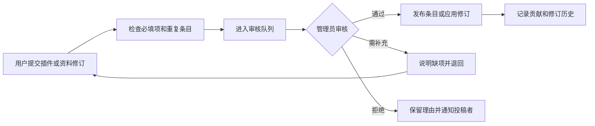

> 此文件为最初的参考草案，内容尚未逐点确认。当前共识以 [已确认需求](../idea.md) 为准；本文件中的人工收录、邮箱登录、强制模板等设想已经被后续讨论调整。

# DSH Plugin Review 网站需求文档 v1.0

日期：2026-10-10  
适用对象：DeepSeek Harness（DSH）插件生态  
文档用途：用于讨论产品范围、设计页面、拆分开发任务和验收首版。

> 建设一个面向中文用户的 DSH 插件资料与评测社区。用户能找到插件、看懂用途、确认兼容性、学会安装，并结合评测和其他用户的体验决定是否使用。

本稿以用户确认的 DeepSeek Harness 为对象，参考 MCMOD 的内容组织方式。`符` 文件夹中的材料仅作为背景；其中的统计门槛、固定时效、商业规则、人员配置和上线条件不自动成为本网站要求。下文的产品选择是本稿建议，后续可以调整。

## 1. 产品定位与目标

暂定名称：**DSH Plugin Review**。中文副标题可用“DeepSeek Harness 插件百科与评测”。网站以独立社区身份运营，在关于页面说明与官方的关系。

网站帮助用户回答六个问题：

1. 有哪些插件能解决我的需求？
2. 这个插件实际能做什么，有什么限制？
3. 我的 DSH 版本、操作系统和使用方式能否运行它？
4. 如何安装、配置、更新和卸载？
5. 实际使用效果怎样，需要付出多少成本、授予哪些权限？
6. 遇到问题时，哪里有教程、反馈和作者回应？

核心内容围绕“插件条目”组织。一个条目连接版本、安装说明、评测、教程和讨论，持续积累资料。

### 1.1 首版成功标准

用户无需登录即可完成“搜索 → 查看插件 → 阅读评测／安装教程 → 打开上游来源”的完整路径。管理员可以维护资料、发布评测、审核投稿和处理评论。网站具备持续更新内容的能力。

### 1.2 首版范围

首版包含插件目录、搜索筛选、插件详情、站方评测、教程、账户、收藏、评论、资料投稿和管理后台。评测由人工执行并录入，网站负责展示和追溯。

自动执行插件测试、复杂能力榜、完整论坛、插件包托管、付费交易、与 DSH 客户端直接联动安装，作为后续独立项目评估，不列入首版验收。

## 2. MCMOD 参考与迁移

以下是从公开页面观察到的组织方式，以及本稿提出的迁移建议。迁移部分是本网站的产品设计。

| 参考点 | MCMOD 页面观察 | DSH Plugin Review 的对应需求 |
|---|---|---|
| 内容首页 | 首页聚合分类、最新收录、更新动态、教程和短评 | 首页聚合用途分类、最新插件、最新评测、教程和近期讨论 |
| 多条件检索 | 模组列表提供版本、平台、运作方式、状态等条件 | 插件列表按用途、DSH 版本、运行方式、费用、测评状态筛选 |
| 独立条目 | 模组详情集中介绍、版本、作者、来源及内容入口 | 每个插件有长期稳定的资料页，集中呈现介绍、安装、评测和讨论 |
| 条目关系 | 详情页有模组关系、资料和下载等入口 | 记录依赖、冲突、替代方案及相关插件，注明适用版本和来源 |
| 内容贡献 | 网站有添加、编辑、审核状态和历史编辑入口 | 用户提交插件和资料修订，审核后发布，保留变更记录 |
| 内容社区 | 首页有教程、社群动态、评价等内容 | 教程和讨论首先关联插件，再聚合到全站入口 |

观察来源：[MCMOD 首页](https://www.mcmod.cn/)、[模组检索](https://www.mcmod.cn/modlist.html)、[机械动力条目](https://www.mcmod.cn/class/2021.html)。

参考范围为信息结构、检索方式和内容关联。DSH 站点使用自己的品牌、页面布局和原创描述；首版资料由人工核验录入。

DeepSeek Harness 官方 README 将项目描述为插件架构，并说明当前处于快速迭代的开发预览阶段。因此本网站应把兼容性核验作为核心内容，区分作者声明与站方实测。[官方 README](https://github.com/deepseek-ai/deepseek-harness)

## 3. 用户与权限

| 角色 | 主要需求 | 权限 |
|---|---|---|
| 访客 | 查找插件、阅读资料、评测和讨论 | 浏览、搜索、筛选、复制安装命令、访问上游链接 |
| 注册用户 | 收藏、交流、补充资料 | 收藏、评论、回复、举报、投稿、提交修订、管理自己的内容 |
| 插件作者 | 补充介绍、回应问题、提供更新资料 | 首版使用注册用户的投稿和回复入口；独立认证在后续开放 |
| 编辑／测评员 | 整理资料、撰写评测和教程 | 在后台维护内容草稿，提交审核 |
| 管理员 | 审核发布、管理用户、处理争议 | 发布与撤回、分类管理、审核投稿、评论处置、权限和操作日志查看 |

作者认证开放后，应核验作者对仓库或发布包的控制权。认证证明身份，不能自动赋予修改站方评测的权限。

## 4. 信息架构与页面

主导航建议：**首页 / 插件库 / 评测 / 教程 / 提交插件**。全站保留搜索入口；登录后显示个人中心和收藏。

| 页面 | 建议路径 | 核心内容 | 优先级 |
|---|---|---|---|
| 首页 | `/` | 搜索、用途入口、最新收录、最新评测、教程、动态 | P0 |
| 插件库／检索 | `/plugins` | 关键词、多条件筛选、排序、分页 | P0 |
| 插件详情 | `/plugins/:slug` | 资料、版本、安装、评测、教程、关系、讨论 | P0 |
| 评测列表 | `/reviews` | 评测检索、类型、分类、发布时间 | P0 |
| 评测详情 | `/reviews/:slug` | 结论、环境、过程、结果、证据、回应 | P0 |
| 教程列表／详情 | `/guides`、`/guides/:slug` | 入门、安装、排障、使用案例 | P0 |
| 投稿 | `/submit` | 提交插件或教程、查看本次提交结果 | P0 |
| 登录／注册 | `/login`、`/register` | 账户建立与登录 | P0 |
| 个人中心 | `/me` | 收藏、投稿状态、自己的评论 | P0 |
| 关于／评测说明 | `/about`、`/methodology` | 站点定位、内容来源、评测规则、联系入口 | P0 |
| 管理后台 | `/admin` | 插件、报告、教程、审核、评论和用户管理 | P0 |
| 对比页 | `/compare` | 同场景插件字段与结果并排查看 | P1 |
| 作者主页 | `/authors/:slug` | 作者身份、作品与公开贡献 | P1 |
| 专题／组合方案 | `/collections/:slug` | 按需求整理的插件组合与配置说明 | P1 |
| 更新动态页 | `/activity` | 全站公开内容更新与贡献记录 | P1 |

优先级约定：P0 为首版上线必需；P1 为首版稳定后的扩展；P2 为需要另行定义规则和成本的长期功能。路径为规划示例，可随实现调整。

## 5. 首页需求

首页采用资料社区的阅读结构，首屏突出搜索和分类。

```text
┌──────────────────────────────────────────────────────┐
│ DSH Plugin Review   首页 插件库 评测 教程 提交   登录 │
├──────────────────────────────────────────────────────┤
│ 搜索插件名、作者、包名，或“我想让 AI 记住项目背景”   │
│ 用途：记忆 · 工具 · 编程 · 协作 · 界面 · 数据 · 安全 │
├───────────────────────────────────┬──────────────────┤
│ 最新评测                          │ 新手开始         │
│ 标题、摘要、版本、测评日期         │ 站点公告         │
├───────────────────────────────────┼──────────────────┤
│ 最新收录 / 最近更新的插件         │ 近期讨论         │
├───────────────────────────────────┼──────────────────┤
│ 教程与使用案例                    │ 内容统计         │
└───────────────────────────────────┴──────────────────┘
```

具体要求：

- 搜索框直接支持名称、用途关键词、作者和完整包名。
- 分类可直接进入带条件的插件列表。
- 评测卡展示被测版本、内容类型、结论摘要和测评日期。
- 插件卡展示名称、作者、简介、用途、兼容信息及“未测／有评测”。
- “最近更新”区分插件上游版本更新、站内资料更新和评测更新。
- 近期讨论仅展示公开可见的评论，关联到对应插件或文章。
- 首期缺少内容的栏目收起，避免大量空白卡片。
- 统计只计算实际发布内容；示例数据不得计入线上统计。
- 手机端按搜索、分类、评测、插件、教程的顺序排列。

## 6. 插件库与搜索筛选

### 6.1 分类体系

分类面向用户用途，以下为可由后台调整的初始方案，不代表 DSH 官方分类。

| 主分类 | 示例需求 |
|---|---|
| 记忆与上下文 | 跨会话记忆、项目知识、历史整理 |
| 工具与自动化 | 浏览器操作、文件处理、工作流执行 |
| 编程与开发 | 代码检索、测试、调试、开发辅助 |
| 协作与编排 | 多智能体协作、任务分配、进度查看 |
| 界面与交互 | 面板、主题、可视化、对话体验 |
| 数据与知识 | 数据库、知识库、检索和文档处理 |
| 外部服务 | 平台连接、通知、第三方服务集成 |
| 安全与管理 | 权限、审计、配置和运行管理 |

每个插件设一个主分类，可添加多个标签。标签描述具体能力，例如“本地存储”“浏览器”“SQLite”；“好用”“安全”不作为功能标签。

收录对象首先为 DSH 插件。相关 MCP 服务、技能包和组合方案可以关联；若作为独立条目收录，必须显示资源类型和 DSH 接入依据。

### 6.2 检索规则

- 支持中文名称、英文名称、别名、完整包名、作者及简介关键词检索。
- 完整包名和精确名称优先，其次是别名、作者、简介匹配。
- P0 支持用途关键词匹配；拼音和自然语言语义检索放在 P1。
- 默认仅检索已发布条目；审核草稿和撤回内容不进入公开搜索。
- 搜索失败和无结果分别显示，并提供修改条件或提交插件入口。
- 返回列表保留关键词、筛选和分页状态，支持分享当前检索 URL。

### 6.3 筛选与排序

P0 筛选：用途分类、DSH 版本、操作系统、运行方式、费用类型、是否有站方评测、维护状态。

运行方式暂设“命令行／Web 界面／其他／待核实”；维护状态暂设“维护中／作者声明停更／仓库已归档／待核实”。状态附来源与核验日期，不能仅凭一段时间未更新判定停更。

兼容性记录分为“作者声明支持／站方实测可用／站方实测失败／待核实”。筛选默认包含声明支持和实测可用，界面允许切换“仅实测”；失败及未知记录在详情页可查。

不同筛选维度之间取交集，同一维度多选取并集。未知信息不能当成满足条件。版本范围采用明确的精确版本或有效范围；无法解析的上游版本文本保留原文并标待核实。

P0 排序：搜索相关性、最新收录、最近资料更新、最近评测。P1 可加入近期浏览和收藏热度，明确其时间窗口和含义。

列表提供分页，默认每页 20 条，显示结果数、当前条件和清除筛选按钮。

## 7. 插件详情页

首屏直接展示“它是什么、适合做什么、我的环境能否使用、资料和评测是否完整”。

### 7.1 基础资料

名称、别名、图标、完整包名、作者、用途分类、简介、上游仓库／官网、许可证、费用类型、依赖要求、收录日期、资料最后核验日期。

相同展示名称可能对应不同作者和包，必须同时显示作者及完整包名。条目身份不能只按展示名称去重。

### 7.2 内容分区

1. **介绍**：能力、适用场景、截图、限制和需要准备的东西。
2. **安装与配置**：前置条件、适用版本、安装步骤、配置示例、验证方法、更新与卸载说明。
3. **版本与兼容性**：插件版本 × DSH 版本 × 系统／运行方式的记录，显示依据和日期。
4. **评测**：站方报告及社区体验入口，按被测版本显示，最新适用报告优先。
5. **教程**：关联安装、使用、排障和进阶文章。
6. **相关插件**：依赖、已知冲突、替代方案、可组合插件，带来源及适用范围。
7. **讨论**：评论、回复和用户反馈，可注明所用版本与环境。
8. **更新记录**：上游更新摘要与站内修订历史，分别标示。

资料较少时仍保留统一结构，空分区显示“暂无资料／欢迎补充”，不生成无依据的介绍。

### 7.3 安装入口

- 首版提供复制命令、查看完整教程和打开上游来源。
- 安装命令记录来源、适用插件版本、使用环境和最后核验时间。
- 命令由编辑核验录入；缺少可靠命令时引导用户查看上游说明。
- 对不同运行方式或系统给出对应步骤；必要时说明 profile、路径或凭据配置。
- 复制成功有明确反馈；不得通过普通网页按钮在用户机器上自动执行。
- 卸载说明指出配置或数据是否保留，区分卸载软件与清理个人数据。

### 7.4 权限、费用与来源

分别记录是否涉及文件读取／写入、执行命令、网络访问、第三方凭据、外部数据发送和后台运行。每项可为“涉及／不涉及／未核实”，说明来自作者描述还是站方观察。

费用区分插件价格、模型费用和外部服务费用；价格附来源日期，测评成本附统计范围。不掌握金额时显示未知。

首版不设笼统的“安全认证”徽章。可以展示具体检查及风险提醒，并链接到对应证据。

## 8. 评测内容与展示

### 8.1 内容类型

| 类型 | 发布者 | 内容要求 | 展示方式 |
|---|---|---|---|
| 站方体验评测 | 编辑／测评员，经管理员审核 | 安装与实际使用、环境、优缺点、证据和局限 | 明确标“站方评测” |
| 站方对照评测 | 编辑／测评员，经管理员审核 | 相同任务下的对照配置、过程、结果和成本 | 明确标“对照评测”，附方法说明 |
| 社区体验 | 注册用户，经审核 | 实际使用场景、版本、环境、体验描述 | 标“社区体验”，与站方结论分开展示 |
| 作者说明／自测 | 作者或投稿者，经审核 | 主张、演示或自测资料、来源 | 标“作者说明”，不计为站方已测 |

P0 先通过固定模板发布站方体验评测和对照评测。社区长篇体验可通过投稿入口提交；短体验使用评论。首版不要求自动判分或统一统计模型。

### 8.2 报告模板

每篇报告包含：

- 标题、摘要、内容类型、作者、审核人、发布日期、实际测评日期。
- 被测插件身份：包名、版本／commit／发布包标识；不可获得时说明。
- 环境：DSH 版本、操作系统、运行方式、使用模型及必要配置。
- 要解决的问题、任务设置、操作步骤和验收方式。
- 结果：完成、部分完成、失败及其具体原因，附截图、产物或可公开的记录。
- 优点、限制、适合人群、已发现的问题和未测试范围。
- 费用和耗时：已测数值、估算或未知，标明单位和口径。
- 推荐意见及适用范围，例如“适合本地个人项目，团队共享未测”。
- 关系披露：作者本人、自家项目、赞助、委托或其他可能影响判断的关系。
- 更正记录、必要的作者回应及相关资料链接。

对照评测额外写明：对照对象、任务是否相同、环境差异、执行次数和资源差异。证据只能支撑测过的版本与场景。

### 8.3 状态必须分开

| 状态轴 | 示例值 | 用途 |
|---|---|---|
| 内容发布状态 | 草稿／待审／已发布／已撤回 | 控制公开展示 |
| 测评进展 | 未测／计划测／测试中／有报告 | 描述工作进度，不表达效果 |
| 实际结果 | 各任务完成／部分完成／失败 | 记录观察到的结果 |
| 推荐意见 | 值得试／限定场景／暂不推荐／信息不足 | 提供有范围的编辑建议 |
| 当前适用性 | 对应版本适用／需复核／历史记录 | 说明报告是否覆盖当前使用环境 |

“已收录”“有报告”“安装成功”不能自动等同于推荐。安装失败也能发布报告，并记录原因。

插件更新后，旧报告保留；未实测的新版本显示“暂无对应评测”。上游作者声明兼容只能补充声明记录。历史报告不自动覆盖最新版。

### 8.4 评分与发现机制

首版采用结果说明、推荐意见和逐项指标。默认不设置统一星级和综合能力总分。

热门插件、近期收藏、最新评测可以帮助发现内容，但必须标明统计对象和排序依据。编辑推荐写出推荐理由；社区反馈数量和站方评测结果分开显示。

P1 的对比页先比较用途、兼容性、安装难度、费用、权限、维护和报告。环境或任务不一致时标注“不可直接比较”，不自动推导谁更强。

P2 若建立能力榜，需另外定义同场景任务、版本、成本、评分和复核规则。原材料中的五种统计结论和严格验证管线可作为研究方案继续讨论。

## 9. 教程与社区

### 9.1 教程

教程分为 DSH 入门、插件安装、场景使用、排障、开发扩展。文章支持 Markdown、代码块、图片和关联多个插件，显示适用版本、作者和最后更新日期。

过时教程可标注版本提醒，并链接新教程。编辑支持草稿预览和审核发布。面向用户的文字优先讲清操作与结果。

### 9.2 评论与反馈

- 已发布插件条目允许讨论，包括尚未被站方测评的插件。
- 用户登录后可以评论和回复；支持一级评论加回复，避免无限嵌套。
- 插件评论建议填写插件版本、DSH 版本、系统和使用场景，正文必填。
- 评测、教程也可评论，讨论跟随原文保留。
- 首版按时间排序；支持举报、管理员隐藏及用户删除自己的内容。
- 首版新评论审核后公开；作者可以查看自己的待审状态。公开被隐藏内容显示处置占位，避免回复链错位。
- 普通用户编辑已发布评论后重新审核；审核通过前保留旧的公开版本。
- 保留负面体验及作者回应；审核理由区分垃圾信息、人身攻击、敏感信息等。
- 用户反馈是线索，未经核验不直接变成站方风险结论。
- 首版采用后台处置，风险原因、操作者和时间进入记录。

### 9.3 投稿与资料修订



首版插件投稿必填名称、上游地址、用途简介、资源类型；包名在可获得时填写。资料修订写明修改对象、建议内容和来源。投稿者可在个人中心查看状态和回复审核要求。

重复条目按规范化包名、仓库和已有身份记录提示，由管理员决定合并。相同名称、不同作者的插件不自动合并。

## 10. 管理后台

后台至少提供以下能力：

| 模块 | 操作要求 |
|---|---|
| 插件资料 | 新建、编辑、预览、发布、撤回、合并重复项、维护来源与版本 |
| 兼容记录 | 录入插件和 DSH 版本组合、系统、运行方式、结果、依据和日期 |
| 评测 | 填写模板、关联插件与版本、上传证据、审核发布、更正、标记需复核 |
| 教程 | 草稿、预览、关联插件、审核发布、标记旧版本说明 |
| 投稿审核 | 查看差异与来源、通过、退回补充、拒绝及记录理由 |
| 评论管理 | 审核、查看举报、隐藏、恢复、查看回复上下文 |
| 分类标签 | 增改分类、管理标签、合并同义标签 |
| 用户权限 | 查询用户、调整角色、限制违规账户、查看处置记录 |
| 首页内容 | 管理推荐位、公告及内容排列，推荐位记录理由 |
| 操作记录 | 查看内容修订、发布、撤回、权限变更和处置历史 |
| 数据维护 | 导出公开内容、配置备份、查看备份及恢复结果 |

编辑不能自行授予管理员权限。内容发布、撤回和权限变更必须由服务端检查权限，不能只隐藏前端按钮。

## 11. 数据对象与关键字段

| 对象 | 核心字段与关系 |
|---|---|
| 插件 Plugin | ID、slug、名称、别名、包名、资源类型、作者、简介、分类、标签、来源、费用、许可证、发布状态 |
| 插件版本 PluginVersion | 插件 ID、版本或来源标识、发布时间、发布链接、更新摘要、最后核验日期 |
| 兼容记录 Compatibility | 插件版本、DSH 版本／范围、系统、运行方式、声明或实测、结果、来源、核验日期 |
| 安装说明 InstallInstruction | 插件及适用版本、系统／运行方式、前置条件、步骤、命令、验证与卸载方式、来源 |
| 评测 Review | 插件版本、环境、内容类型、任务、结果、成本、推荐意见、证据、关系披露、作者、审核人、发布时间、适用状态 |
| 教程 Guide | 标题、正文、类型、关联插件、适用版本、作者、发布时间和更新时间 |
| 插件关系 PluginRelation | 起点插件、终点插件、依赖／冲突／替代／组合、适用范围、依据 |
| 评论 Comment | 目标类型及 ID、用户、父评论、正文、版本环境、审核状态、创建及修改时间 |
| 投稿 Submission | 类型、目标对象、建议内容、来源、提交人、审核状态、处理人和反馈 |
| 用户 User | 昵称、登录身份、角色、状态、创建时间 |
| 收藏 Favorite | 用户、插件、创建时间；同用户同插件唯一 |
| 修订 Revision | 内容对象、旧／新版本或差异、修改人、修改理由、时间 |
| 证据 Evidence | 关联报告、文件类型、访问地址、说明、公开状态、上传者 |

基础约束：

- 费用、耗时、权限和兼容性未知时保存未知，不以零或“支持全部”代替。
- 评测必须能定位到被测版本或明确的来源快照。
- 评论与收藏保存稳定 ID，不依赖可变标题或 slug。
- slug 修改和条目合并保留旧地址跳转，相关内容跟随稳定 ID。
- 内容更新、上游更新、测评日期分别保存，展示用途不同。
- 附件发布前经过人工检查和必要脱敏，非公开证据不得出现在公开接口。
- 草稿／待审公开不可见；已发布内容撤回后退出列表、搜索和推荐，原地址显示撤回说明。非法或隐私内容可按需关闭访问，后台保留必要记录。

## 12. 页面体验与视觉要求

整体方向：清晰、紧凑、便于查资料的技术社区。桌面端内容区配辅助侧栏，手机端使用单列布局和可展开筛选。

- 页面层级统一，重点区分插件名称、用途简介、版本状态和阅读入口。
- 分类、状态、风险提示有稳定样式，标签文字表达含义，不能只靠颜色区分。
- 正文保持易读行宽；安装命令和配置示例有复制按钮。
- 长条目提供分区导航；手机端导航不遮挡正文和操作。
- 360px 宽度下主页面无整体横向溢出，代码块和宽表格可局部滚动。
- 按钮、输入框和导航可使用键盘，表单字段有名称、错误提示和提交反馈。
- 所有列表及表单提供加载、空内容、失败和成功状态。
- 图片附说明；截图可查看大图，封面缺失时使用统一占位。
- 首版以中文为主，英文包名和命令保留原文。暗色模式与中英双语列入 P1。

## 13. 技术与运行要求

本节描述实现必须达到的能力，不指定技术框架。

- **搜索可索引**：公开插件、评测和教程有稳定 URL、独立标题、摘要、canonical 和站点地图；草稿及私人页面不进入索引。
- **内容渲染**：安全渲染 Markdown 和代码块，用户内容不得注入脚本；外链与站内链接表现清楚。
- **账户**：P0 采用一种登录方式，暂按邮箱注册与登录设计，具备验证码／验证、退出、找回和基本限流；后台必须登录。
- **上传**：P0 仅支持受限图片和必要的只读证据文件，限制类型与大小；不接收可执行插件包。
- **权限与接口**：服务端验证角色、内容归属、文件访问权限；用户不能访问他人的私人投稿或草稿。
- **运行隔离**：网站提供内容管理和展示；如以后建立插件测试服务，执行环境与网站生产环境分开。
- **性能目标**：在约定测试环境和 5,000 条插件记录下，常用搜索／筛选接口 P95 不高于 1 秒；正文页面主要内容目标 2.5 秒内可读。上线前写明网络、设备和并发条件，再测量验收。
- **备份**：每日备份数据库，附件有备份策略；首次上线前在测试环境完成恢复演练，记录结果。
- **导出**：支持管理员导出结构化插件资料和正文，降低后续迁移成本。
- **观察**：记录服务异常、审核操作和必要的使用事件；日志不得记录密码、密钥及完整敏感表单内容。

## 14. 分期开发

| 阶段 | 交付内容 | 完成条件 |
|---|---|---|
| A：内容骨架 | 分类、插件字段、首页／列表／详情、基础内容后台 | 管理员能发布条目，访客能检索并阅读 |
| B：评测与教程 | 报告模板、版本环境、证据、教程、安装说明 | 插件、评测、教程相互关联，来源和适用版本可查 |
| C：社区与审核 | 登录、收藏、评论、投稿、管理权限及修订记录 | 用户贡献可审核、可追溯，公开和私人内容权限正确 |
| D：上线准备 | 真实种子内容、移动端、索引、备份、安全及完整流程验证 | P0 验收完成，站点可持续维护 |
| P1：体验扩展 | 对比、作者认证、专题、通知、拼音搜索、暗色模式 | 在真实使用反馈后确定顺序 |
| P2：专业扩展 | 自动采集、隔离测试管线、专项榜单、客户端联动 | 分别形成任务范围、数据规则和运行预算 |

阶段 A 至 D 构成首版，不是四次互相独立的上线承诺。工期需根据人员、内容准备及技术选型估算。

### 14.1 建议的种子内容

首版建议准备 20–30 个经来源核验的插件条目，覆盖至少 4 类用途；发布至少 5 篇实际评测与 5 篇安装／入门教程。这些是内容准备目标，不能作为目前已有成果。

每个首发条目至少有名称、身份来源、用途、分类、安装来源、兼容信息或待核实说明。暂缺站方实测的条目显示“未测”。先根据真实内容调整首页栏目数量。

## 15. 首版验收清单

| 编号 | 验收场景 | 通过标准 |
|---|---|---|
| AC-01 | 按名称、包名、作者、用途搜索 | 对预置检索样例返回正确的公开条目，精确包名匹配优先 |
| AC-02 | 分类、版本、系统和测评状态组合筛选 | 结果满足所有维度，未知不当作已支持，清除筛选和分页正常 |
| AC-03 | 查看同名不同作者插件 | 身份、来源、版本和关联报告不混淆 |
| AC-04 | 查看插件详情与安装步骤 | 必填资料完整，命令有来源及范围，复制反馈正确，上游链接可打开 |
| AC-05 | 查看版本兼容性 | 作者声明和实测分开；失败、未知及核验时间可见 |
| AC-06 | 发布及阅读评测 | 被测版本、环境、任务、结果、证据、局限及关系披露可查 |
| AC-07 | 插件更新且未完成复测 | 新版本不继承旧评测结论；历史报告可访问 |
| AC-08 | 教程关联插件 | 从插件可进入教程，从教程可返回关联插件，并显示适用版本 |
| AC-09 | 注册、登录、退出、收藏 | 账户流程成功，收藏不重复且个人收藏不可被他人修改 |
| AC-10 | 评论、回复、编辑与举报 | 审核流程正确；待审内容不公开，修改保留旧公开版，处置有记录 |
| AC-11 | 提交新插件和修订 | 审核通过后发布／应用修订，退回及拒绝理由可由提交人查看 |
| AC-12 | 非管理员访问后台／他人草稿 | 服务端拒绝，接口不泄露内容；编辑不能自行提权 |
| AC-13 | 修改地址、合并或撤回条目 | 原地址正确跳转或提示，关联内容保留，撤回内容退出公开列表 |
| AC-14 | 手机与键盘浏览 | 主要路径可操作，360px 布局可读，表单反馈清楚 |
| AC-15 | 上传证据与正文渲染 | 拒绝不允许的文件，脚本不可执行，私人证据不公开 |
| AC-16 | 备份、导出和恢复 | 能恢复测试副本，插件与正文导出内容完整 |
| AC-17 | 公开索引与性能 | 公开页面元信息和站点地图正确，性能达到约定环境中的目标 |
| AC-18 | 内容和状态真实性 | 无虚构统计、评测或兼容标签；推荐位可追溯到理由和资料 |

## 16. 运营观察指标

首期记录实际数据，用于决定改进方向：

- 搜索次数、无结果比例、搜索后进入插件详情的比例。
- 插件详情到评测、教程、上游来源的点击情况。
- 安装命令复制次数；只代表使用意图，不能统计为安装成功。
- 有来源资料、安装说明、兼容记录和站方评测的插件覆盖率。
- 投稿数量、审核处理时间、被退回的常见原因。
- 有版本和环境信息的反馈比例、重复问题及作者回应情况。
- 内容核验与评测维护投入，确定实际更新能力。

首版先提供基础统计，不预设增长承诺。运营数据不能替代实际插件效果证据。

## 17. 可调整决策与参考资料

本稿的默认选择为：中文优先、独立社区定位、人工核验资料、人工测评、邮箱账户、首版评论审核、无统一综合分、复制安装命令与上游导流。技术栈、域名、视觉品牌及后续收费方式尚未指定，不影响先进行原型设计和开发拆解。

后续最需要讨论的产品决策：收录是否扩展到 MCP 和技能包、如何认证作者、社区体验是否开放评分、哪些场景值得建设对照任务、更新核验由人工还是同步工具承担。

参考资料（查阅日期：2026-10-10）：

- [MCMOD 首页](https://www.mcmod.cn/)：首页内容组织与贡献入口。
- [MCMOD 模组检索](https://www.mcmod.cn/modlist.html)：多维筛选与列表结构。
- [MCMOD 机械动力条目](https://www.mcmod.cn/class/2021.html)：独立条目、版本、作者、内容与关系入口。
- [DeepSeek Harness 官方仓库](https://github.com/deepseek-ai/deepseek-harness)：目标平台身份及兼容性背景。
- 本地背景：`符/插件测评站-方案v3.0-简版.md`、`符/插件测评站-方案v3.0-完整修订版.md`、`符/工程协议手册-v1.1.md`、`符/端到端验证计划-v0.md`。

本需求文档本身不是任何插件的评测结果，也不表示网站已经完成开发。
